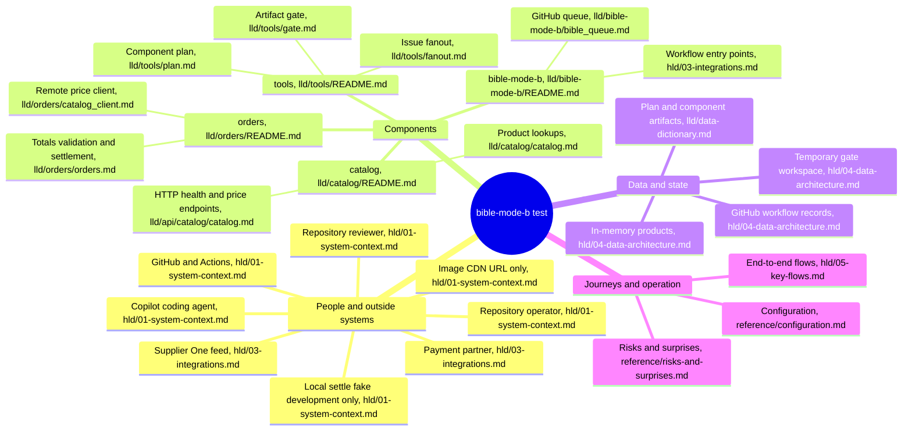
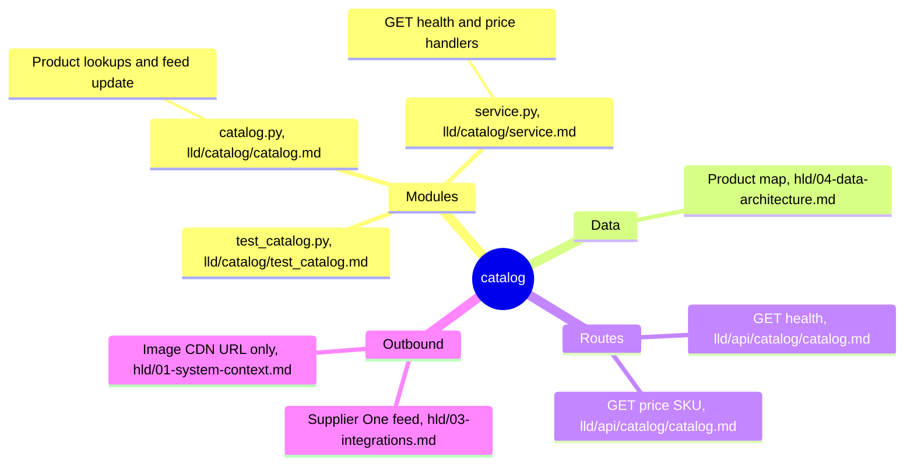
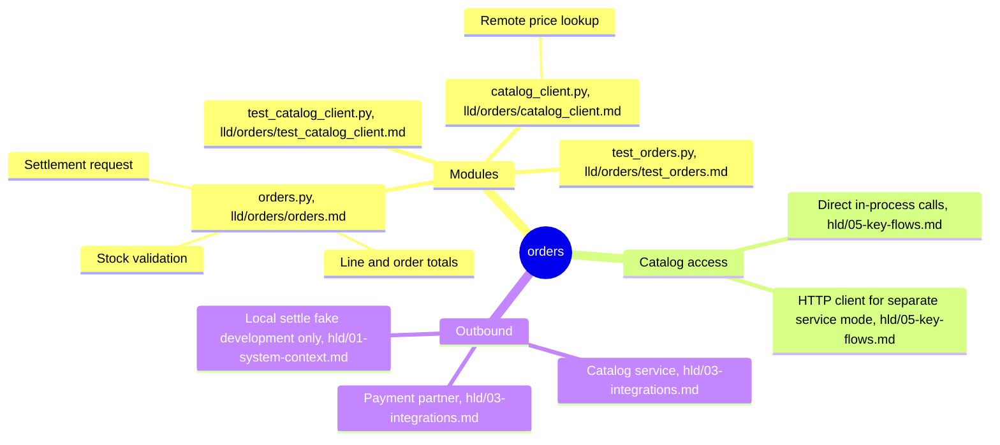
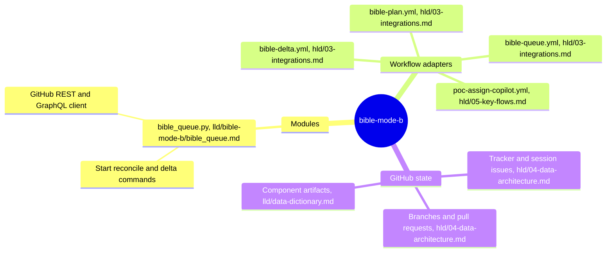
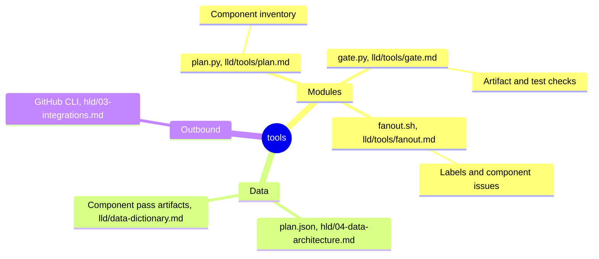

# Mind map

The whole system and its component detail. Each leaf names the analysis page with its evidence.

## catalog

## orders

## bible-mode-b

## tools

## As a list

- bible-mode-b test repository
  - People and outside systems
    - Repository operator ([hld/01-system-context.md](hld/01-system-context.md))
    - Repository reviewer ([hld/01-system-context.md](hld/01-system-context.md))
    - GitHub and Actions ([hld/01-system-context.md](hld/01-system-context.md))
    - Copilot coding agent ([hld/01-system-context.md](hld/01-system-context.md))
    - Supplier One feed ([hld/03-integrations.md](hld/03-integrations.md))
    - Payment partner ([hld/03-integrations.md](hld/03-integrations.md))
    - Image CDN URL only ([hld/01-system-context.md](hld/01-system-context.md))
  - Components
    - catalog ([lld/catalog/README.md](lld/catalog/README.md))
      - Product lookups ([lld/catalog/catalog.md](lld/catalog/catalog.md))
      - HTTP health and price endpoints ([lld/api/catalog/catalog.md](lld/api/catalog/catalog.md))
    - orders ([lld/orders/README.md](lld/orders/README.md))
      - Totals, validation, and settlement ([lld/orders/orders.md](lld/orders/orders.md))
      - Remote price client ([lld/orders/catalog_client.md](lld/orders/catalog_client.md))
    - bible-mode-b ([lld/bible-mode-b/README.md](lld/bible-mode-b/README.md))
      - GitHub queue ([lld/bible-mode-b/bible_queue.md](lld/bible-mode-b/bible_queue.md))
      - Workflow entry points ([hld/03-integrations.md](hld/03-integrations.md))
    - tools ([lld/tools/README.md](lld/tools/README.md))
      - Component plan ([lld/tools/plan.md](lld/tools/plan.md))
      - Artifact gate ([lld/tools/gate.md](lld/tools/gate.md))
      - Issue fanout ([lld/tools/fanout.md](lld/tools/fanout.md))
  - Data and state
    - In-memory products ([hld/04-data-architecture.md](hld/04-data-architecture.md))
    - GitHub workflow records ([hld/04-data-architecture.md](hld/04-data-architecture.md))
    - Plan and component artifacts ([lld/data-dictionary.md](lld/data-dictionary.md))
    - Temporary gate workspace ([hld/04-data-architecture.md](hld/04-data-architecture.md))
  - Journeys and operation
    - End-to-end flows ([hld/05-key-flows.md](hld/05-key-flows.md))
    - Configuration ([reference/configuration.md](reference/configuration.md))
    - Risks and surprises ([reference/risks-and-surprises.md](reference/risks-and-surprises.md))
