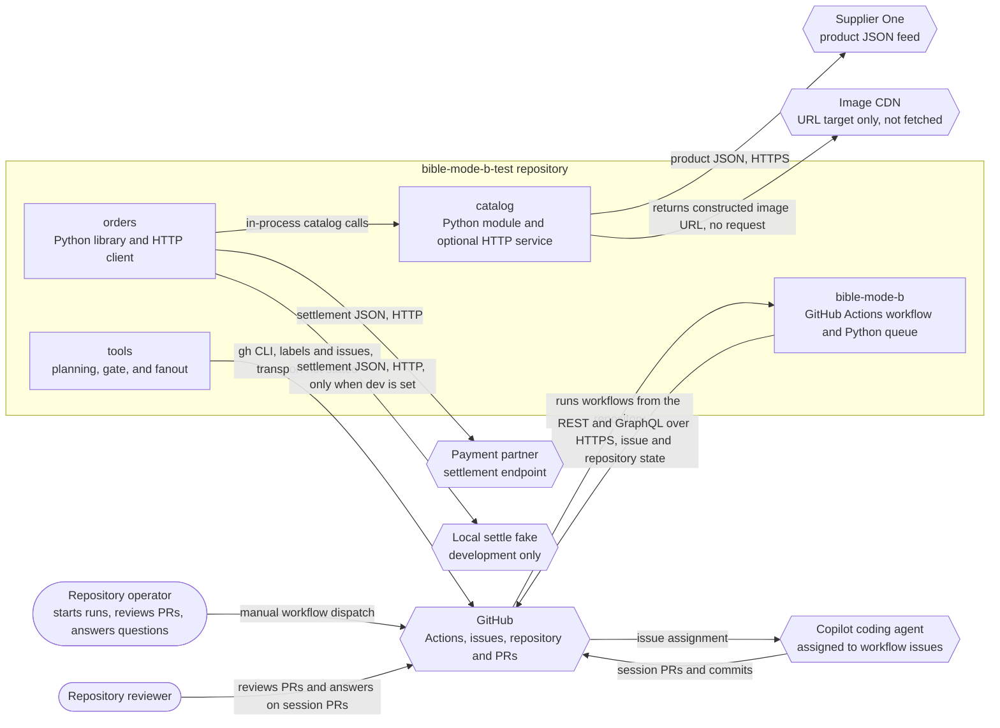

# bible-mode-b test: system reference

Status: UPDATED FOR CODE CHANGES (claude/update-125-126, 2026-11-24; 11 cards written or rewritten in the catalog and queue modules and the pages that cite them changed, not re-verified; `ledger/delta.md` and `CHANGELOG.md` name every file and function). Before this update the status was: CORRECTED AFTER VERIFICATION (report of 2026-11-24, round 6; about 250 statements, rows, citations and diagram elements added or changed since (an estimate from the edits listed in `revision-log.md`), not re-verified, each accounted for in `revision-log.md`).

| | |
| --- | --- |
| Depth | Deep for all four components |
| Version given by the user | Not provided |
| Snapshot | 30 in-scope files, 1,962 source lines, the code of 2026-11-24 after the supplier-feed HTTPS change and the queue's re-check and replay changes (the queue file has 1,434 lines) |
| Coverage | `coverage.py` of 2026-11-24, after the update for the code changes: result PASS at deep, 124/124 symbols, 103/103 functions with a full card, 344/344 branch lines, 247/247 call-graph edges, 3,588/3,588 citations (one per range), 17/17 front-matter pages, 2/2 calls into other components |
| Produced with | Copilot coding agent (model not recorded) for planning, the components, assembly and the first revisions; Claude Sonnet 5.5 standing in for Copilot for the revisions of 24 Nov 2026 (the afternoon, #96 finish and #101, when the account's Copilot AI credits were used up, and the round-4 and round-5 revisions after the reports of that date) |
| Diagrams | Checked by reading only; no Mermaid renderer was available |

## In two minutes

The repository combines a sample catalog/orders application with a separate GitHub Actions workflow system for producing and maintaining codebase analyses; the modules share a repository but are not one deployed service (`README.md:1-7`; [`system context`](hld/01-system-context.md)). The catalog keeps product records in process memory, provides price and stock lookups, and includes an optional HTTP server (`components/catalog/catalog.py:11-41`; `components/catalog/service.py:15-49`). The current order helpers import the catalog directly, while the HTTP price client is intended for a separately deployed orders service (its docstring says so) and is called only by tests in this repository (inferred: its docstring, `components/orders/catalog_client.py:1-4`, names the separate-service use, and a search of the repository finds `catalog_client` imported only by `components/orders/test_catalog_client.py`) (`components/orders/orders.py:5`, `components/orders/orders.py:19-20`, `components/orders/orders.py:35-42`; `components/orders/catalog_client.py:1-4`, `components/orders/catalog_client.py:19-23`; `components/orders/test_catalog_client.py:37-62`). Orders computes totals, validates stock, and sends settlement requests to a partner or local development endpoint (`components/orders/orders.py:19-51`). The `bible-mode-b` queue uses GitHub issues, branches, and pull requests to assign Copilot work, inspect artifacts, and coordinate human review (`.github/bible/bible_queue.py:128-154`, `.github/bible/bible_queue.py:167-174`, `.github/bible/bible_queue.py:970-995`, `.github/bible/bible_queue.py:867-871`, `.github/bible/bible_queue.py:705-756`). The `tools` commands generate a component plan, validate component artifacts, and create component issues (`tools/plan.py:21-58`; `tools/gate.py:42-78`; `tools/fanout.sh:7-30`). GitHub Actions runs the queue and related automation on `ubuntu-latest` runners (assumed: GitHub-hosted runners) (`.github/workflows/bible-queue.yml:19-37`); no production deployment topology for catalog or orders is declared (inferred: a listing of the 30 files outside the analysis folder and the skills shows no Dockerfile, compose file, Procfile, deployment manifest, service unit or build file, and a search of them for `dockerfile`, `docker-compose`, `procfile`, `kubernetes`, `helm`, `terraform` and `systemd` finds 0 hits; [`architecture`](hld/02-architecture.md)). The main operational cautions are the plain-HTTP payment call (the supplier feed now uses HTTPS with a verifying context, but the live supplier certificate was not checked (inferred: per `https-migration/https-migration-summary.md:29`)), unauthenticated catalog routes (inferred: a search of `components` for `auth`, `authorization`, `login`, `password`, `token` and `jwt` finds 0 hits), process-local product data, and no source evidence for the supplier feed's claimed nightly schedule (inferred: a search of the repository outside the analysis folder and the skills for `cron` and `schedul` finds 3 hits, the docstring at `components/catalog/catalog.py:49` and the queue's own schedule at `.github/workflows/bible-queue.yml:8-9`, and a search for `fetch_supplier_feed` finds its definition and one test call) (`components/catalog/catalog.py:8`, `components/catalog/catalog.py:48-63`; `components/catalog/service.py:24-43`; `components/orders/orders.py:7-12`, `components/orders/orders.py:45-50`).

## At a glance

The context diagram shows the application's direct calls and the workflow system's GitHub-mediated work; the CDN is a URL target only (inferred: a search of the repository outside the analysis folder and the skills for `image_url` and `IMAGE_CDN` finds 3 hits, all in `components/catalog/catalog.py:9-45`).

| Element | Evidence |
| --- | --- |
| Operator and reviewer actions | `.github/workflows/bible-plan.yml:7-8`; `.github/bible/bible_queue.py:779-780`, `.github/bible/bible_queue.py:799-807`, `.github/bible/bible_queue.py:943-947` |
| GitHub workflow, issue and repository interactions | `.github/workflows/bible-queue.yml:7-37`; `.github/bible/bible_queue.py:92-106`, `.github/bible/bible_queue.py:128-154`, `.github/bible/bible_queue.py:114`, `.github/bible/bible_queue.py:355-363` |
| Copilot assignment and session PRs | `.github/bible/bible_queue.py:167-174`, `.github/bible/bible_queue.py:447-451`, `.github/bible/bible_queue.py:568-593` |
| Orders to catalog | `components/orders/orders.py:5`, `components/orders/orders.py:19-20`, `components/orders/orders.py:35-42` |
| Catalog to supplier feed | `components/catalog/catalog.py:8`, `components/catalog/catalog.py:18-24`, `components/catalog/catalog.py:48-55` |
| Orders to payment partner | `components/orders/orders.py:7-9`, `components/orders/orders.py:45-51` |
| Image URL construction without a request | `components/catalog/catalog.py:9`, `components/catalog/catalog.py:44-45` |
| Orders to the local settlement fake (development only (inferred: the comment at `components/orders/orders.py:11` says "never deployed"), used only when `dev` is set) | `components/orders/orders.py:11-12`, `components/orders/orders.py:47` |
| Tools to GitHub through the `gh` CLI | `tools/fanout.sh:10-12`, `tools/fanout.sh:24-29` |

Shapes: rounded = people, rectangle = repository units, hexagon = external system. The edge to the Image CDN is drawn solid because the code builds the URL (read in the code); no request is made (inferred: the same search, 3 hits for `image_url` and `IMAGE_CDN`, all in `components/catalog/catalog.py`).

## Components

| Component | Kind | Technology | Responsibility | Pages | Size (files, lines, functions, routes) |
| --- | --- | --- | --- | --- | --- |
| `catalog` | Service and library | Python 3 standard library | Product data, price/stock lookups, optional HTTP API | [`catalog`](lld/catalog/README.md), [`endpoints`](lld/api/catalog/catalog.md) | 3 source files, 160 lines, 11 runtime functions and methods, 2 routes |
| `orders` | Library | Python 3 standard library | Totals, stock validation, settlement, optional remote catalog client | [`orders`](lld/orders/README.md) | 4 source files, 158 lines, 18 functions/methods (7 in `orders.py` and `catalog_client.py`, 11 test methods), 0 routes |
| `bible-mode-b` | CLI and workflow component | Python 3 and GitHub Actions | Starts and reconciles analysis runs, assigns sessions, gates work, tracks deltas | [`bible-mode-b`](lld/bible-mode-b/README.md) | 1 Python file of 1,434 lines (78 functions/methods, 2 classes, one more function nested in `Queue.delta`) and 4 workflow files of 201 lines, 0 HTTP routes |
| `tools` | CLI and shell tools | Python 3 and Bash | Component planning, artifact gate, issue fanout | [`tools`](lld/tools/README.md) | 3 files, 210 lines, 7 Python functions, 0 routes |

## Reading paths

| You are | Read, in order |
| --- | --- |
| Manager or new joiner | This page, [`mind map`](00-mind-map.md), [`system context`](hld/01-system-context.md), [`key flows`](hld/05-key-flows.md) |
| Architect | [`HLD 01`](hld/01-system-context.md), [`02`](hld/02-architecture.md), [`03`](hld/03-integrations.md), [`04`](hld/04-data-architecture.md), [`05`](hld/05-key-flows.md), [`06`](hld/06-cross-cutting.md), then each component README under [`lld`](lld/) |
| Engineer changing a component | Its component README, module pages, any catalog endpoint card, and the [`data dictionary`](lld/data-dictionary.md) |
| Operator | [`deployment architecture`](hld/02-architecture.md), [`cross-cutting concerns`](hld/06-cross-cutting.md), and [`configuration`](reference/configuration.md) |

## Files

One line per analysis file, in reading order. Generated inventory, coverage, and knowledge artifacts are included.

- [`00-mind-map.md`](00-mind-map.md)
- [`README.md`](README.md)
- [`hld/01-system-context.md`](hld/01-system-context.md)
- [`hld/02-architecture.md`](hld/02-architecture.md)
- [`hld/03-integrations.md`](hld/03-integrations.md)
- [`hld/04-data-architecture.md`](hld/04-data-architecture.md)
- [`hld/05-key-flows.md`](hld/05-key-flows.md)
- [`hld/06-cross-cutting.md`](hld/06-cross-cutting.md)
- [`reference/glossary.md`](reference/glossary.md)
- [`reference/configuration.md`](reference/configuration.md)
- [`reference/risks-and-surprises.md`](reference/risks-and-surprises.md)
- [`reference/open-questions.md`](reference/open-questions.md)
- [`lld/data-dictionary.md`](lld/data-dictionary.md)
- [`lld/catalog/README.md`](lld/catalog/README.md)
- [`lld/catalog/catalog.md`](lld/catalog/catalog.md)
- [`lld/catalog/service.md`](lld/catalog/service.md)
- [`lld/catalog/test_catalog.md`](lld/catalog/test_catalog.md)
- [`lld/api/catalog/catalog.md`](lld/api/catalog/catalog.md)
- [`lld/orders/README.md`](lld/orders/README.md)
- [`lld/orders/orders.md`](lld/orders/orders.md)
- [`lld/orders/catalog_client.md`](lld/orders/catalog_client.md)
- [`lld/orders/test_catalog_client.md`](lld/orders/test_catalog_client.md)
- [`lld/orders/test_orders.md`](lld/orders/test_orders.md)
- [`lld/bible-mode-b/README.md`](lld/bible-mode-b/README.md)
- [`lld/bible-mode-b/bible_queue.md`](lld/bible-mode-b/bible_queue.md)
- [`lld/tools/README.md`](lld/tools/README.md)
- [`lld/tools/plan.md`](lld/tools/plan.md)
- [`lld/tools/gate.md`](lld/tools/gate.md)
- [`lld/tools/fanout.md`](lld/tools/fanout.md)
- [`ledger/coverage-ledger.md`](ledger/coverage-ledger.md)
- [`ledger/coverage-report.md`](ledger/coverage-report.md)
- [`ledger/baseline.json`](ledger/baseline.json)
- [`ledger/citations.tsv`](ledger/citations.tsv)
- [`ledger/inventory.json`](ledger/inventory.json)
- [`ledger/symbol-checklist.md`](ledger/symbol-checklist.md)
- [`ledger/issues/plan.md`](ledger/issues/plan.md)
- [`ledger/issues/catalog.md`](ledger/issues/catalog.md)
- [`ledger/issues/orders.md`](ledger/issues/orders.md)
- [`ledger/issues/bible-mode-b.md`](ledger/issues/bible-mode-b.md)
- [`ledger/issues/tools.md`](ledger/issues/tools.md)
- [`ledger/issues/assemble.md`](ledger/issues/assemble.md)
- [`ledger/components/catalog/status.json`](ledger/components/catalog/status.json)
- [`ledger/components/catalog/verification-coverage.md`](ledger/components/catalog/verification-coverage.md)
- [`ledger/components/catalog/verification-report.md`](ledger/components/catalog/verification-report.md)
- [`ledger/components/catalog/verification-report-2026-11-23.md`](ledger/components/catalog/verification-report-2026-11-23.md)
- [`ledger/components/catalog/verification-report-2026-11-23-2.md`](ledger/components/catalog/verification-report-2026-11-23-2.md)
- [`ledger/components/orders/status.json`](ledger/components/orders/status.json)
- [`ledger/components/orders/verification-coverage.md`](ledger/components/orders/verification-coverage.md)
- [`ledger/components/orders/verification-report.md`](ledger/components/orders/verification-report.md)
- [`ledger/components/orders/verification-report-2026-11-23.md`](ledger/components/orders/verification-report-2026-11-23.md)
- [`ledger/components/orders/questions.md`](ledger/components/orders/questions.md)
- [`ledger/components/tools/status.json`](ledger/components/tools/status.json)
- [`ledger/components/tools/verification-coverage.md`](ledger/components/tools/verification-coverage.md)
- [`ledger/components/tools/verification-report.md`](ledger/components/tools/verification-report.md)
- [`ledger/components/tools/verification-report-2026-11-23.md`](ledger/components/tools/verification-report-2026-11-23.md)
- [`ledger/components/tools/questions.md`](ledger/components/tools/questions.md)
- [`ledger/components/bible-mode-b/status.json`](ledger/components/bible-mode-b/status.json)
- [`ledger/components/bible-mode-b/verification-coverage.md`](ledger/components/bible-mode-b/verification-coverage.md)
- [`ledger/components/bible-mode-b/verification-report.md`](ledger/components/bible-mode-b/verification-report.md)
- [`ledger/components/bible-mode-b/verification-report-2026-11-23.md`](ledger/components/bible-mode-b/verification-report-2026-11-23.md)
- [`ledger/components/bible-mode-b/verification-report-2026-11-23-2.md`](ledger/components/bible-mode-b/verification-report-2026-11-23-2.md)
- [`ledger/components/bible-mode-b/verification-report-2026-11-23-3.md`](ledger/components/bible-mode-b/verification-report-2026-11-23-3.md)
- [`ledger/components/bible-mode-b/verification-report-2026-11-23-4.md`](ledger/components/bible-mode-b/verification-report-2026-11-23-4.md)
- [`ledger/components/bible-mode-b/verification-report-2026-11-23-5.md`](ledger/components/bible-mode-b/verification-report-2026-11-23-5.md)
- [`progress.md`](progress.md)
- [`run-notes.md`](run-notes.md)
- [`knowledge/AGENT-CONTEXT.md`](knowledge/AGENT-CONTEXT.md)
- [`knowledge/README.md`](knowledge/README.md)
- [`knowledge/graph.json`](knowledge/graph.json)
- [`knowledge/nodes.csv`](knowledge/nodes.csv)
- [`knowledge/edges.csv`](knowledge/edges.csv)
- [`knowledge/chunks.jsonl`](knowledge/chunks.jsonl)
- [`knowledge/symbol-index.json`](knowledge/symbol-index.json)
- [`components.json`](components.json)
- [`components.md`](components.md)
- [`ledger/next.md`](ledger/next.md)
- [`ledger/session.json`](ledger/session.json)
- [`status.json`](status.json)

## Totals

| Measure | Count |
| --- | --- |
| Components / source files / current source lines | 4 / 14 (11 hold code, 3 are empty `__init__.py` files) / 1,962 |
| Symbols documented / functions with full cards | 124 / 103 |
| Routes documented | 2 catalog GET endpoints (the static scanner finds 0) |
| External nodes / named graph stores | 5 / 1; the data dictionary describes 4 stores and no relational tables |
| Flows / Mermaid diagrams | 10 end-to-end flows / 46 diagrams (45 without the generated `components.md`) |
| Business rules | 35 |
| Statements marked inferred / assumed | 201 / 77 (counted in the pages and `knowledge/AGENT-CONTEXT.md`) |
| Risks and surprises / unanswered questions | 14 / 0 |
| Knowledge graph nodes / edges / chunks | 224 / 596 / 365 |

<!-- cites .github/bible/bible_queue.py@a625b4c3353b1744b965b8bbee13e6b3ed5f72a6 -->

<!-- cites .github/workflows/bible-plan.yml@65016c0e6616ef12f74a26e6d6a4a5f566b584c1 -->

<!-- cites .github/workflows/bible-queue.yml@d54080b12d039672f31f0d0924cc380ded069010 -->

<!-- cites README.md@62b6ccb3c5858e5b699500d9253942283b61da60 -->

<!-- cites components/catalog/catalog.py@75bb1dc767dc16cad9a5ed5555a7293bc004275b -->

<!-- cites components/catalog/service.py@64e5abbab5e101fac6e56c67450ac4c6346198f1 -->

<!-- cites components/orders/catalog_client.py@469f9d282aab983cdd85f364e46bcd02ef6d3635 -->

<!-- cites components/orders/orders.py@33203a1b4d48a6d335cf411f56a54a7035a66ae0 -->

<!-- cites components/orders/test_catalog_client.py@1d32463e1cdc21bd3eee3bc1b6f31feb8ef40a2d -->

<!-- cites https-migration/https-migration-summary.md@8af6a247647debc371a600624b95b7c94326da9c -->

<!-- cites tools/fanout.sh@9ad43aa70e042837954fea1faf483f6c08e07470 -->

<!-- cites tools/gate.py@65eb0af527e554cfb2dadb9d0c8cd1ee6e975c99 -->

<!-- cites tools/plan.py@e1dae33df7990fe69b145146d570403758d0635e -->
