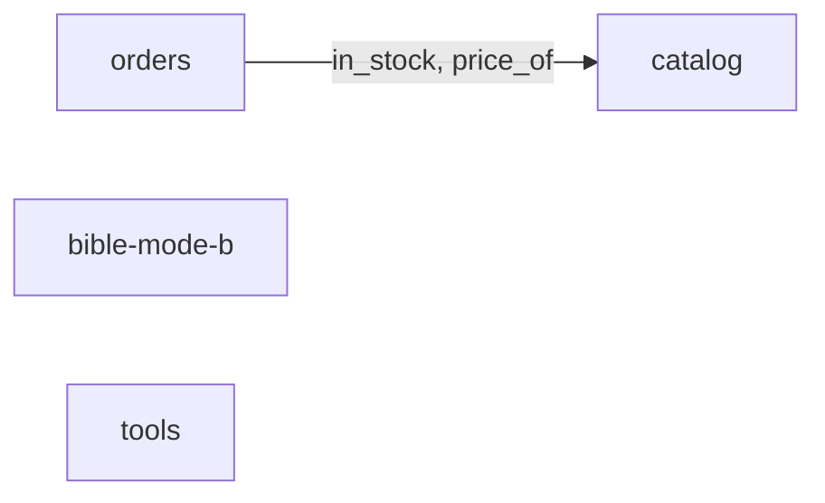

# Components

Written by `discover.py` on 2026-11-23 from the plan under `## Components` in `progress.md`. 4 components, 14 packets; about 8 sessions in all at 6 packets per session (each component's packets in sessions, plus one for its page and check; depth `deep`).

| Component | Paths | Source files | Lines | Packets | Sessions (est.) | Routes | Calls into | Called by |
| --- | --- | --- | --- | --- | --- | --- | --- | --- |
| `catalog` | `components/catalog/` | 3 | 108 | 3 | 2 | 0 | none | `orders` |
| `orders` | `components/orders/` | 4 | 158 | 4 | 2 | 0 | `catalog` | none |
| `bible-mode-b` | `.github/bible/`, `.github/workflows/` | 1 | 844 | 4 | 2 | 0 | none | none |
| `tools` | `tools/` | 3 | 210 | 3 | 2 | 0 | none | none |

Sessions (est.) is the packets divided by the packets per session, rounded up, plus one for the component page and its check. Verification is one more session per component.

## Calls between components

## How to run

- One component: `python3 -I .github/skills/analyzing-a-codebase/scripts/next.py --repo . --analysis codebase-analysis --component NAME --new-session`, then follow what it prints until `COMPONENT DONE NAME`.
- Where every component stands: `python3 -I .github/skills/analyzing-a-codebase/scripts/next.py --repo . --analysis codebase-analysis --board`.
- On GitHub without workflows: one issue per component from `ledger/issues/` (docs/github-guide.md, Part 4).
- When every component is done: the assemble step (`ledger/issues/assemble.md`).
