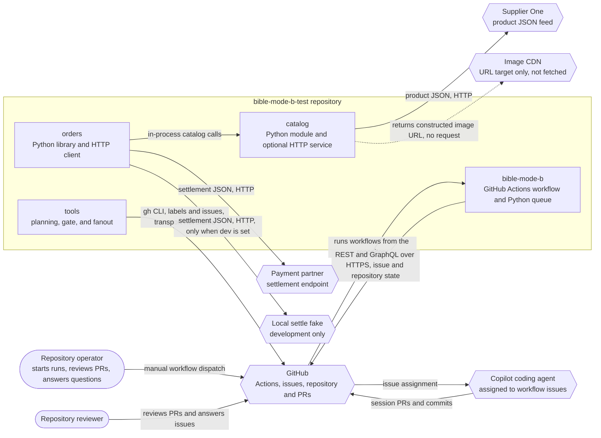

# System context

The repository contains a small catalog/orders sample and a separate GitHub Actions workflow system that assigns agents to create and verify codebase analyses (`README.md:1-7`). The application modules and the analysis automation share a repository but are not one deployed service.

The diagram shows the repository's modules and the external systems they contact. The Image CDN is listed below because code creates its URL, but it does not fetch images.

| Person or outside system | What the system uses it for | Protocol, scheme, port | Address from | Authentication | Evidence |
| --- | --- | --- | --- | --- | --- |
| Repository operator | Starts an analysis with `bible-plan`; can run the queue manually | GitHub Actions UI; transport not specified by repository code | Workflow dispatch | GitHub repository/workflow access; workflow-level identity rules are not stated | `.github/workflows/bible-plan.yml:7-8`; `.github/workflows/bible-queue.yml:7-10` |
| Repository reviewer or answerer | Reviews component PRs and supplies answers on waiting issues | GitHub UI; transport not specified by repository code | GitHub issues and PRs | GitHub access controls; no application authentication layer is defined | `.github/bible/bible_queue.py:711-719`, `.github/bible/bible_queue.py:778-782`, `.github/bible/bible_queue.py:853-857` |
| GitHub and GitHub Actions | Stores issues, labels, branches, PRs and repository files; runs the plan, queue, delta and POC workflows | GitHub API REST and GraphQL; default API base is HTTPS, port 443 | `GITHUB_API_URL`, default `https://api.github.com`; hosted workflow events | GitHub token in `GH_TOKEN`; workflows supply the `BIBLE_ASSIGN_TOKEN` secret | `.github/bible/bible_queue.py:92-105`, `.github/bible/bible_queue.py:113`, `.github/bible/bible_queue.py:127-153`, `.github/bible/bible_queue.py:291-330`; `.github/workflows/bible-plan.yml:44-49`; `.github/workflows/bible-queue.yml:31-36` |
| GitHub CLI calls from `tools/fanout.sh` | Creates labels and issues in the repository named by the operator | `gh` CLI; the transport is not stated by the script | The `owner/repo` argument | The operator's own `gh` login (inferred: the script sets no token or credential of its own, so `gh` uses whatever login it already holds) | `tools/fanout.sh:7-12`, `tools/fanout.sh:24-29` |
| Copilot coding agent | Works on issues created and assigned by the queue or POC workflow, then returns PRs | Assignment and work events are mediated by GitHub; no direct network call from repository code | Issue `agent_assignment` | GitHub assignment; the POC documents that a user token is required | `.github/bible/bible_queue.py:166-173`, `.github/bible/bible_queue.py:223-234`, `.github/bible/bible_queue.py:364-368`; `.github/workflows/poc-assign-copilot.yml:4-6`, `.github/workflows/poc-assign-copilot.yml:55-69` |
| Supplier One | Supplies product JSON when `fetch_supplier_feed` is invoked | HTTP, port 80 implicit in the URL | Hard-coded `SUPPLIER_FEED_URL` | None shown | `components/catalog/catalog.py:5`, `components/catalog/catalog.py:36-39` |
| Payment partner | Receives order settlement JSON | HTTP, port 80 implicit in the URL | Hard-coded `PARTNER_SETTLE_URL` | None shown | `components/orders/orders.py:7-9`, `components/orders/orders.py:45-51` |
| Local settlement fake | Receives the settlement JSON only when `settle` is called with `dev=True`; development only (inferred: the comment above `DEV_SETTLE_URL` calls it a local fake used by developers and never deployed, `components/orders/orders.py:11`, and no code in the repository starts a server on that port) | HTTP, port 8099 | Hard-coded `DEV_SETTLE_URL` | None shown | `components/orders/orders.py:11-12`, `components/orders/orders.py:47` |
| Image CDN | Destination encoded into a returned image URL; catalog code does not make an HTTP request | HTTPS URL, port 443 implicit | Hard-coded `IMAGE_CDN` | Not applicable; no call is made | `components/catalog/catalog.py:6`, `components/catalog/catalog.py:32-33` |

No separate shopper, customer interface, or production hosting environment is identified in the repository. The catalog HTTP API exists in code, but its only in-repository HTTP caller is the orders test; the separate-service use is documented as an intended deployment mode, not a deployed one (`components/catalog/service.py:40-49`; `components/orders/catalog_client.py:1-4`, `components/orders/catalog_client.py:14-23`; `components/orders/test_catalog_client.py:37-62`).

<!-- cites .github/bible/bible_queue.py@5886e8a4b1928e02dee435ffad7e6f9a1e5ec075 -->

<!-- cites .github/workflows/bible-plan.yml@65016c0e6616ef12f74a26e6d6a4a5f566b584c1 -->

<!-- cites .github/workflows/bible-queue.yml@d54080b12d039672f31f0d0924cc380ded069010 -->

<!-- cites .github/workflows/poc-assign-copilot.yml@dab60e0d846bfee50726dce662df48fc186ca3d3 -->

<!-- cites README.md@62b6ccb3c5858e5b699500d9253942283b61da60 -->

<!-- cites components/catalog/catalog.py@1e15fdaab1fa3c720d99a864abb4cac9c8259421 -->

<!-- cites components/catalog/service.py@64e5abbab5e101fac6e56c67450ac4c6346198f1 -->

<!-- cites components/orders/catalog_client.py@469f9d282aab983cdd85f364e46bcd02ef6d3635 -->

<!-- cites components/orders/orders.py@33203a1b4d48a6d335cf411f56a54a7035a66ae0 -->

<!-- cites components/orders/test_catalog_client.py@1d32463e1cdc21bd3eee3bc1b6f31feb8ef40a2d -->

<!-- cites tools/fanout.sh@9ad43aa70e042837954fea1faf483f6c08e07470 -->
