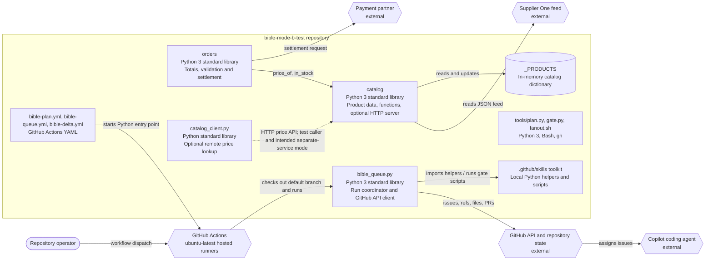
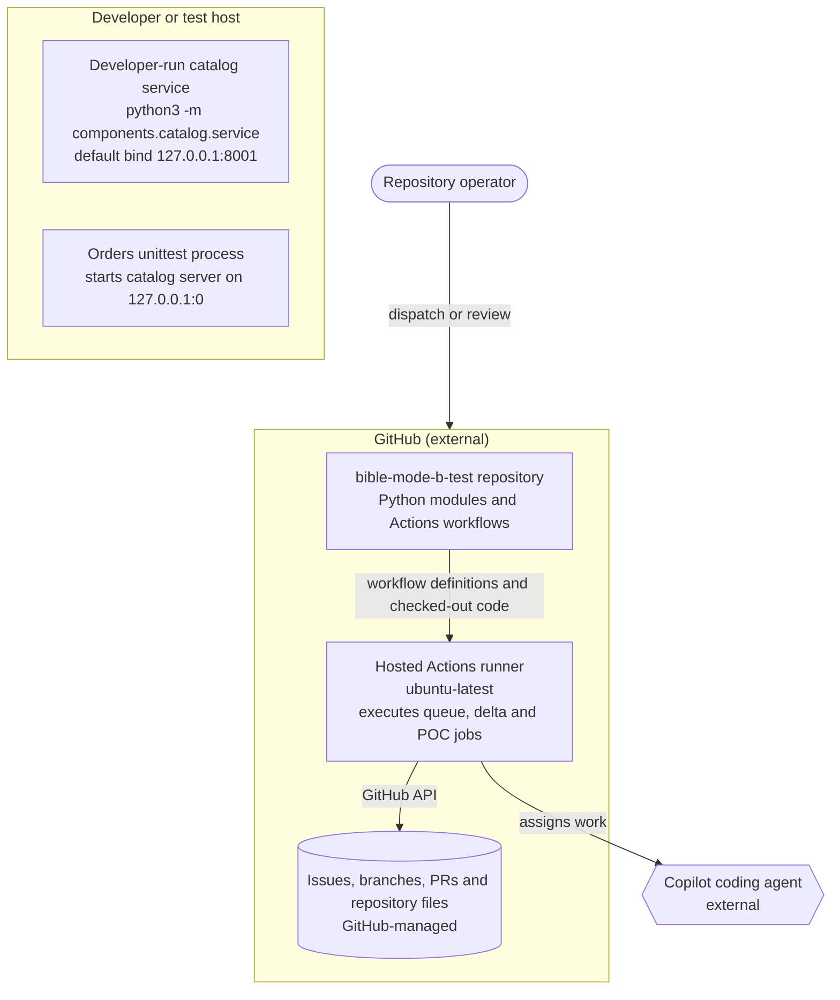

# Architecture

The application is a small Python library with a standard-library HTTP server; the repository also contains command-line analysis tools and GitHub Actions adapters. No application image, package build, deployment manifest, service manager, or production topology is declared. GitHub Actions runs the Mode B scripts on hosted `ubuntu-latest` runners. The TLS migration inventory and service configuration are repository configuration artifacts, not deployed services (`tls-migration/evidence/inventory.json:1-14`; `tls-migration/tls-services.yaml:1-20`).

## Containers

Runtime modules and their direct dependencies. The optional HTTP path from `orders` to the catalog is used by tests and is an intended separate-service mode; the current order helpers import the catalog in-process.

| Element | Evidence |
| --- | --- |
| `orders` imports and calls `catalog` directly | `components/orders/orders.py:5,19-20,35-42`; `components/catalog/catalog.py:15-29` |
| `catalog_client.py` calls the catalog HTTP service; test starts that service locally | `components/orders/catalog_client.py:14-23`; `components/orders/test_catalog_client.py:12-19,37-62` |
| Catalog product store is module memory | `components/catalog/catalog.py:8-12,42-47` |
| Workflows invoke queue commands on GitHub Actions runners | `.github/workflows/bible-plan.yml:37-54`; `.github/workflows/bible-queue.yml:23-37`; `.github/workflows/bible-delta.yml:20-38` |
| Queue uses GitHub API and invokes local analysis toolkit code | `.github/bible/bible_queue.py:90-103,125-151,857-882,1221-1223` |
| `tools` contains planning, gate, and fanout commands | `tools/plan.py:21-62`; `tools/gate.py:23-117`; `tools/fanout.sh:1-31` |

Shapes: rounded = people, rectangle = repository units, cylinder = data store, hexagon = external system. Dashed line = documented intended/test-only HTTP path, not a production deployment.

## Deployment

The diagram shows declared execution environments only. It does not imply a deployed catalog or orders service.

| Component | Packaged as | Built by | Started by | Port | Replicas, limits | Mounts and volumes | Evidence |
| --- | --- | --- | --- | --- | --- | --- | --- |
| `catalog` | Python source; no image or package artifact declared | No build step found | `python3 -m components.catalog.service` | Default bind `127.0.0.1` (port 8001); `CATALOG_HOST` and `CATALOG_PORT` can change it | `ThreadingHTTPServer`; deployment replica/resource limits not specified | None specified | `components/catalog/service.py:1-5,40-49` |
| `orders` | Python library | No build step declared | Imported by Python callers; the HTTP test starts the catalog server in-process | No application port; test server uses `127.0.0.1` (ephemeral port) | Not specified | None | `components/orders/orders.py:1-51`; `components/orders/test_catalog_client.py:12-19` |
| `bible-mode-b` plan and queue | Repository Python script plus Actions YAML | GitHub Actions checks out the default branch; no application build | Manual `bible-plan`; `bible-queue` manual dispatch or 15-minute cron | No service port | `ubuntu-latest`; 15-minute plan, 20-minute queue timeout; workflow concurrency groups do not cancel in-progress jobs | Runner workspace; delta list in `$RUNNER_TEMP`; gate uses a temporary work directory | `.github/workflows/bible-plan.yml:24-54`; `.github/workflows/bible-queue.yml:7-37`; `.github/workflows/bible-delta.yml:20-38`; `.github/bible/bible_queue.py:863-882` |
| `bible-delta` | Repository Python script plus Actions YAML | GitHub Actions checkout with `fetch-depth: 0` | Default-branch push excluding `.github/**` and `codebase-analysis/**` | No service port | `ubuntu-latest`; 15-minute timeout | `$RUNNER_TEMP/changed.txt` | `.github/workflows/bible-delta.yml:6-36` |
| POC assignment workflow | Actions YAML and inline shell/`jq`/`gh` commands; no checkout | No build step; explicitly checks out no repository code | Manual `workflow_dispatch` | No service port | `ubuntu-latest`; 5-minute timeout | Runner-local `request.json` and `response.json` | `.github/workflows/poc-assign-copilot.yml:1-10,11-69` |
| `tools` | Python scripts and Bash script | No build step declared | CLI or `ENGINE=... tools/fanout.sh <owner/repo>` | None | Not specified | Reads and writes `codebase-analysis/plan.json` | `tools/plan.py:41-58`; `tools/gate.py:81-117`; `tools/fanout.sh:2-12` |

`catalogdev` is a source-supported local invocation, not a deployment declared by a workflow or manifest. The orders test starts its server in the test process on an ephemeral port selected by the operating system (`components/catalog/service.py:40-49`; `components/orders/test_catalog_client.py:12-19`).

## Module map

The `bible-mode-b` queue is a Python module with workflow adapters; catalog and orders are Python modules, and tools includes Python and Bash entry points (`.github/bible/bible_queue.py:1-11,1260-1310`; `components/catalog/catalog.py:1-47`; `components/catalog/service.py:1-49`; `components/orders/orders.py:1-51`; `tools/plan.py:1-62`; `tools/gate.py:1-117`; `tools/fanout.sh:1-31`).

## Technology

| Layer | Technology | Version | Declared in | Evidence |
| --- | --- | --- | --- | --- |
| Sample application and queue | Python 3 standard library | Python minor version not pinned | Python source and workflow `python3` invocations | `components/catalog/service.py:7-12`; `.github/workflows/bible-plan.yml:52-54`; `.github/workflows/bible-queue.yml:34-37` |
| Tool fanout | Bash, `gh`, `jq` | Versions not stated | `tools/fanout.sh` and POC inline shell | `tools/fanout.sh:1-31`; `.github/workflows/poc-assign-copilot.yml:55-69` |
| Workflow runner | GitHub Actions `ubuntu-latest` | Runner image is managed; no exact OS version pinned | Workflow `runs-on` fields | `.github/workflows/bible-plan.yml:37-40`; `.github/workflows/bible-queue.yml:23-26`; `.github/workflows/poc-assign-copilot.yml:34-37` |
| Checkout action | `actions/checkout` | Major version `v6` | Workflow `uses` fields | `.github/workflows/bible-plan.yml:40-42`; `.github/workflows/bible-queue.yml:26-29`; `.github/workflows/bible-delta.yml:23-25` |

## Configuration sources

| Component | Configuration source | Environments or profiles | Evidence |
| --- | --- | --- | --- |
| `catalog` | `CATALOG_HOST` default `127.0.0.1`, `CATALOG_PORT` default `8001`; supplier and image URLs are constants | No profiles or environment-specific deployment files found | `components/catalog/service.py:40-43`; `components/catalog/catalog.py:5-6` |
| `orders` | `CATALOG_URL` default `http://127.0.0.1:8001`; settlement URL, discounts, and bulk threshold are constants; `dev` selects the local fake endpoint | No profiles or environment-specific deployment files found | `components/orders/catalog_client.py:11,14-16`; `components/orders/orders.py:7-16,45-48` |
| `bible-mode-b` | Workflow inputs and `BIBLE_ASSIGN_TOKEN` secret; `GITHUB_REPOSITORY`, `GH_TOKEN`, `GITHUB_API_URL`, `BIBLE_AGENT_LOGINS`, `BIBLE_AGENT_APP`, `BIBLE_NOW`, `BIBLE_SKILLS` | GitHub repository workflow environment; no application profiles | `.github/workflows/bible-plan.yml:9-23,44-49`; `.github/workflows/bible-queue.yml:31-36`; `.github/bible/bible_queue.py:34-36,61-65,111,357,478-480,1276-1278` |
| `tools` | `ENGINE` environment variable, default `copilot`; repository is a positional argument; plan and gate data under `codebase-analysis/` | CLI invocation; no profiles | `tools/fanout.sh:7-12,24-29`; `tools/plan.py:41-58`; `tools/gate.py:81-108` |

<!-- cites .github/bible/bible_queue.py@161344dc7ddde551f4020972e6d61c782a86d480 -->

<!-- cites .github/workflows/bible-delta.yml@5317a1ada61df3db98cc21d8db6d1415fe732c58 -->

<!-- cites .github/workflows/bible-plan.yml@65016c0e6616ef12f74a26e6d6a4a5f566b584c1 -->

<!-- cites .github/workflows/bible-queue.yml@d54080b12d039672f31f0d0924cc380ded069010 -->

<!-- cites .github/workflows/poc-assign-copilot.yml@dab60e0d846bfee50726dce662df48fc186ca3d3 -->

<!-- cites components/catalog/catalog.py@1e15fdaab1fa3c720d99a864abb4cac9c8259421 -->

<!-- cites components/catalog/service.py@64e5abbab5e101fac6e56c67450ac4c6346198f1 -->

<!-- cites components/orders/catalog_client.py@469f9d282aab983cdd85f364e46bcd02ef6d3635 -->

<!-- cites components/orders/orders.py@33203a1b4d48a6d335cf411f56a54a7035a66ae0 -->

<!-- cites components/orders/test_catalog_client.py@1d32463e1cdc21bd3eee3bc1b6f31feb8ef40a2d -->

<!-- cites tls-migration/evidence/inventory.json@2d46a3e849f9c1688bd72d8e4add3feeb368314e -->

<!-- cites tls-migration/tls-services.yaml@b494ef963f852e6359ef12c79eed00a71427eaf0 -->

<!-- cites tools/fanout.sh@9ad43aa70e042837954fea1faf483f6c08e07470 -->

<!-- cites tools/gate.py@65eb0af527e554cfb2dadb9d0c8cd1ee6e975c99 -->

<!-- cites tools/plan.py@e1dae33df7990fe69b145146d570403758d0635e -->
