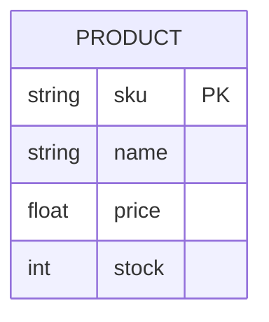
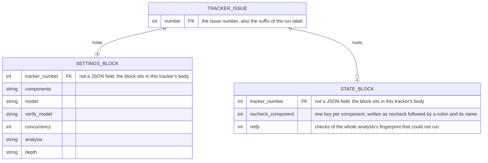
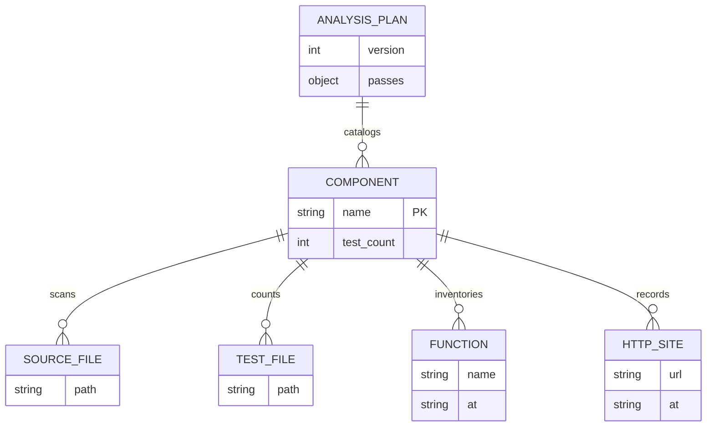
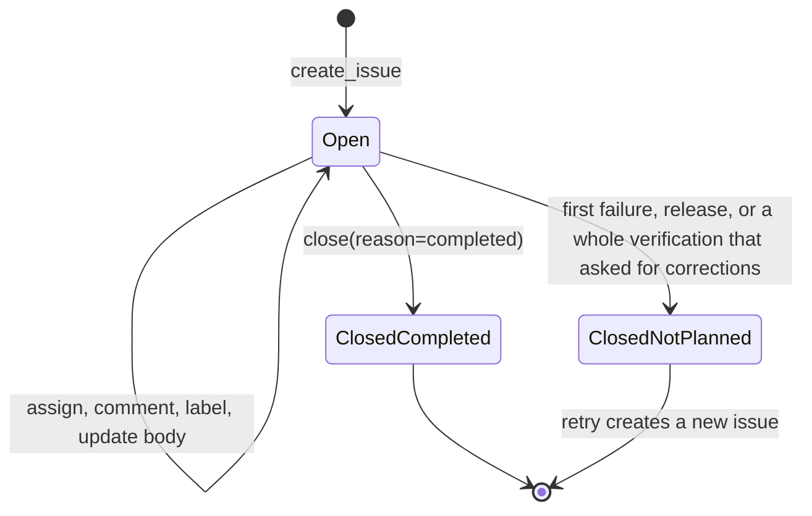
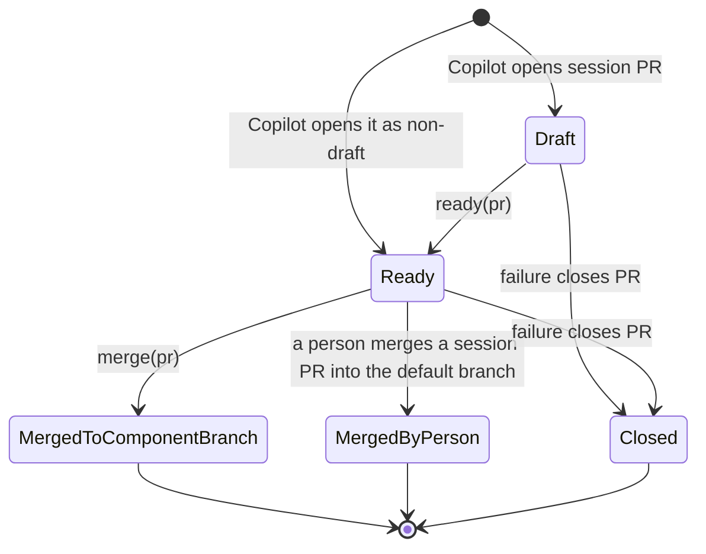
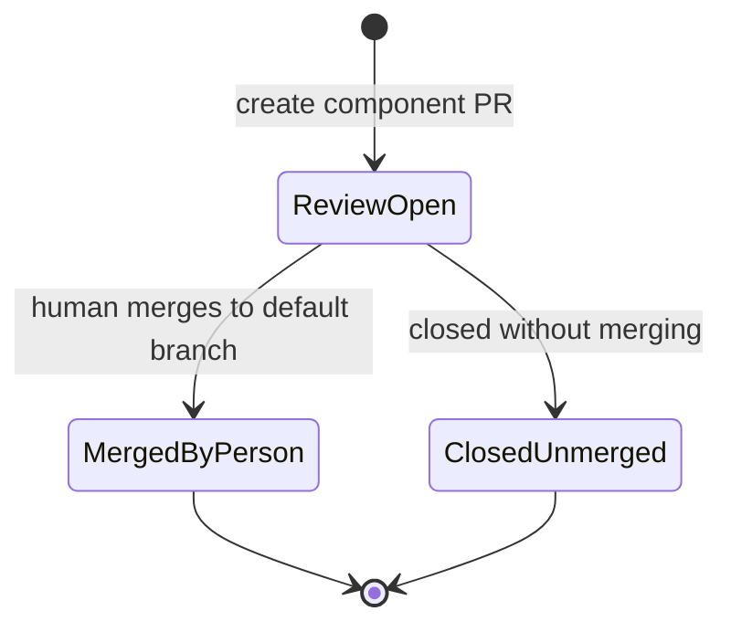
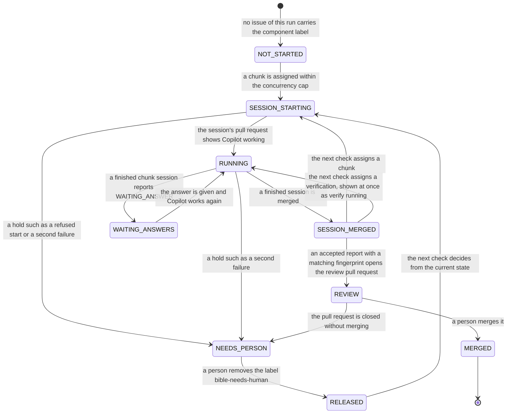

# Data architecture

## Stores and ownership

| Store | Technology | Owned by | Read by | Schema in | Evidence |
| --- | --- | --- | --- | --- | --- |
| `_PRODUCTS` | Python dictionary in process memory, keyed by SKU | `catalog` | Catalog lookups, `orders` direct imports and the catalog HTTP API (through `catalog.price_of`) | `components/catalog/catalog.py` | `components/catalog/catalog.py:11-15`, `components/catalog/catalog.py:27-41`, `components/catalog/catalog.py:58-63`; `components/orders/orders.py:5`, `components/orders/orders.py:19-20`, `components/orders/orders.py:35-42`; `components/catalog/service.py:31` |
| GitHub issues, labels, branches, PRs and repository files | GitHub-managed records and content | `bible-mode-b` | Queue and agent sessions | Only selected fields and workflow conventions are defined by repository code; GitHub owns the complete schema (assumed: GitHub's API defines the records) | `.github/bible/bible_queue.py:92-106`, `.github/bible/bible_queue.py:128-154`, `.github/bible/bible_queue.py:156-222`, `.github/bible/bible_queue.py:253-331` |
| `codebase-analysis/plan.json` (one of the data dictionary's "Tools' analysis artifacts") | Local JSON file | `tools` | `tools/gate.py`, `tools/fanout.sh` | `tools/plan.py` constructs its schema | `tools/plan.py:41-58`; `tools/gate.py:86`; `tools/fanout.sh:9` |
| Component analysis artifacts (the same store as `plan.json`, the data dictionary's "Tools' analysis artifacts") | JSON and Markdown files in the repository: the queue reads `<analysis>/ledger/components/<c>/status.json` and the other pages from GitHub branches, while `tools/gate.py` reads the local checkout, `codebase-analysis/components/<c>/status.json` and the artifacts beside it | Analysis workflow | `tools/gate.py` (local checkout) or `bible-mode-b` (GitHub branches) | Field formats used by each reader are described in [the data dictionary](../lld/data-dictionary.md) | `tools/gate.py:20`, `tools/gate.py:42-78`, `tools/gate.py:81-108`; `.github/bible/bible_queue.py:438-444`, `.github/bible/bible_queue.py:454-459`, `.github/bible/bible_queue.py:478-507`, `.github/bible/bible_queue.py:552-555`, `.github/bible/bible_queue.py:716`, `.github/bible/bible_queue.py:830`, `.github/bible/bible_queue.py:865-866`, `.github/bible/bible_queue.py:941`; `tools/gate.py:89` |
| Temporary gate workspace (tarball buffer and unpacked branch; a `bible-whole-` directory of the same kind holds the default branch for the whole analysis's fingerprint) | Temporary local file/directory | `bible-mode-b` | `coverage.py` and `status.py` subprocesses | No durable schema | `.github/bible/bible_queue.py:292-331`, `.github/bible/bible_queue.py:976-995`, `.github/bible/bible_queue.py:1010-1025` |

No relational database, cache, object store, or durable application-side order record is declared (inferred: a search of `components/` for `sqlite`, `redis`, `shelve`, `pickle`, `write_text` and `cache` finds 0 hits, and one for `open(` finds 4 hits, all network calls (`opener.open(` at `components/catalog/catalog.py:54` and `urlopen(` at `components/orders/orders.py:50`, `components/orders/catalog_client.py:22` and `components/orders/test_catalog_client.py:32`). Catalog contents disappear when the process exits; the queue's durable run state lives in GitHub issues, labels, branches and PRs (`components/catalog/catalog.py:11-15`; `.github/bible/bible_queue.py:128-154`, `.github/bible/bible_queue.py:253-331`).

## Data models

### `_PRODUCTS`: the catalog products

`_PRODUCTS` is a map whose key is the SKU. The diagram shows the record fields seeded by the module and updated from a supplier feed; `components/catalog/catalog.py:1-63` holds no other product structure.

| Element | Evidence |
| --- | --- |
| `PRODUCT.sku` is the dictionary key | `components/catalog/catalog.py:11-15`, `components/catalog/catalog.py:29` |
| `name`, `price`, and `stock` are the product values | `components/catalog/catalog.py:11-15` |
| Feed updates `price` and `stock` for known SKUs only | `components/catalog/catalog.py:58-63` |

### Tracker hidden blocks

The tracker issue body holds two hidden JSON comments, `bible-settings` (the run's settings) and `bible-state` (the queue's own counters). The schema is in the code, not in a file (inferred: a listing of the 30 files outside the analysis folder and the skills shows no schema file).

| Element | Evidence |
| --- | --- |
| `SETTINGS_BLOCK` fields are those `start` writes, and `settings_of` reads them back, refusing unsafe values | `.github/bible/bible_queue.py:86`, `.github/bible/bible_queue.py:407-427`, `.github/bible/bible_queue.py:1415-1420` |
| `Queue.render` writes the settings block back with every table rewrite | `.github/bible/bible_queue.py:1313` |
| `TRACKER_ISSUE.number` is the key: the run label is `bible-run-<tracker number>`, and both blocks are read from that issue's body; `tracker_number` in the blocks is the link drawn by the diagram, not a stored field | `.github/bible/bible_queue.py:708`, `.github/bible/bible_queue.py:709-715`, `.github/bible/bible_queue.py:407-411` |
| `STATE_BLOCK` keys are the counters of checks that could not run; a count reaching `MAX_NOCHECK` ends in a hold | `.github/bible/bible_queue.py:87`, `.github/bible/bible_queue.py:89`, `.github/bible/bible_queue.py:709-715`, `.github/bible/bible_queue.py:997-1008`, `.github/bible/bible_queue.py:1311` |

### Component plan file

The JSON arrays are shown as child records to make the plan's shape readable; this is a file schema, not a relational database.

| Element | Evidence |
| --- | --- |
| Plan contains version, pass descriptions and component inventory; a plan can hold zero components, because the loop adds one entry per folder under `components/` whose name does not start with an underscore | `tools/plan.py:42-54` |
| Component source and test paths plus test-count baseline | `tools/plan.py:21-27`, `tools/plan.py:35-38` |
| Function and HTTP-site records | `tools/plan.py:29-38` |

## Record lifecycles

### GitHub issue

The queue creates an open issue, updates its body/labels/assignment while it is active, and closes it either as completed or not planned. A retry is a new issue with an incremented attempt, not a reopening of the failed issue. A pull request that says "Fixes #N" closes the issue when GitHub merges it (assumed: GitHub behaviour, stated in the comment at `.github/bible/bible_queue.py:1038-1039`).

| Element | Evidence |
| --- | --- |
| `create_issue` starts tracker and session records | `.github/bible/bible_queue.py:167-174`, `.github/bible/bible_queue.py:767-768`, `.github/bible/bible_queue.py:793-794`, `.github/bible/bible_queue.py:900-908`, `.github/bible/bible_queue.py:1420` |
| Issue body, assignment and label updates | `.github/bible/bible_queue.py:333-353`, `.github/bible/bible_queue.py:623-628` |
| Normal close reason defaults to `completed` | `.github/bible/bible_queue.py:343-344` |
| A first failed attempt closes as `not_planned` and an attempt-2 issue is created; a second failure stays open, labelled `bible-needs-human` and unassigned, with a comment | `.github/bible/bible_queue.py:642-661` |
| A component session a person released is closed as `not_planned`; a verify-all issue that the queue still sees open, when its merged pull request holds a report that asks for corrections, is also closed as `not_planned` | `.github/bible/bible_queue.py:618-622`, `.github/bible/bible_queue.py:1095-1099` |

### Agent session pull request

Chunk and verify session PRs are merged into a component branch after path and status checks; failed PRs are closed. The PRs of the plan, assembly, whole-verification, whole-revision and update sessions target the default branch and a person merges them, since the queue never merges into the default branch (inferred: the module docstring, `.github/bible/bible_queue.py:28`, says so, and a search of the queue for `.merge(` finds 1 call, at `.github/bible/bible_queue.py:965`, for session pull requests into the component branch). The separate component review PR also targets the default branch and is merged by a person, not by this queue (inferred: the same two sources).

| Element | Evidence |
| --- | --- |
| Agent may open draft; `merge` marks it ready (through `ready`, a GraphQL mutation) before it merges; a PR that is not a draft needs no such step and counts as asked for review | `.github/bible/bible_queue.py:355-363`, `.github/bible/bible_queue.py:365-369`, `.github/bible/bible_queue.py:588` |
| Queue validates changed files and status before merging a chunk or verify session PR into the component branch | `.github/bible/bible_queue.py:931-965` |
| Plan, assemble, verify-all, revise-all and update sessions are assigned with the default branch as base, and the queue never merges into it (inferred: the module docstring at line 28, and `merge` is called only at line 965, for session pull requests into the component branch) | `.github/bible/bible_queue.py:28`, `.github/bible/bible_queue.py:768`, `.github/bible/bible_queue.py:1129`, `.github/bible/bible_queue.py:1249`, `.github/bible/bible_queue.py:1380` |
| A person merges those session pull requests into the default branch (`Ready --> MergedByPerson`) (inferred: the module docstring says "a person merges those pull requests", and the queue only reads `merged_at` for them) | `.github/bible/bible_queue.py:28`, `.github/bible/bible_queue.py:1086-1087`, `.github/bible/bible_queue.py:1199-1200` |
| Failed session closes its PR | `.github/bible/bible_queue.py:645-647` |

### Component review pull request

The separate component review PR targets the default branch and is merged by a person, not by this queue (inferred: the module docstring, `.github/bible/bible_queue.py:28`, and `merge` is called only at `.github/bible/bible_queue.py:965`, for session pull requests into the component branch).

| Element | Evidence |
| --- | --- |
| Component review PR is opened for a person to review (its description says "Review the pages under ... then merge") | `.github/bible/bible_queue.py:867-871`; module docstring `.github/bible/bible_queue.py:28` |
| A matching PR closed without merging stops the component with "needs a person" until it is reopened or a new run starts | `.github/bible/bible_queue.py:805-807` |

### Component row on the tracker

The tracker issue shows one row per component, recomputed from GitHub at every check, so the arrows below are the usual order of rows across checks (inferred: no row is stored, `Queue.run` builds each one again from the issues and pull requests it finds).

| Element | Evidence |
| --- | --- |
| `not started` when no issue of this run carries the component label; a chunk is then assigned while the `concurrency` cap allows | `.github/bible/bible_queue.py:820-821`, `.github/bible/bible_queue.py:747-751` |
| `<kind> running`, and `waiting for answers on #<PR>` for a finished chunk session whose status is `WAITING_ANSWER` | `.github/bible/bible_queue.py:584-586`, `.github/bible/bible_queue.py:923-924`, `.github/bible/bible_queue.py:943-947` |
| `waiting for answers` returns to `<kind> running` when the session's pull request shows Copilot working again; the answer is given on the pull request with `@copilot` (the label text) | `.github/bible/bible_queue.py:104`, `.github/bible/bible_queue.py:584-586`, `.github/bible/bible_queue.py:923-924` |
| A finished session that passes the checks is merged and shown as `<kind> merged`; the next check assigns the next chunk (shown as `session starting`) or the verification (shown at once as `verify running`) | `.github/bible/bible_queue.py:965-968`, `.github/bible/bible_queue.py:860-861`, `.github/bible/bible_queue.py:899-909` |
| `needs a person` after a hold (a second failure, a refused start, the session cap or the verification rounds used up) | `.github/bible/bible_queue.py:648-653`, `.github/bible/bible_queue.py:917-919`, `.github/bible/bible_queue.py:849-858`, `.github/bible/bible_queue.py:886-894` |
| `released: next step at the next check` after a person removes `bible-needs-human` | `.github/bible/bible_queue.py:618-622`, `.github/bible/bible_queue.py:812-813` |
| A report that `accepted` counts as verified (a `PASS`, or a `PASS AFTER CORRECTIONS` with a confirmed re-check), with a matching fingerprint, opens the review pull request; a person merges it (inferred: the module docstring, `.github/bible/bible_queue.py:28`, and `merge` is called only at `.github/bible/bible_queue.py:965`), or it is closed without merging | `.github/bible/bible_queue.py:867-871`, `.github/bible/bible_queue.py:803-807` |

The component status artifact also carries `NEW_CHAT`, `COMPONENT_DONE`, `WAITING_ANSWER`, and `STOP`; this repository code reads these values to decide queue behavior but does not write their transitions (inferred: a search of the queue for `/contents` finds 1 hit, the read in `file`, `.github/bible/bible_queue.py:195-199`) (`.github/bible/bible_queue.py:73`, `.github/bible/bible_queue.py:552-555`, `.github/bible/bible_queue.py:830-832`, `.github/bible/bible_queue.py:941-951`). The transitions belong to the analysis toolkit and are not inferred here.

## Files, caches and other state

| State | Reads | Writes | Lifecycle | Evidence |
| --- | --- | --- | --- | --- |
| `plan.json` | Gate and fanout tools | Planning tool | Regenerated from component Python files | `tools/plan.py:21-58`; `tools/gate.py:86`; `tools/fanout.sh:9` |
| Component `status.json`, `inventory.md`, `risks.md`, `tests-report.md` (under `codebase-analysis/components/<c>/`) | Gate tool | Not written by `tools/gate.py` (inferred: a search of `tools/gate.py` for `write` and `open(` finds 0 hits) | Read for validation; absent files fail the relevant pass | `tools/gate.py:42-78`, `tools/gate.py:89-108` |
| `components.json`, issue templates, status (`<analysis>/ledger/components/<c>/status.json`) and verification reports | Queue reads from GitHub default or component branch | Queue changes GitHub issue/PR state, not these local files (inferred: a search of the queue for `write_text`, `.write(` and `open(` finds 5 hits, none of which writes one of these files: `urlopen` at line 126, the tarball buffer at line 307, `tarfile.open` at line 312, the unpacked files at line 330, and the read of the changed-path file at line 1426) | Component artifacts move with their branches; whole-system files are read from the default branch | `.github/bible/bible_queue.py:195-199`, `.github/bible/bible_queue.py:438-444`, `.github/bible/bible_queue.py:454-459`, `.github/bible/bible_queue.py:478-507`, `.github/bible/bible_queue.py:552-555`, `.github/bible/bible_queue.py:716`, `.github/bible/bible_queue.py:830`, `.github/bible/bible_queue.py:865-866` |
| `baseline.json` | Queue checks its presence before delta work | Not written by the queue (inferred: a search of the queue for `baseline.json` finds 2 hits, a read and a log line, at lines 1342-1343) | Missing baseline prevents delta issue creation | `.github/bible/bible_queue.py:1341-1344` |
| Tracker `bible-settings` block | `Queue.reconcile` reads it through `settings_of`, and `Queue.run` passes it on | `start` writes it when it creates the tracker, and `Queue.render` writes it back with each table rewrite | A hidden JSON comment in the tracker body; a tracker with no readable or unsafe block is skipped with a log line | `.github/bible/bible_queue.py:86`, `.github/bible/bible_queue.py:407-427`, `.github/bible/bible_queue.py:668-671`, `.github/bible/bible_queue.py:1313`, `.github/bible/bible_queue.py:1420` |
| Tracker `bible-state` block | Queue reads it at the start of a run | `Queue.render` rewrites the tracker body when its table or this block changed (the `Updated` line alone does not trigger a write) | Keys `nocheck:<component>` and `nofp` count checks in a row that could not run; they end in a hold at 3 | `.github/bible/bible_queue.py:87`, `.github/bible/bible_queue.py:89`, `.github/bible/bible_queue.py:709-715`, `.github/bible/bible_queue.py:997-1008`, `.github/bible/bible_queue.py:1311`, `.github/bible/bible_queue.py:1314-1316` |
| `bible-deferred-update` comments | `Queue.deferred_updates` reads the queue's own comments on the tracker | `Queue.delta` writes them while a run is open and its tracker was updated in the last 14 days (at most 200 paths each) | Replayed into update issues when the run ends through its Done step: before the tracker closes, then once more for paths recorded after the first read. When a person closes the tracker, or the run does not finish, `Queue.replay_closed_runs` replays them at a later check: it reads the paths of every closed tracker that has no `bible-replayed` label and no mark comment, passes them to `Queue.delta` (which records them on a run open at that time, or creates the update issues), comments with `REPLAYED_MARK` and labels the tracker `bible-replayed` (inferred: a search of the file for `deferred_updates(` finds 4 hits, the definition and three calls, two at the Done step and one in `replay_closed_runs`). A later update issue for the same component asks its session for every change since the analysis's baseline, not only that push's files. When a replay happens, `Queue.delta` still skips or holds: with no `components.json` or `ledger/baseline.json` the paths are dropped with only a log line (`.github/bible/bible_queue.py:1341-1344`); more than 10 touched components give one hold issue (labelled `bible-delta` and `bible-needs-human`) instead of update issues, unless such a hold issue is already open (`.github/bible/bible_queue.py:1353-1362`); a component with an open `bible-delta` issue is skipped (`.github/bible/bible_queue.py:1368-1370`) | `.github/bible/bible_queue.py:392`, `.github/bible/bible_queue.py:393`, `.github/bible/bible_queue.py:94`, `.github/bible/bible_queue.py:391`, `.github/bible/bible_queue.py:667`, `.github/bible/bible_queue.py:676-679`, `.github/bible/bible_queue.py:681-703`, `.github/bible/bible_queue.py:1327`, `.github/bible/bible_queue.py:1371-1375`, `.github/bible/bible_queue.py:1331-1333`, `.github/bible/bible_queue.py:1334-1337`, `.github/bible/bible_queue.py:1131-1148`, `.github/bible/bible_queue.py:1150-1162` |
| `bible-continue` marker | `Queue.continue_if_unfinished` counts comments that carry it | The same method ends its `@copilot continue` comment with it | Counted since a person last released the session; 3 allowed (`MAX_CONTINUE`) | `.github/bible/bible_queue.py:84`, `.github/bible/bible_queue.py:85`, `.github/bible/bible_queue.py:1270-1272`, `.github/bible/bible_queue.py:1289`, `.github/bible/bible_queue.py:1296-1304` |
| Changed-path list | `delta` reads one UTF-8 path per line | Workflow writes it to `$RUNNER_TEMP/changed.txt` | Written under `$RUNNER_TEMP` (inferred: the workflow does not delete it, `.github/workflows/bible-delta.yml:37-38`; assumed: GitHub discards a hosted runner after the job) | `.github/workflows/bible-delta.yml:31-38`; `.github/bible/bible_queue.py:1426-1428` |
| Temporary gate workspace | Coverage and status subprocesses | Queue streams and extracts under a temporary location; the whole analysis's fingerprint uses a `bible-whole-` directory of the same kind | Temporary buffer closes; worktree is removed in `finally` | `.github/bible/bible_queue.py:292-331`, `.github/bible/bible_queue.py:976-995`, `.github/bible/bible_queue.py:1010-1025` |
| POC `request.json`, `response.json` | `gh api` receives request file; `jq` reads response fields | POC job writes both in runner workspace | No checkout or repository commit (the job has a single shell step, no checkout step); the files live in the runner workspace (assumed: GitHub discards a hosted runner after the job) | `.github/workflows/poc-assign-copilot.yml:34-47`, `.github/workflows/poc-assign-copilot.yml:55-69`, `.github/workflows/poc-assign-copilot.yml:70-71` |

See [the data dictionary](../lld/data-dictionary.md) for field meanings and status values.

<!-- cites .github/bible/bible_queue.py@a625b4c3353b1744b965b8bbee13e6b3ed5f72a6 -->

<!-- cites .github/workflows/bible-delta.yml@5317a1ada61df3db98cc21d8db6d1415fe732c58 -->

<!-- cites .github/workflows/poc-assign-copilot.yml@dab60e0d846bfee50726dce662df48fc186ca3d3 -->

<!-- cites components/catalog/catalog.py@75bb1dc767dc16cad9a5ed5555a7293bc004275b -->

<!-- cites components/catalog/service.py@64e5abbab5e101fac6e56c67450ac4c6346198f1 -->

<!-- cites components/orders/catalog_client.py@469f9d282aab983cdd85f364e46bcd02ef6d3635 -->

<!-- cites components/orders/orders.py@33203a1b4d48a6d335cf411f56a54a7035a66ae0 -->

<!-- cites components/orders/test_catalog_client.py@1d32463e1cdc21bd3eee3bc1b6f31feb8ef40a2d -->

<!-- cites tools/fanout.sh@9ad43aa70e042837954fea1faf483f6c08e07470 -->

<!-- cites tools/gate.py@65eb0af527e554cfb2dadb9d0c8cd1ee6e975c99 -->

<!-- cites tools/plan.py@e1dae33df7990fe69b145146d570403758d0635e -->
