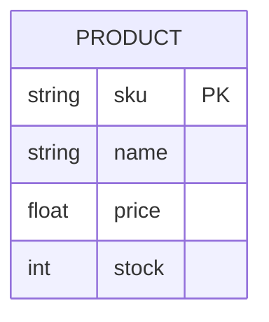
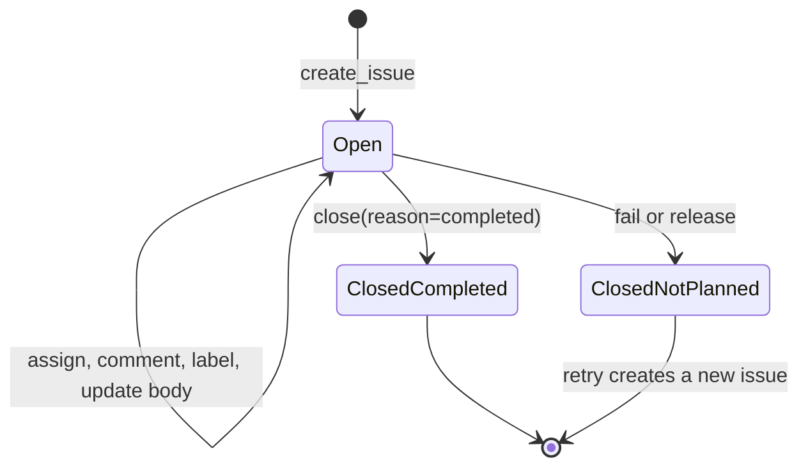
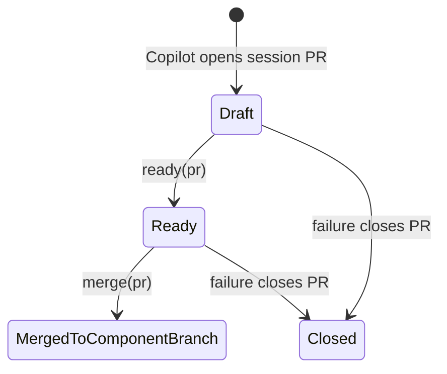
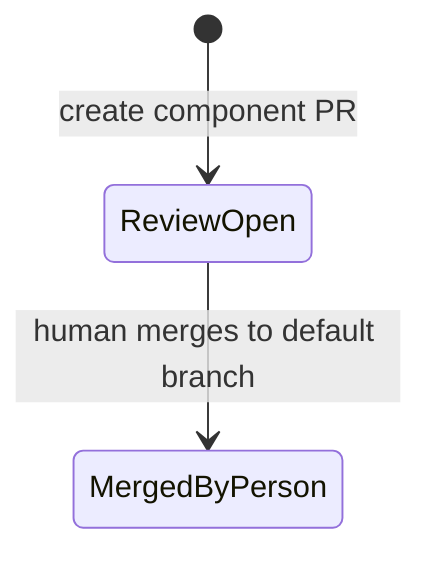

# Data architecture

## Stores and ownership

| Store | Technology | Owned by | Read by | Schema in | Evidence |
| --- | --- | --- | --- | --- | --- |
| `_PRODUCTS` | Python dictionary in process memory, keyed by SKU | `catalog` | Catalog lookups and `orders` direct imports | `components/catalog/catalog.py` | `components/catalog/catalog.py:8-12,15-29,42-47`; `components/orders/orders.py:5,19-20,35-42` |
| GitHub issues, labels, branches, PRs and repository files | GitHub-managed records and content | `bible-mode-b` | Queue and agent sessions | Only selected fields and workflow conventions are defined by repository code; GitHub owns the complete schema | `.github/bible/bible_queue.py:92-105,127-153,155-221,252-330` |
| `codebase-analysis/plan.json` | Local JSON file | `tools` | `tools/gate.py`, `tools/fanout.sh` | `tools/plan.py` constructs its schema | `tools/plan.py:41-58`; `tools/gate.py:86`; `tools/fanout.sh:9` |
| Component analysis artifacts | JSON and Markdown files stored on GitHub branches | Analysis workflow | `tools/gate.py` or `bible-mode-b` | Field formats used by each reader are described in [the data dictionary](../lld/data-dictionary.md) | `tools/gate.py:42-78,81-108`; `.github/bible/bible_queue.py:436-442,452-457,469-482,492-495,628,742,777` |
| Gate workspace and tarball buffer | Temporary local file/directory | `bible-mode-b` | `coverage.py` and `status.py` subprocesses | No durable schema | `.github/bible/bible_queue.py:291-330,886-905` |

No relational database, cache, object store, or durable application-side order record is declared. Catalog contents disappear when the process exits; the queue's durable run state lives in GitHub issues, labels, branches and PRs (`components/catalog/catalog.py:8-12`; `.github/bible/bible_queue.py:127-153,252-330`).

## Data models

### `_PRODUCTS`: the catalog products

`_PRODUCTS` is a map whose key is the SKU. The diagram shows the record fields seeded by the module and updated from a supplier feed; there are no other product relationships.

| Element | Evidence |
| --- | --- |
| `PRODUCT.sku` is the dictionary key | `components/catalog/catalog.py:8-12,15` |
| `name`, `price`, and `stock` are the product values | `components/catalog/catalog.py:8-12` |
| Feed updates `price` and `stock` for known SKUs only | `components/catalog/catalog.py:42-47` |

### Component plan file

The JSON arrays are shown as child records to make the plan's shape readable; this is a file schema, not a relational database.

| Element | Evidence |
| --- | --- |
| Plan contains version, pass descriptions and component inventory | `tools/plan.py:42-54` |
| Component source and test paths plus test-count baseline | `tools/plan.py:21-27,35-38` |
| Function and HTTP-site records | `tools/plan.py:29-38` |

## Record lifecycles

### GitHub issue

The queue creates an open issue, updates its body/labels/assignment while it is active, and closes it either as completed or not planned. A retry is a new issue with an incremented attempt, not a reopening of the failed issue.

| Element | Evidence |
| --- | --- |
| `create_issue` starts tracker and session records | `.github/bible/bible_queue.py:166-173,679-680,705-706,811-818,1322` |
| Issue body, assignment and label updates | `.github/bible/bible_queue.py:332-352,563-568` |
| Normal close reason defaults to `completed` | `.github/bible/bible_queue.py:342-343` |
| Failed attempts close as `not_planned`; a later attempt is newly created | `.github/bible/bible_queue.py:582-601` |

### Agent session pull request

Agent PRs are merged into a component branch after path and status checks; failed PRs are closed. The separate component review PR targets the default branch and is merged by a person, not by this queue.

| Element | Evidence |
| --- | --- |
| Agent may open draft; `merge` marks it ready (through `ready`, a GraphQL mutation) before it merges | `.github/bible/bible_queue.py:354-362`, `.github/bible/bible_queue.py:364-368` |
| Queue validates changed files and status before merging session PR | `.github/bible/bible_queue.py:841-875` |
| Failed session closes its PR | `.github/bible/bible_queue.py:585-587` |

### Component review pull request

The separate component review PR targets the default branch and is merged by a person, not by this queue.

| Element | Evidence |
| --- | --- |
| Component review PR is opened for a person to review | `.github/bible/bible_queue.py:778-782`; module docstring `.github/bible/bible_queue.py:28` |

The component status artifact also carries `NEW_CHAT`, `COMPONENT_DONE`, `WAITING_ANSWER`, and `STOP`; this repository code reads these values to decide queue behavior but does not write their transitions (`.github/bible/bible_queue.py:73,492-495,742-744,851-861`). The transitions belong to the analysis toolkit and are not inferred here.

## Files, caches and other state

| State | Reads | Writes | Lifecycle | Evidence |
| --- | --- | --- | --- | --- |
| `plan.json` | Gate and fanout tools | Planning tool | Regenerated from component Python files | `tools/plan.py:21-58`; `tools/gate.py:86`; `tools/fanout.sh:9` |
| Component `status.json`, `inventory.md`, `risks.md`, `tests-report.md` | Gate tool | Not written by `tools/gate.py` | Read for validation; absent files fail the relevant pass | `tools/gate.py:42-78,89-108` |
| `components.json`, issue templates, status and verification reports | Queue reads from GitHub default or component branch | Queue changes GitHub issue/PR state, not these local files | Component artifacts move with their branches; whole-system files are read from the default branch | `.github/bible/bible_queue.py:194-198,436-442,452-457,469-482,492-495,628,742,777` |
| `baseline.json` | Queue checks its presence before delta work | Not written by the queue | Missing baseline prevents delta issue creation | `.github/bible/bible_queue.py:1243-1246` |
| Tracker `bible-state` block | Queue reads it at the start of a run | `Queue.render` rewrites the tracker body when its table or this block changed (the `Updated` line alone does not trigger a write) | Keys `nocheck:<component>` and `nofp` count checks in a row that could not run; they end in a hold at 3 | `.github/bible/bible_queue.py:87`, `.github/bible/bible_queue.py:621-627,907-918`, `.github/bible/bible_queue.py:1213` |
| `bible-deferred-update` comments | `Queue.deferred_updates` reads the queue's own comments on the tracker | `Queue.delta` writes them while a run is open (at most 200 paths each) | Replayed into update issues before the tracker closes, then once more after it | `.github/bible/bible_queue.py:1236-1239`, `.github/bible/bible_queue.py:1052-1064` |
| `bible-continue` marker | `Queue.continue_if_unfinished` counts comments that carry it | The same method ends its `@copilot continue` comment with it | Counted since a person last released the session; 3 allowed | `.github/bible/bible_queue.py:85`, `.github/bible/bible_queue.py:1172-1174,1198-1206` |
| Changed-path list | `delta` reads one UTF-8 path per line | Workflow writes it to `$RUNNER_TEMP/changed.txt` | Removed with the runner workspace | `.github/workflows/bible-delta.yml:31-38`; `.github/bible/bible_queue.py:1328-1330` |
| Gate tarball and extracted worktree | Coverage and status subprocesses | Queue streams and extracts under a temporary location | Temporary buffer closes; worktree is removed in `finally` | `.github/bible/bible_queue.py:291-330,886-905` |
| POC `request.json`, `response.json` | `gh api` receives request file; `jq` reads response fields | POC job writes both in runner workspace | No checkout or repository commit; runner workspace is ephemeral | `.github/workflows/poc-assign-copilot.yml:55-69` |

See [the data dictionary](../lld/data-dictionary.md) for field meanings and status values.

<!-- cites .github/bible/bible_queue.py@5886e8a4b1928e02dee435ffad7e6f9a1e5ec075 -->

<!-- cites .github/workflows/bible-delta.yml@5317a1ada61df3db98cc21d8db6d1415fe732c58 -->

<!-- cites .github/workflows/poc-assign-copilot.yml@dab60e0d846bfee50726dce662df48fc186ca3d3 -->

<!-- cites components/catalog/catalog.py@1e15fdaab1fa3c720d99a864abb4cac9c8259421 -->

<!-- cites tools/fanout.sh@9ad43aa70e042837954fea1faf483f6c08e07470 -->

<!-- cites tools/gate.py@65eb0af527e554cfb2dadb9d0c8cd1ee6e975c99 -->

<!-- cites tools/plan.py@e1dae33df7990fe69b145146d570403758d0635e -->
