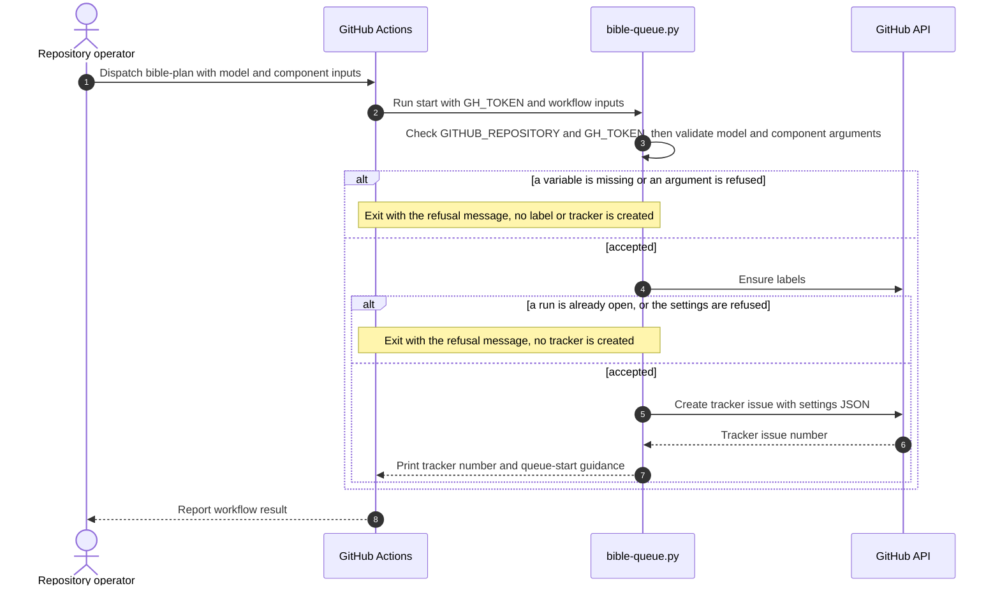
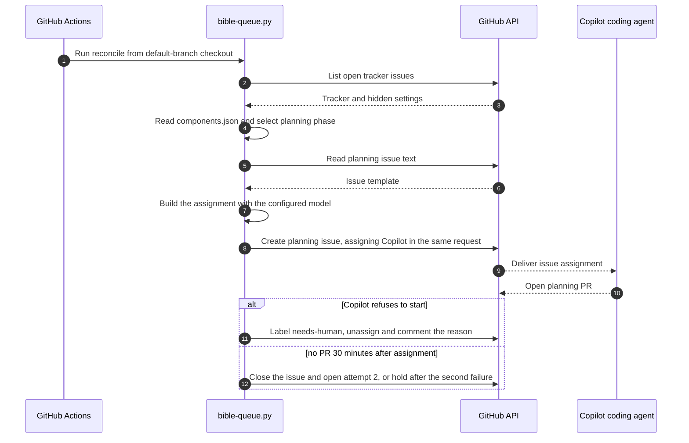
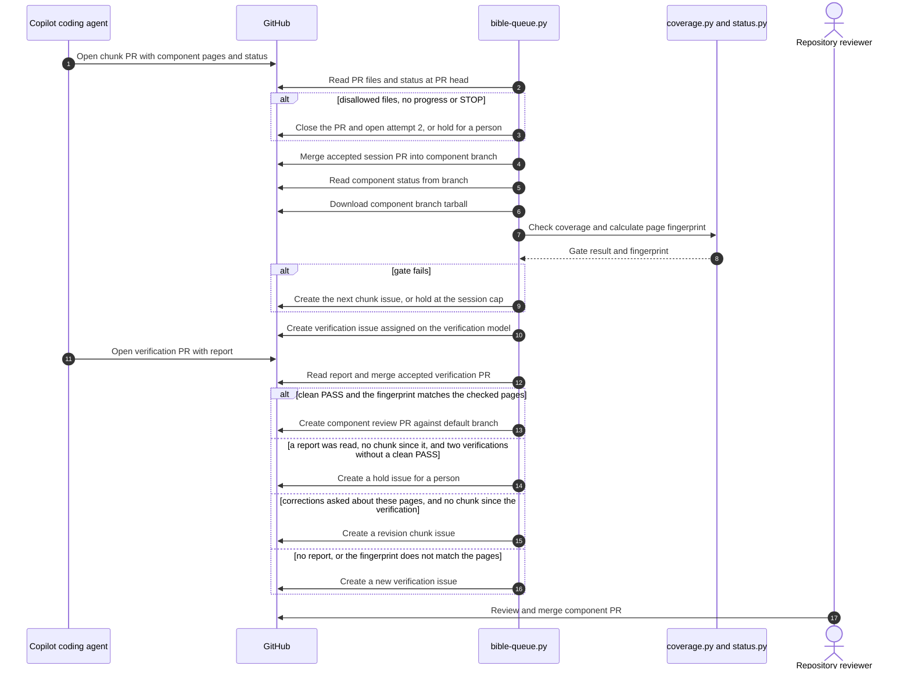
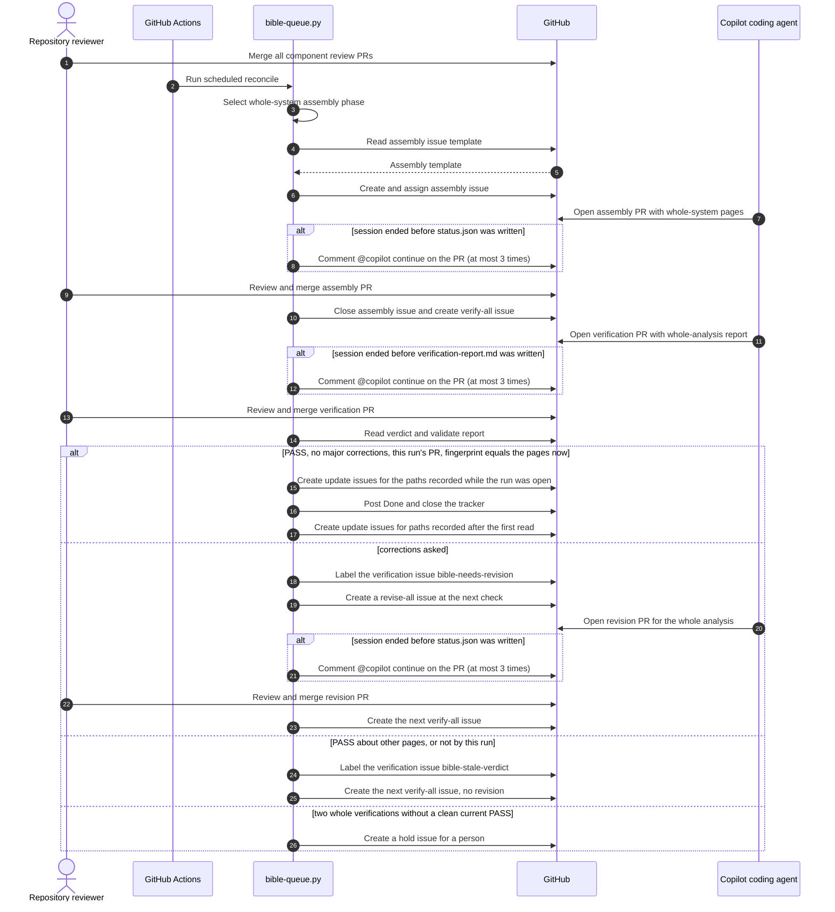
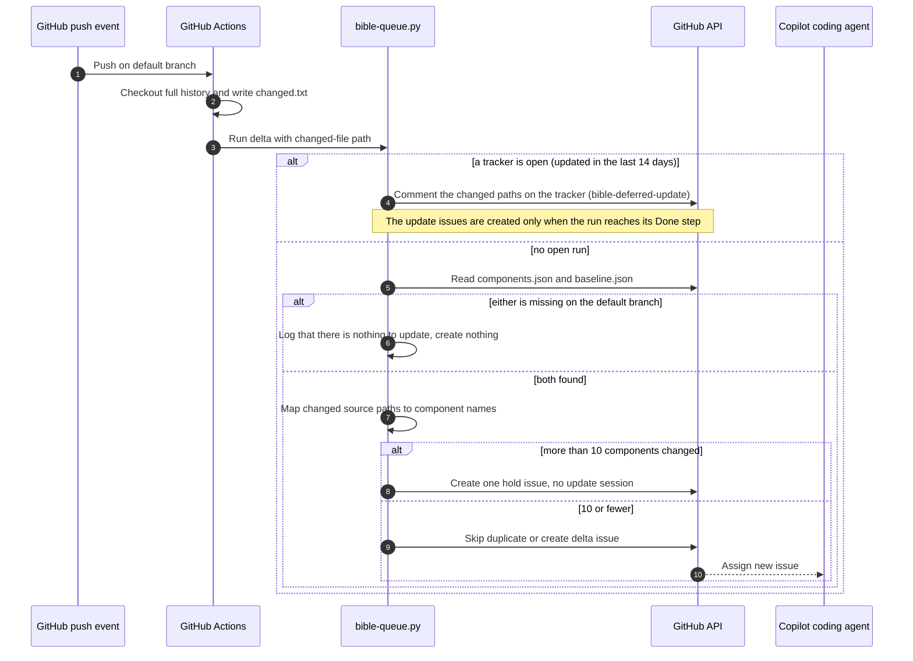
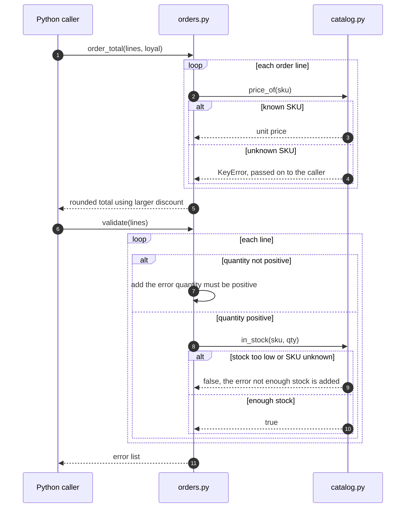
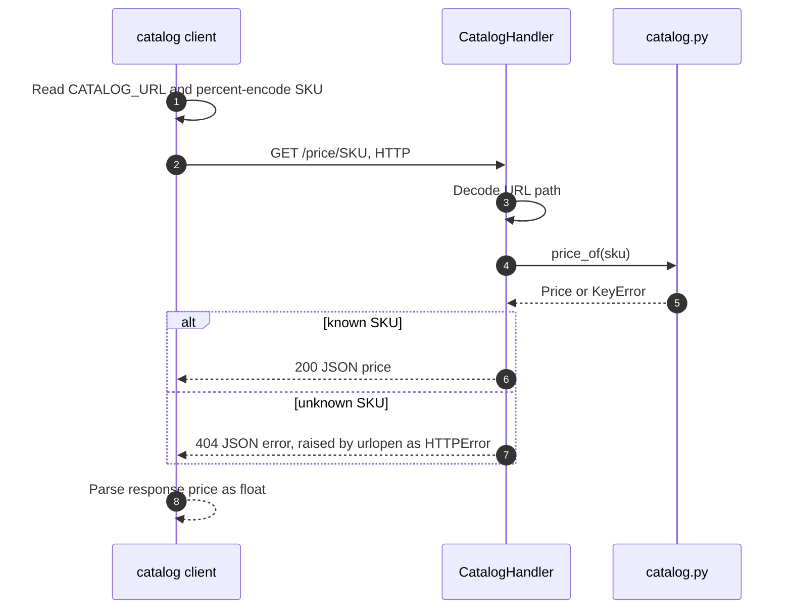
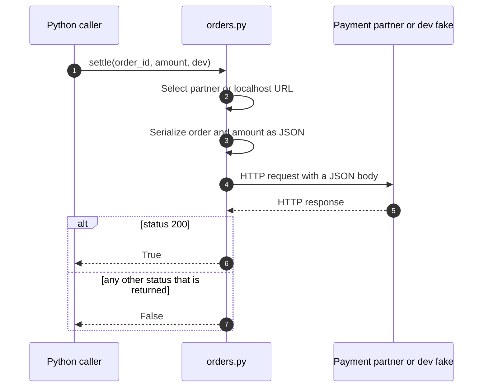
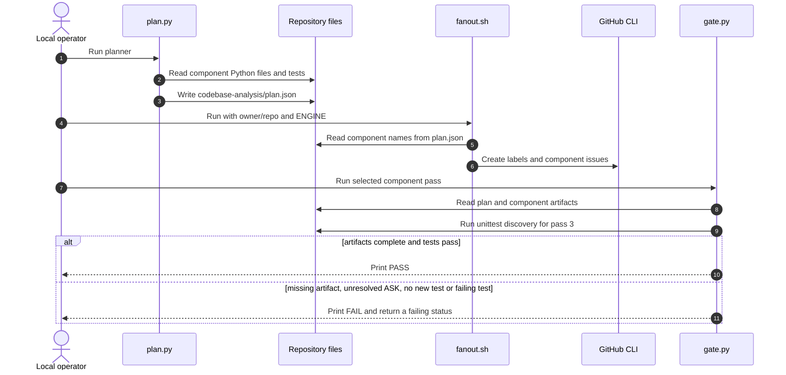
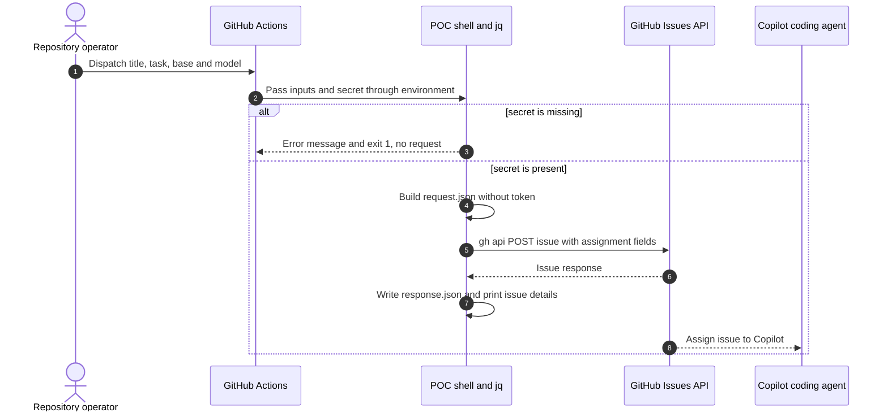

# Key flows

| # | Flow | Trigger | Components | Endpoint cards |
| --- | --- | --- | --- | --- |
| 1 | Start an analysis run | Operator dispatches `bible-plan` | GitHub Actions, `bible_queue.py`, GitHub | None |
| 2 | Queue creates and assigns the planning session | Queue schedule or manual dispatch | `bible_queue.py`, GitHub, Copilot | None |
| 3 | Component session passes the gate and reaches human review | Agent session PR and `COMPONENT_DONE` status | Queue, toolkit gate, Copilot, reviewer | None |
| 4 | Whole-analysis assembly and verification | All component review PRs are merged | Queue, assembly agent, verification agent, reviewer | None |
| 5 | Changed code produces component delta issues | Default-branch push | Delta workflow, queue, GitHub, Copilot | None |
| 6 | Order total and stock validation use the in-process catalog | Python caller invokes order functions | `orders`, `catalog` | None |
| 7 | Remote catalog client reads a price | Python caller or HTTP client test | `catalog_client`, catalog HTTP service | [Catalog API](../lld/api/catalog/catalog.md) |
| 8 | Settlement sends an order amount | Python caller invokes `settle` | `orders`, payment partner or local fake | None |
| 9 | Component plan, fanout and gate | Local operator runs the tools | `plan.py`, `fanout.sh`, `gate.py`, GitHub CLI | None |
| 10 | POC workflow creates and assigns a task issue | Operator dispatches the POC workflow | GitHub Actions, `gh`, GitHub, Copilot | None |

## 1. Start an analysis run

**Trigger:** An operator dispatches `bible-plan` from the default branch. **Outcome:** The workflow creates one tracker issue with the run settings; the queue starts the planning session on its next run.

| Step | What happens | Evidence |
| ---: | --- | --- |
| 1 | Operator dispatches the workflow and supplies the inputs. | `.github/workflows/bible-plan.yml:7-23` |
| 2 | Workflow checks the default branch (the job's `if:` condition), verifies `BIBLE_ASSIGN_TOKEN`, and invokes `start`. | `.github/workflows/bible-plan.yml:36`, `.github/workflows/bible-plan.yml:40-54` |
| 3 | `main` exits unless `GITHUB_REPOSITORY` and `GH_TOKEN` are set, then validates the model and component arguments. | `.github/bible/bible_queue.py:1302-1304`, `.github/bible/bible_queue.py:1309-1313` |
| 4 | Queue ensures labels (before either refusal), refuses an open tracker and refused settings, and then creates a tracker issue with settings in a hidden JSON comment. | `.github/bible/bible_queue.py:1314-1322` |
| 5 | GitHub returns the tracker issue number. | `.github/bible/bible_queue.py:1322-1323` |
| 6 | CLI prints the issue number and queue-start guidance. | `.github/bible/bible_queue.py:1323-1324` |
| 7 | Workflow reports its result to the operator. | `.github/workflows/bible-plan.yml:50-54` |

**Failure paths:** A non-default branch skips the job (`if:` at line 36); missing secret exits with an error; invalid models, components, missing repository/token settings, or an already-open tracker terminate `start` rather than creating a second run (`.github/workflows/bible-plan.yml:36`, `.github/workflows/bible-plan.yml:52-54`; `.github/bible/bible_queue.py:1302-1321`).

## 2. Queue creates and assigns the planning session

**Trigger:** The 15-minute schedule or a manual queue dispatch. **Outcome:** Reconciliation reads GitHub state and opens/assigns the next planning issue.

| Step | What happens | Evidence |
| ---: | --- | --- |
| 1 | The queue workflow starts on schedule or manual dispatch and checks out the default branch. | `.github/workflows/bible-queue.yml:7-10`, `.github/workflows/bible-queue.yml:23-37` |
| 2 | `reconcile` lists open tracker issues. | `.github/bible/bible_queue.py:151-153`, `.github/bible/bible_queue.py:607` |
| 3 | GitHub returns the tracker and its hidden settings. | `.github/bible/bible_queue.py:141-153`, `.github/bible/bible_queue.py:405-425` |
| 4 | Queue loads `components.json` and selects planning when the catalog is missing, proposed, or invalid. | `.github/bible/bible_queue.py:628-630` |
| 5 | Queue reads the planning issue text from `ledger/issues/plan.md`. | `.github/bible/bible_queue.py:674-678` |
| 6 | GitHub returns the issue template. | `.github/bible/bible_queue.py:194-198`, `.github/bible/bible_queue.py:436-442` |
| 7 | Queue builds the assignment: the target repository, the base branch and, when one is set, the configured analysis model. | `.github/bible/bible_queue.py:445-449`, `.github/bible/bible_queue.py:680` |
| 8 | Queue creates the planning issue; the same create request assigns Copilot (its payload carries `assignees` and `agent_assignment`), so there is no separate assign call. | `.github/bible/bible_queue.py:169-173`, `.github/bible/bible_queue.py:679-680` |
| 9 | GitHub delivers the issue assignment to Copilot (assumed: GitHub performs the assignment named in the request). | `.github/bible/bible_queue.py:170-173` |
| 10 | Agent work and PR status return through GitHub issue timelines and pull requests. | `.github/bible/bible_queue.py:204-234`, `.github/bible/bible_queue.py:517-533` |

**Failure paths:** An unreadable tracker settings block is logged and skipped; a per-tracker exception does not stop reconciliation of other trackers. A detected start error creates a human hold; a no-PR timeout retries once, then requires a person (`.github/bible/bible_queue.py:609-615`, `.github/bible/bible_queue.py:686-690`, `.github/bible/bible_queue.py:574-601`).

## 3. Component session passes the gate and reaches human review

**Trigger:** Component work produces a session PR and a `COMPONENT_DONE` status. **Outcome:** A matching clean verification opens a component review PR to the default branch.

| Step | What happens | Evidence |
| ---: | --- | --- |
| 1 | Queue finds the agent's open chunk PR and checks the PR's changed files. | `.github/bible/bible_queue.py:508-514`, `.github/bible/bible_queue.py:824`, `.github/bible/bible_queue.py:835-850` |
| 2 | Queue validates changed paths and reads status JSON at the PR head. | `.github/bible/bible_queue.py:841-851` |
| 3 | A valid session PR is marked ready if draft, merged into the component branch, and its issue is closed. | `.github/bible/bible_queue.py:354-368`, `.github/bible/bible_queue.py:875-878` |
| 4 | Queue reads the merged component status; on `COMPONENT_DONE`, it starts the gate. | `.github/bible/bible_queue.py:742-747` |
| 5 | Queue unpacks the branch tarball in a temporary directory. | `.github/bible/bible_queue.py:291-330`, `.github/bible/bible_queue.py:886-889` |
| 6 | Queue runs coverage and fingerprint checks using scripts from the configured toolkit path. | `.github/bible/bible_queue.py:882-900` |
| 7 | Gate returns its pass/fail result and page fingerprint. | `.github/bible/bible_queue.py:897-900` |
| 8 | Queue creates a verification issue assigned on `verify_model`; `start` refuses a `--verify-model` that equals `--model` (inferred: a search of `bible_queue.py` for `verify_model` finds 6 hits, and only line 1309 compares it with `model`). | `.github/bible/bible_queue.py:810-819`, `.github/bible/bible_queue.py:1309-1310` |
| 9 | Verification agent opens a PR containing the verification report. | `.github/bible/bible_queue.py:821-824`, `.github/bible/bible_queue.py:872-874` |
| 10 | Queue merges the eligible verification PR and reads its verdict/fingerprint. | `.github/bible/bible_queue.py:875-878`, `.github/bible/bible_queue.py:469-482`, `.github/bible/bible_queue.py:777` |
| 11 | A clean `PASS` whose fingerprint matches the checked pages creates a PR for a person to review. | `.github/bible/bible_queue.py:778-782` |
| 12 | Human reviewer merges the component PR to the default branch (inferred: the module docstring at line 28, and `merge` is called only at line 875, for session pull requests into the component branch). | `.github/bible/bible_queue.py:28`, `.github/bible/bible_queue.py:715-716` |

**Failure paths:** Disallowed PR files, `STOP`, no progress, missing verification report, or a revision that does not reach `COMPONENT_DONE` triggers the one-retry/hold logic. `WAITING_ANSWER` labels the issue and PR. A failed gate starts more component work; a report with corrections, an unreadable or stale fingerprint, or repeated non-clean verification leads to revision, re-verification, or a human hold (`.github/bible/bible_queue.py:582-601`, `.github/bible/bible_queue.py:841-874`, `.github/bible/bible_queue.py:753-809`).

## 4. Whole-analysis assembly and verification

**Trigger:** Component review PRs have been merged. **Outcome:** Assembly and a second-model verification are merged; a clean whole-analysis report that is about the pages now, and was written by this run's own pull request, closes the tracker. A report that asks for corrections starts one revision of the whole analysis and then a second verification; after two whole verifications without a clean, current `PASS` a person decides.

| Step | What happens | Evidence |
| ---: | --- | --- |
| 1 | Component PRs are merged by a person; scripts do not merge work to the default branch (inferred: the module docstring at line 28, and `merge` is called only at line 875, for session pull requests into the component branch). | `.github/bible/bible_queue.py:28`, `.github/bible/bible_queue.py:715-716` |
| 2 | Queue workflow invokes reconciliation. | `.github/workflows/bible-queue.yml:7-10`, `.github/workflows/bible-queue.yml:23-37` |
| 3 | Queue selects the whole-system assembly phase when every wanted component's row is `merged`. | `.github/bible/bible_queue.py:666-667` |
| 4 | Queue reads the assembly issue template. | `.github/bible/bible_queue.py:1027-1028` |
| 5 | GitHub returns the assembly template. | `.github/bible/bible_queue.py:436-442` |
| 6 | Queue creates and assigns the assembly issue. | `.github/bible/bible_queue.py:1033-1035` |
| 7 | Assembly agent opens a PR with whole-system pages. When its session has ended but the PR does not yet contain the assembly's `status.json`, the queue comments `@copilot continue ...` on the PR (the comment ends with the marker `CONTINUE_MARK`), at most `MAX_CONTINUE` (3) times; when Copilot failed before it started any work, the queue holds the issue for a person at once. | `.github/bible/bible_queue.py:508-514`, `.github/bible/bible_queue.py:1022-1026`, `.github/bible/bible_queue.py:1154-1207`; `codebase-analysis/ledger/issues/assemble.md` (the folder is the tracker's `analysis` setting, default `codebase-analysis`, `.github/bible/bible_queue.py:618`) |
| 8 | A person reviews and merges the assembly PR to the default branch (inferred: the module docstring at line 28, and `merge` is called only at line 875, for session pull requests into the component branch). | `.github/bible/bible_queue.py:995-1011` |
| 9 | Queue closes the assembly issue and creates a verification issue using `verify_model`. | `.github/bible/bible_queue.py:939-941`, `.github/bible/bible_queue.py:1008`, `.github/bible/bible_queue.py:1029-1035` |
| 10 | Verification agent opens a PR with the whole-analysis report; the same continuation rule applies, with `verification-report.md` as the end marker. | `.github/bible/bible_queue.py:508-514`, `.github/bible/bible_queue.py:1022-1026`, `.github/bible/bible_queue.py:1162-1164` |
| 11 | A person reviews and merges the verification PR (inferred: the module docstring at line 28, and `merge` is called only at line 875, for session pull requests into the component branch). | `.github/bible/bible_queue.py:995-1011` |
| 12 | Queue reads the report. A report that is missing, unreadable, not `PASS`, or has major corrections is not the end of the run: the queue labels the verification issue `bible-needs-revision`, comments, and reports "corrections asked ... revision next". An issue the queue sees still open (its merged pull request has not closed it) is also closed as not planned; an issue GitHub has already closed as completed is only labelled and commented (assumed: GitHub closes the issue when the pull request saying "Fixes #N" is merged, as the comment at lines 948-949 says). | `.github/bible/bible_queue.py:999-1007`, `.github/bible/bible_queue.py:947-951`, `.github/bible/bible_queue.py:981-985` |
| 13 | Next check, `revise_all_step`: the queue creates a `bible-revise-all` issue for Copilot that asks it to use the skill in revision mode on the whole analysis, apply every correction of `verification-report.md` without editing it, and finish with `status.py --write`. A revision pull request may change only files under the analysis folder, never `verification-*` files, else it is retried or held. A person merges it (inferred: the module docstring at line 28, and `merge` is called only at line 875, for session pull requests into the component branch), the queue closes the revise-all issue, and the next whole verification issue is created. A finished revise-all session that ends unfinished is continued as in step 7, with `status.json` as the end marker. | `.github/bible/bible_queue.py:1074-1152`, `.github/bible/bible_queue.py:1101-1105`, `.github/bible/bible_queue.py:1121-1126`, `.github/bible/bible_queue.py:1143-1152` |
| 14 | A clean `PASS` ends the run only when three things hold: no major correction, the fingerprint printed in the report equals the fingerprint of the whole analysis on the default branch now (`status.py --fingerprint` on a downloaded tarball), and the report on the default branch is the one written by a merged pull request of this run's own verification issue. A `PASS` that is not about the pages now, or not by this run, is labelled `bible-stale-verdict` and verified again. | `.github/bible/bible_queue.py:947-980`, `.github/bible/bible_queue.py:920-935` |
| 15 | Only here, at the Done step, does the queue read the paths recorded on the tracker while the run was open (inferred: a search of the queue for `deferred_updates(` finds 3 hits, the definition and the two calls at lines 1038 and 1043) (see flow 5) and create their update issues; then it comments "Done" and closes the tracker, reads the recorded paths once more, and creates update issues for any that arrived after the first read. An error in the first step is not caught there: the tracker stays open and the next check tries again; an error in the late step is commented on the closed tracker with the files to update by hand. | `.github/bible/bible_queue.py:1036-1042`, `.github/bible/bible_queue.py:1043-1049`, `.github/bible/bible_queue.py:1052-1064`, `.github/bible/bible_queue.py:612-615` |

**Failure paths:** A whole verification that is missing, unreadable, not `PASS` or has major corrections does not stop for a person: it starts the revision loop in steps 12-13. On the verdict alone, a person is asked only after `MAX_VERIFY_ROUNDS` (2) whole verifications without a clean, current `PASS` (verdicts that asked for corrections plus stale ones, counted since a person last released the run): the queue creates the issue "the whole analysis needs a person" with the labels `bible-hold`, `bible-whole` and `bible-needs-human`; removing the label starts new rounds (`.github/bible/bible_queue.py:76`, `.github/bible/bible_queue.py:1089-1097`, `.github/bible/bible_queue.py:1136-1142`, `.github/bible/bible_queue.py:1066-1072`). A fingerprint that cannot be computed now is counted, and after `MAX_NOCHECK` (3) checks in a row a person is asked; when too little of the run's time is left the check waits for the next run (`.github/bible/bible_queue.py:964-971`, `.github/bible/bible_queue.py:89`). A held assembly, revision or verification session, a failed start, or a session that does not start within 30 minutes follows the same retry and hold rules as a component session, except that when a person releases a held whole-analysis session it is assigned to Copilot again, where a released component session is closed as not planned and its next step is decided afresh (`.github/bible/bible_queue.py:1012-1026`, `.github/bible/bible_queue.py:1099-1127`, `.github/bible/bible_queue.py:558-568`). A pull request file list that cannot be completed raises a `RuntimeError` that is not caught here (inferred: `assemble_phase` and `revise_all_step` have no `except` around those calls, lines 937-1050 and 1074-1152, except the late replay at 1045-1049), so that tracker's run ends with a logged error and is tried again at the next check (`.github/bible/bible_queue.py:959`, `.github/bible/bible_queue.py:1121`, `.github/bible/bible_queue.py:612-615`).

## 5. Changed code produces component delta issues

**Trigger:** A push on the default branch that changes any file outside `codebase-analysis/**` and `.github/skills/**` (assumed: GitHub's `paths-ignore` filter). **Outcome:** While an analysis run is open (its tracker updated in the last 14 days) the change is only recorded on the tracker, and its update issues are created only when the run ends through its Done step (if a person closes the tracker, or the run never finishes, they are never created for those paths (inferred: `deferred_updates` is called only at `.github/bible/bible_queue.py:1038` and `.github/bible/bible_queue.py:1043`); a later update issue for the same component asks for every change since the baseline, `.github/bible/bible_queue.py:1273-1277`); otherwise the queue maps the changed paths to components and creates one update issue per affected component, or one hold issue when more than 10 components changed.

| Step | What happens | Evidence |
| ---: | --- | --- |
| 1 | Push workflow runs for default-branch changes (job condition) and ignores only `codebase-analysis/**` and `.github/skills/**`; a push that changes workflows or queue code under `.github/` starts it (assumed: GitHub's `paths-ignore` filter). | `.github/workflows/bible-delta.yml:6-12`, `.github/workflows/bible-delta.yml:19` |
| 2 | Workflow checks out full history and writes changed paths to `$RUNNER_TEMP/changed.txt`. | `.github/workflows/bible-delta.yml:20-25`, `.github/workflows/bible-delta.yml:34-37` |
| 3 | CLI reads nonempty path lines and passes them to `Queue.delta`. | `.github/bible/bible_queue.py:1328-1330` |
| 4 | When a tracker issue is open and its own `Updated` line (its creation time when it has none) is no older than 14 days (`ABANDONED_AFTER`), the queue does not create update issues: it comments the plain paths on the first such tracker, in comments of at most 200 paths, each with a hidden `bible-deferred-update` marker, and returns. | `.github/bible/bible_queue.py:1226-1242`, `.github/bible/bible_queue.py:390-391` |
| 5 | The update issues for those paths are created only when the run ends through its Done step: the assembly phase reads the marked comments the queue itself wrote, runs the update for them before it closes the tracker, and once more for paths recorded after the first read. `reconcile` visits only open trackers (inferred: `deferred_updates` is called only at lines 1038 and 1043), so paths recorded on a tracker that a person closes, or on a run that never reaches Done, are never replayed: they get no update issue of their own, and the next update issue for the same component, created by a later push, asks its session for every change since the analysis's baseline. The replay goes through `delta`: with no `components.json` or no `ledger/baseline.json` on the default branch the paths are dropped with only a log line, more than 10 touched components give one hold issue, and a component that already has an open update issue is skipped. | `.github/bible/bible_queue.py:607`, `.github/bible/bible_queue.py:1038-1050`, `.github/bible/bible_queue.py:1052-1064`, `.github/bible/bible_queue.py:1273-1277`, `.github/bible/bible_queue.py:1243-1246`, `.github/bible/bible_queue.py:1255-1264`, `.github/bible/bible_queue.py:1270-1272` |
| 6 | With no open run, the queue requires `components.json` and `ledger/baseline.json` on the default branch. | `.github/bible/bible_queue.py:1243-1246` |
| 7 | Queue maps changed source paths (not the analysis folder, not the skills folder) to component names with the toolkit's `components` helpers. | `.github/bible/bible_queue.py:1247-1254`, `.github/bible/bible_queue.py:1265-1269` |
| 8 | When more than `MAX_DELTA_ISSUES` (10) components are touched, the queue creates one hold issue labelled `bible-delta` and `bible-needs-human` (unless one is open) and starts no update session. | `.github/bible/bible_queue.py:1255-1264`, `.github/bible/bible_queue.py:392` |
| 9 | Otherwise it skips a component that already has an open delta issue, or creates a new issue. | `.github/bible/bible_queue.py:1270-1283` |
| 10 | GitHub assigns each newly created issue to Copilot (assumed: GitHub performs the assignment named in the request). | `.github/bible/bible_queue.py:1273-1282` |

**Failure paths:** The first push with no prior SHA exits without a delta run. Missing catalog or baseline makes the queue log that there is nothing to update. Empty paths or paths outside component ownership produce no issue; an already-open delta issue is not duplicated; a push that touches more than 10 components gives a hold issue instead of update sessions (`.github/workflows/bible-delta.yml:34-38`; `.github/bible/bible_queue.py:1243-1246`, `.github/bible/bible_queue.py:1255-1264`, `.github/bible/bible_queue.py:1270-1283`). While a run is open the update waits for the run's Done step; if the tracker is closed by a person or the run never finishes, those paths get no update issue of their own (inferred: `reconcile` lists open trackers only, `.github/bible/bible_queue.py:607`, and `deferred_updates` is called only at lines 1038 and 1043), and a later update issue for the same component asks for every change since the baseline (`.github/bible/bible_queue.py:1273-1277`). A paths-ignored push, or one that changes only the analysis or the skills, does not start the workflow at all (assumed: GitHub's `paths-ignore` filter) (`.github/workflows/bible-delta.yml:10-12`).

## 6. Order total and stock validation use the in-process catalog

**Trigger:** Python caller invokes `order_total` and `validate`. **Outcome:** The caller receives a rounded total and a list of quantity/stock errors; `order_total` and `validate` persist no order or stock reservation (`components/orders/orders.py:23-42`).

| Step | What happens | Evidence |
| ---: | --- | --- |
| 1 | Caller supplies `(sku, qty)` lines and a loyalty flag. | `components/orders/orders.py:23-24` |
| 2 | `order_total` requests each line's price from `catalog.price_of`. | `components/orders/orders.py:19-25` |
| 3 | Catalog returns the price for a known SKU. | `components/catalog/catalog.py:20-25` |
| 4 | `order_total` selects the larger loyalty/bulk discount and returns the rounded total. | `components/orders/orders.py:14-16`, `components/orders/orders.py:26-32` |
| 5 | Caller invokes `validate` on the lines. | `components/orders/orders.py:35` |
| 6 | Validation rejects nonpositive quantities or asks the catalog whether stock is sufficient. | `components/orders/orders.py:35-42` |
| 7 | Catalog returns stock availability for the SKU. | `components/catalog/catalog.py:27-29` |
| 8 | Validation returns one error string per invalid line; no stock is decremented or order record written. | `components/orders/orders.py:35-42` |

**Failure paths:** Unknown SKU raises `KeyError` during total calculation. Validation accumulates `"quantity must be positive"` or `"not enough stock"` errors for invalid lines (`components/catalog/catalog.py:20-29`; `components/orders/orders.py:23-42`).

## 7. Remote catalog client reads a price

**Trigger:** Caller uses `remote_price` or `remote_line_total`; the repository's test starts the catalog service on loopback. **Outcome:** Client reads the JSON price and converts it to a float.

| Step | What happens | Evidence |
| ---: | --- | --- |
| 1 | Client reads `CATALOG_URL` and quotes the SKU. | `components/orders/catalog_client.py:11`, `components/orders/catalog_client.py:14-21` |
| 2 | Client sends the request, with no body (assumed: library behaviour, `urlopen` then sends a GET), with its configured timeout (default 5 seconds). | `components/orders/catalog_client.py:19-23` |
| 3 | Handler extracts the URL path. | `components/catalog/service.py:24-25` |
| 4 | Handler decodes the SKU and calls `price_of`. | `components/catalog/service.py:28-31` |
| 5 | Catalog returns a price or raises `KeyError` for an unknown SKU. | `components/catalog/catalog.py:20-24` |
| 6 | Server returns `200` with `sku` and `price`, or `404` with an error. | `components/catalog/service.py:28-34` |
| 7 | Client loads the JSON body and converts `price` to `float`. | `components/orders/catalog_client.py:22-23` |

**Failure paths:** Unknown SKUs return 404, which `urlopen` surfaces as `HTTPError` (assumed: library behaviour, and the docstring at `components/orders/catalog_client.py:20` says the same); invalid JSON, missing fields, timeouts, and connection errors are not translated by the client (inferred: `remote_price` has no `except`, `components/orders/catalog_client.py:19-23`). The HTTP client path has test callers only in this repository (inferred: a search of the repository outside the analysis folder and the skills for `remote_price` and `remote_line_total` finds 10 hits: callers only in `test_catalog_client.py`, and `remote_line_total` calling `remote_price` in `catalog_client.py` itself) (`components/orders/catalog_client.py:19-23`; `components/orders/catalog_client.py:26-29`; `components/orders/test_catalog_client.py:37-62`).

## 8. Settlement sends an order amount

**Trigger:** Python caller invokes `settle(order_id, amount, dev=False)`. **Outcome:** It sends JSON and returns whether a received response has status 200.

| Step | What happens | Evidence |
| ---: | --- | --- |
| 1 | Caller supplies the order identifier, amount, and optional development flag. | `components/orders/orders.py:45` |
| 2 | `dev=True` selects `localhost:8099`; otherwise the hard-coded partner URL is used. | `components/orders/orders.py:7-12`, `components/orders/orders.py:47` |
| 3 | Code serializes `order` and `amount` as JSON. | `components/orders/orders.py:48-49` |
| 4 | Code sends the request, a JSON body with no method set (assumed: library behaviour, `urllib` then sends a POST), with a 15-second timeout by default. | `components/orders/orders.py:45`, `components/orders/orders.py:49-50` |
| 5 | Partner returns an HTTP response. | `components/orders/orders.py:49-51` |
| 6 | Function returns whether the response status equals 200. | `components/orders/orders.py:50-51` |

**Failure paths:** Network and HTTP errors from `urlopen` propagate (assumed: library behaviour, `urlopen` raises `HTTPError` for an error status); a non-200 response that is returned yields `False`. No retry or idempotency key is shown (`components/orders/orders.py:45-51`).

## 9. Component plan, fanout and gate

**Trigger:** Local operator runs the planning command and then fans out issues; the gate is run for a component pass. **Outcome:** Plan JSON is generated, issues are opened, and each gate reports pass/failure.

| Step | What happens | Evidence |
| ---: | --- | --- |
| 1 | Operator runs the planner. | `tools/plan.py:41-62` |
| 2 | Planner scans component Python files, functions, tests, and literal HTTP URLs. | `tools/plan.py:21-38` |
| 3 | Planner writes versioned JSON to `codebase-analysis/plan.json`. | `tools/plan.py:41-58` |
| 4 | Operator runs fanout with a repository and engine selection. | `tools/fanout.sh:2-8` |
| 5 | Fanout reads component names from `plan.json`. | `tools/fanout.sh:9` |
| 6 | Fanout creates labels and issues through `gh`. | `tools/fanout.sh:10-29` |
| 7 | Operator runs the component gate for a selected pass. | `tools/gate.py:81-92` |
| 8 | Gate reads the plan and component pass artifacts. | `tools/gate.py:42-65`, `tools/gate.py:86-108` |
| 9 | For pass 3, gate invokes unittest discovery. | `tools/gate.py:63-78` |
| 10 | Gate prints PASS/FAIL and returns its process status. | `tools/gate.py:23-26`, `tools/gate.py:109-117` |

**Failure paths:** File/AST/JSON errors stop the relevant tool (assumed: library behaviour, an unreadable file, an `ast.parse` error or a `json.loads` error raises and ends the program), except that an invalid `status.json` makes the gate print FAIL (`tools/gate.py:95-98`); the gate fails on missing artifacts, unresolved `ASK`, no new test functions, or failing tests. `fanout.sh` exits on command failure (assumed: shell behaviour of `set -e`) and rejects an unknown engine (`tools/plan.py:21-58`; `tools/gate.py:42-78`, `tools/gate.py:94-108`; `tools/fanout.sh:6`, `tools/fanout.sh:24-30`).

## 10. POC workflow creates and assigns a task issue

**Trigger:** Operator dispatches the standalone POC workflow. **Outcome:** A GitHub issue is created and assigned directly to Copilot; the workflow does not check out repository code (`.github/workflows/poc-assign-copilot.yml:34-72`: its one step is the inline script).

| Step | What happens | Evidence |
| ---: | --- | --- |
| 1 | Operator supplies required title, task, base branch and optional model. | `.github/workflows/poc-assign-copilot.yml:11-29` |
| 2 | Workflow passes input values and `BIBLE_ASSIGN_TOKEN` into environment variables; the job performs no checkout. | `.github/workflows/poc-assign-copilot.yml:34-72` |
| 3 | Shell exits if the token is missing. | `.github/workflows/poc-assign-copilot.yml:49-53` |
| 4 | `jq` creates `request.json` with issue body, assignee and `agent_assignment`; the token is not included in the JSON payload. | `.github/workflows/poc-assign-copilot.yml:55-64` |
| 5 | `gh api` creates the issue. | `.github/workflows/poc-assign-copilot.yml:66-69` |
| 6 | GitHub returns the issue response. | `.github/workflows/poc-assign-copilot.yml:66-69` |
| 7 | Shell writes `response.json` and prints issue details. | `.github/workflows/poc-assign-copilot.yml:68-72` |
| 8 | GitHub assigns the issue to Copilot (assumed: GitHub performs the assignment named in the request). | `.github/workflows/poc-assign-copilot.yml:65-72` |

**Failure paths:** Missing `BIBLE_ASSIGN_TOKEN` exits before request creation; invalid input or API/CLI errors stop the job under `set -euo pipefail` (assumed: shell behaviour of `set -e` and `pipefail`). Nothing retries (inferred: a search of the workflow for `retry` finds 0 hits); the job is limited to 5 minutes (`timeout-minutes: 5`), and the workflow sets no timeout on the `gh api` call (inferred: lines 66-69 pass no timeout option and wrap the call in no `timeout` command) (`.github/workflows/poc-assign-copilot.yml:37`, `.github/workflows/poc-assign-copilot.yml:66-69`).

<!-- cites .github/bible/bible_queue.py@5886e8a4b1928e02dee435ffad7e6f9a1e5ec075 -->

<!-- cites .github/workflows/bible-delta.yml@5317a1ada61df3db98cc21d8db6d1415fe732c58 -->

<!-- cites .github/workflows/bible-plan.yml@65016c0e6616ef12f74a26e6d6a4a5f566b584c1 -->

<!-- cites .github/workflows/bible-queue.yml@d54080b12d039672f31f0d0924cc380ded069010 -->

<!-- cites .github/workflows/poc-assign-copilot.yml@dab60e0d846bfee50726dce662df48fc186ca3d3 -->

<!-- cites components/catalog/catalog.py@1e15fdaab1fa3c720d99a864abb4cac9c8259421 -->

<!-- cites components/catalog/service.py@64e5abbab5e101fac6e56c67450ac4c6346198f1 -->

<!-- cites components/orders/catalog_client.py@469f9d282aab983cdd85f364e46bcd02ef6d3635 -->

<!-- cites components/orders/orders.py@33203a1b4d48a6d335cf411f56a54a7035a66ae0 -->

<!-- cites components/orders/test_catalog_client.py@1d32463e1cdc21bd3eee3bc1b6f31feb8ef40a2d -->

<!-- cites tools/fanout.sh@9ad43aa70e042837954fea1faf483f6c08e07470 -->

<!-- cites tools/gate.py@65eb0af527e554cfb2dadb9d0c8cd1ee6e975c99 -->

<!-- cites tools/plan.py@e1dae33df7990fe69b145146d570403758d0635e -->
