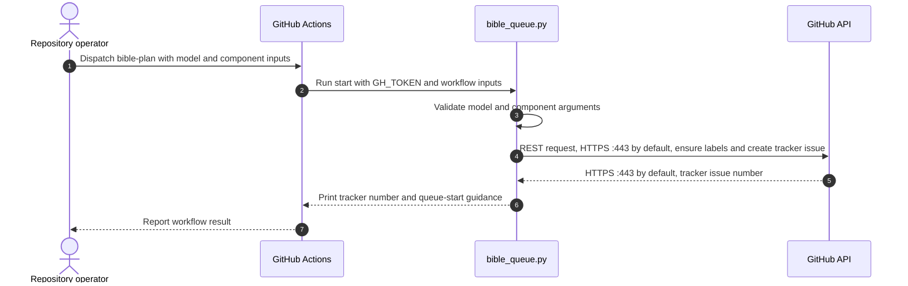
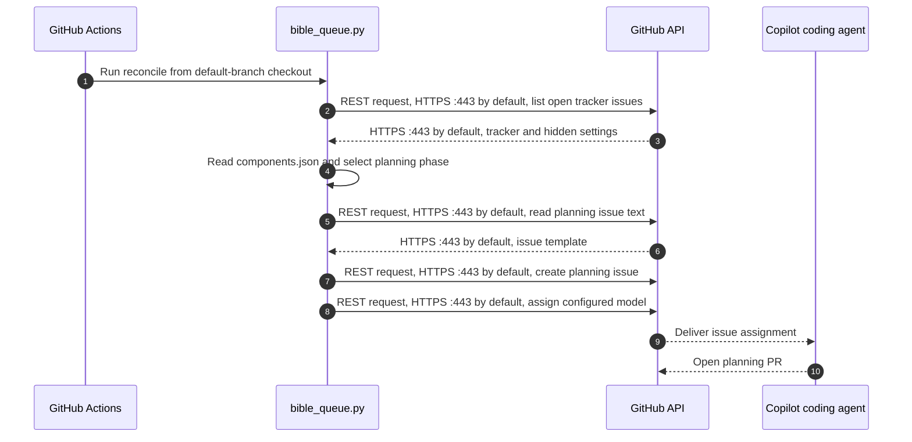
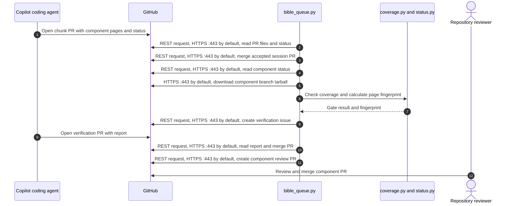
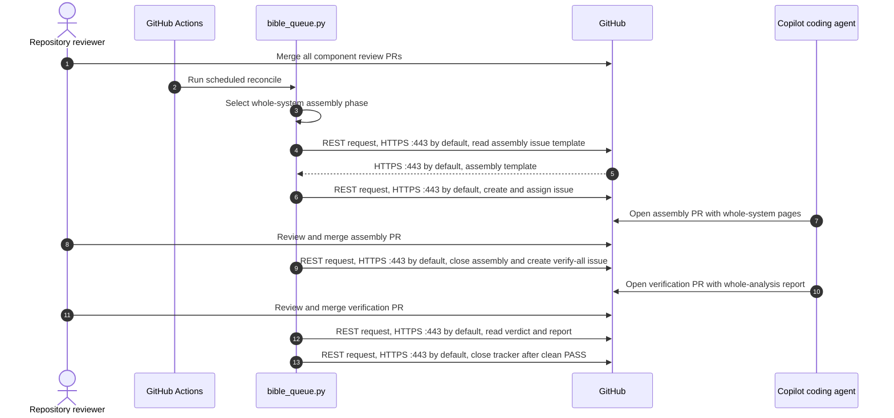
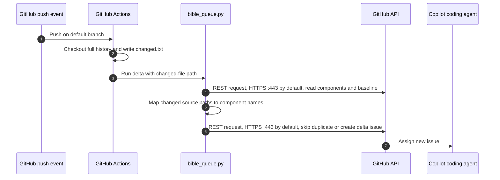
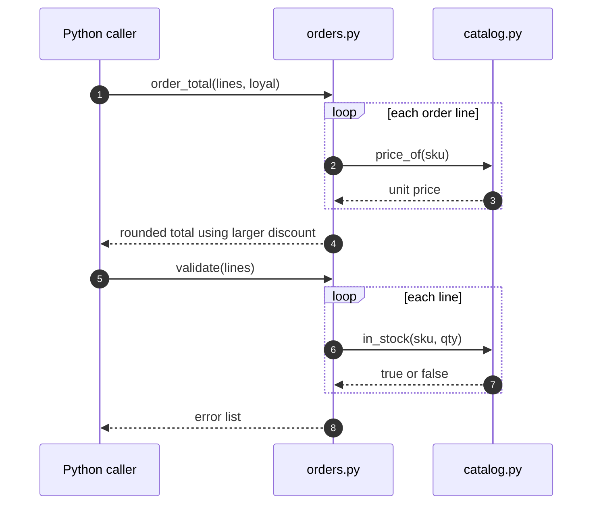
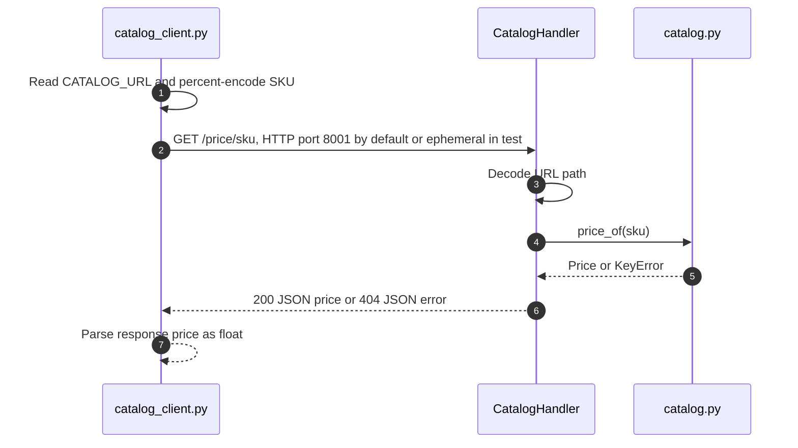
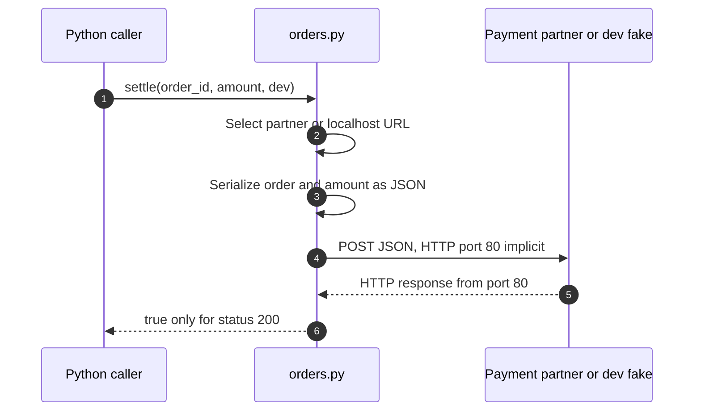
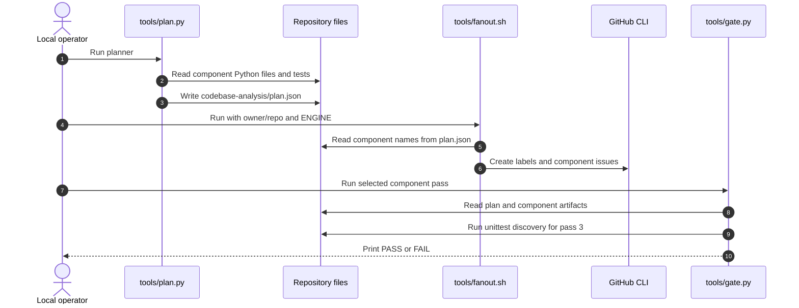
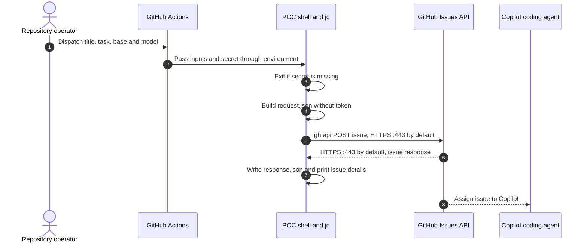

# Key flows

| # | Flow | Trigger | Components | Endpoint cards |
| --- | --- | --- | --- | --- |
| 1 | Start an analysis run | Operator dispatches `bible-plan` | GitHub Actions, `bible_queue.py`, GitHub | None |
| 2 | Queue creates and assigns the planning session | Queue schedule or manual dispatch | `bible_queue.py`, GitHub, Copilot | None |
| 3 | Component session passes the gate and reaches human review | Agent session PR and `COMPONENT_DONE` status | Queue, toolkit gate, Copilot, reviewer | None |
| 4 | Whole-analysis assembly and verification | All component review PRs are merged | Queue, assembly agent, verification agent, reviewer | None |
| 5 | Changed code produces component delta issues | Default-branch push | Delta workflow, queue, GitHub, Copilot | None |
| 6 | Order total and stock validation use the in-process catalog | Python caller invokes order functions | `orders`, `catalog` | None |
| 7 | Remote catalog client reads a price | Python caller or HTTP client test | `catalog_client`, catalog HTTP service | [Catalog API](../lld/api/catalog/catalog.md) |
| 8 | Settlement sends an order amount | Python caller invokes `settle` | `orders`, payment partner or local fake | None |
| 9 | Component plan, fanout and gate | Local operator runs the tools | `plan.py`, `fanout.sh`, `gate.py`, GitHub CLI | None |
| 10 | POC workflow creates and assigns a task issue | Operator dispatches the POC workflow | GitHub Actions, `gh`, GitHub, Copilot | None |

## 1. Start an analysis run

**Trigger:** An operator dispatches `bible-plan` from the default branch. **Outcome:** The workflow creates one tracker issue with the run settings; the queue starts the planning session on its next run.

| Step | What happens | Evidence |
| ---: | --- | --- |
| 1 | Operator dispatches the workflow and supplies the inputs. | `.github/workflows/bible-plan.yml:7-23` |
| 2 | Workflow checks the default branch, verifies `BIBLE_ASSIGN_TOKEN`, and invokes `start`. | `.github/workflows/bible-plan.yml:37-54` |
| 3 | `main` validates the model, component arguments, and settings. | `.github/bible/bible_queue.py:1267-1279` |
| 4 | Queue ensures labels, refuses an already-open tracker, and creates a tracker issue with settings in a hidden JSON comment. | `.github/bible/bible_queue.py:1272-1280` |
| 5 | GitHub returns the tracker issue number. | `.github/bible/bible_queue.py:1280-1281` |
| 6 | CLI prints the issue number and queue-start guidance. | `.github/bible/bible_queue.py:1281-1282` |
| 7 | Workflow reports its result to the operator. | `.github/workflows/bible-plan.yml:50-54` |

**Failure paths:** A non-default branch skips the job; missing secret exits with an error; invalid models, components, settings, missing repository/token settings, or an already-open tracker terminate `start` rather than creating a second run (`.github/workflows/bible-plan.yml:37-54`; `.github/bible/bible_queue.py:1260-1279`).

## 2. Queue creates and assigns the planning session

**Trigger:** The 15-minute schedule or a manual queue dispatch. **Outcome:** Reconciliation reads GitHub state and opens/assigns the next planning issue.

| Step | What happens | Evidence |
| ---: | --- | --- |
| 1 | The queue workflow starts on schedule or manual dispatch and checks out the default branch. | `.github/workflows/bible-queue.yml:7-10,23-37` |
| 2 | `reconcile` lists open tracker issues. | `.github/bible/bible_queue.py:129-131,486-488` |
| 3 | GitHub returns the tracker and its hidden settings. | `.github/bible/bible_queue.py:129-131,316-321` |
| 4 | Queue selects planning when `components.json` is missing, non-dict, marked proposed, or lacks a list-valued `components` field. | `.github/bible/bible_queue.py:601-603` |
| 5 | Queue reads the planning issue text from `ledger/issues/plan.md`. | `.github/bible/bible_queue.py:645-652` |
| 6 | GitHub returns the issue template. | `.github/bible/bible_queue.py:645-652` |
| 7 | Queue creates the planning issue. | `.github/bible/bible_queue.py:144-151,538-546` |
| 8 | Queue assigns the configured analysis model. | `.github/bible/bible_queue.py:144-151,341-345` |
| 9 | GitHub delivers the issue assignment to Copilot. | `.github/bible/bible_queue.py:160-167` |
| 10 | Agent work and PR status return through GitHub issue timelines and pull requests. | `.github/bible/bible_queue.py:195-220,404-429` |

**Failure paths:** An unreadable tracker settings block is logged and skipped; a per-tracker exception does not stop reconciliation of other trackers. A detected start error creates a human hold; a no-PR timeout retries once, then requires a person (`.github/bible/bible_queue.py:481-487,455-474`).

## 3. Component session passes the gate and reaches human review

**Trigger:** Component work produces a session PR and a `COMPONENT_DONE` status. **Outcome:** A matching clean verification opens a component review PR to the default branch.

| Step | What happens | Evidence |
| ---: | --- | --- |
| 1 | Queue observes the chunk or verification session and its linked PR. | `.github/bible/bible_queue.py:794-810` |
| 2 | Queue validates allowed file paths and reads status JSON at the PR head. | `.github/bible/bible_queue.py:814-847` |
| 3 | A valid session PR is merged and its issue is closed. | `.github/bible/bible_queue.py:848-851` |
| 4 | Queue reads component status; on `COMPONENT_DONE`, it starts the gate. | `.github/bible/bible_queue.py:731-741` |
| 5 | Queue unpacks the branch tarball in a temporary directory. | `.github/bible/bible_queue.py:264-303,859-865` |
| 6 | Queue runs coverage and fingerprint checks using scripts from the configured toolkit path. | `.github/bible/bible_queue.py:853-879` |
| 7 | Gate returns its pass/fail result and page fingerprint. | `.github/bible/bible_queue.py:866-873` |
| 8 | Queue starts a verification issue using the distinct verification model. | `.github/bible/bible_queue.py:785-792` |
| 9 | Verification PR must contain a report before it can be merged. | `.github/bible/bible_queue.py:845-847` |
| 10 | Queue reads the verification verdict and fingerprint after the session is merged. | `.github/bible/bible_queue.py:753-780` |
| 11 | A clean `PASS` whose fingerprint matches the checked pages creates a PR for a person to review. | `.github/bible/bible_queue.py:765-779` |
| 12 | Human reviewer merges the component PR to the default branch. | `.github/bible/bible_queue.py:28,608-612` |

**Failure paths:** Disallowed PR files, `STOP`, no progress, missing verification report, or a revision that does not reach `COMPONENT_DONE` triggers the one-retry/hold logic. `WAITING_ANSWER` labels the issue and PR. A failed gate starts more component work; a report with corrections, an unreadable or stale fingerprint, or repeated non-clean verification leads to revision, re-verification, or a human hold (`.github/bible/bible_queue.py:455-483,659-713,608-627`).

## 4. Whole-analysis assembly and verification

**Trigger:** Component review PRs have been merged. **Outcome:** Assembly and a second-model verification are merged; a clean whole-analysis report closes the tracker.

| Step | What happens | Evidence |
| ---: | --- | --- |
| 1 | Component PRs are merged by a person; scripts do not merge work to the default branch. | `.github/bible/bible_queue.py:28,608-612` |
| 2 | Queue workflow invokes reconciliation. | `.github/workflows/bible-queue.yml:7-10,23-37` |
| 3 | Queue selects the whole-system assembly phase. | `.github/bible/bible_queue.py:779-783` |
| 4 | Queue reads the assembly issue template. | `.github/bible/bible_queue.py:332-338,765-766` |
| 5 | GitHub returns the assembly template. | `.github/bible/bible_queue.py:409-415` |
| 6 | Queue creates and assigns the assembly issue. | `.github/bible/bible_queue.py:1006-1008` |
| 7 | Assembly agent opens a PR with whole-system pages. | `.github/bible/bible_queue.py:404-409,765-772`; `ledger/issues/assemble.md` |
| 8 | A person reviews and merges the assembly PR to the default branch. | `.github/bible/bible_queue.py:787-795` |
| 9 | Queue closes the assembly issue and creates a verification issue using `verify_model`. | `.github/bible/bible_queue.py:746-754,768-773` |
| 10 | Verification agent opens a PR with the whole-analysis report. | `.github/bible/bible_queue.py:404-409,768-772` |
| 11 | A person reviews and merges the verification PR. | `.github/bible/bible_queue.py:787-795` |
| 12 | Queue reads the report and requires `PASS` with no major corrections. | `.github/bible/bible_queue.py:790-794` |
| 13 | Queue closes the tracker and posts `Done`. | `.github/bible/bible_queue.py:1014-1015` |

**Failure paths:** If whole verification is missing, unreadable, not `PASS`, or has major corrections, the queue returns a human-needed message rather than closing the tracker. If the assembly or verification session is held or fails to start, it reports that state and follows the retry/hold rules (`.github/bible/bible_queue.py:455-483,749-770`).

## 5. Changed code produces component delta issues

**Trigger:** A push on the default branch that changes files outside the ignored paths. **Outcome:** Queue maps changed paths to components and creates one update issue per affected component.

| Step | What happens | Evidence |
| ---: | --- | --- |
| 1 | Push workflow runs only for default-branch changes and ignores `.github/**` and `codebase-analysis/**`. | `.github/workflows/bible-delta.yml:6-10,18-20` |
| 2 | Workflow checks out full history and writes changed paths to `$RUNNER_TEMP/changed.txt`. | `.github/workflows/bible-delta.yml:21-23,29-36` |
| 3 | CLI reads nonempty path lines and passes them to `Queue.delta`. | `.github/bible/bible_queue.py:1285-1290` |
| 4 | Queue requires `components.json` and `ledger/baseline.json`. | `.github/bible/bible_queue.py:1201-1205` |
| 5 | Queue maps changed source paths to component names. | `.github/bible/bible_queue.py:839-846` |
| 6 | Queue skips a duplicate open delta issue or creates a new issue. | `.github/bible/bible_queue.py:846-858` |
| 7 | GitHub assigns each newly created issue to Copilot. | `.github/bible/bible_queue.py:849-857` |

**Failure paths:** The first push with no prior SHA exits without a delta run. Missing catalog or baseline makes the queue log that there is nothing to update. Empty paths or paths outside component ownership produce no issue; an already-open delta issue is not duplicated (`.github/workflows/bible-delta.yml:31-38`; `.github/bible/bible_queue.py:835-858`).

## 6. Order total and stock validation use the in-process catalog

**Trigger:** Python caller invokes `order_total` and `validate`. **Outcome:** The caller receives a rounded total and a list of quantity/stock errors; no order or stock reservation is persisted.

| Step | What happens | Evidence |
| ---: | --- | --- |
| 1 | Caller supplies `(sku, qty)` lines and a loyalty flag. | `components/orders/orders.py:23-24` |
| 2 | `order_total` requests each line's price from `catalog.price_of`. | `components/orders/orders.py:19-25` |
| 3 | Catalog returns the price for a known SKU. | `components/catalog/catalog.py:20-25` |
| 4 | `order_total` selects the larger loyalty/bulk discount and returns the rounded total. | `components/orders/orders.py:14-16,26-32` |
| 5 | Caller invokes `validate` on the lines. | `components/orders/orders.py:35` |
| 6 | Validation rejects nonpositive quantities or asks the catalog whether stock is sufficient. | `components/orders/orders.py:35-42` |
| 7 | Catalog returns stock availability for the SKU. | `components/catalog/catalog.py:27-29` |
| 8 | Validation returns one error string per invalid line; no stock is decremented or order record written. | `components/orders/orders.py:35-42` |

**Failure paths:** Unknown SKU raises `KeyError` during total calculation. Validation accumulates `"quantity must be positive"` or `"not enough stock"` errors for invalid lines (`components/catalog/catalog.py:20-29`; `components/orders/orders.py:23-42`).

## 7. Remote catalog client reads a price

**Trigger:** Caller uses `remote_price` or `remote_line_total`; the repository's test starts the catalog service on loopback. **Outcome:** Client reads the JSON price and converts it to a float.

| Step | What happens | Evidence |
| ---: | --- | --- |
| 1 | Client reads `CATALOG_URL` and quotes the SKU. | `components/orders/catalog_client.py:11,14-21` |
| 2 | Client sends GET with its configured timeout (default 5 seconds). | `components/orders/catalog_client.py:19-23` |
| 3 | Handler extracts the URL path. | `components/catalog/service.py:24-25` |
| 4 | Handler decodes the SKU and calls `price_of`. | `components/catalog/service.py:28-30` |
| 5 | Catalog returns a price or raises `KeyError` for an unknown SKU. | `components/catalog/catalog.py:20-24` |
| 6 | Server returns `200` with `sku` and `price`, or `404` with an error. | `components/catalog/service.py:28-34` |
| 7 | Client loads the JSON body and converts `price` to `float`. | `components/orders/catalog_client.py:22-23` |

**Failure paths:** Unknown SKUs return 404, which `urlopen` surfaces as `HTTPError`; invalid JSON, missing fields, timeouts, and connection errors are not translated by the client. The HTTP client path has test callers only in this repository (`components/orders/catalog_client.py:19-23`; `components/orders/test_catalog_client.py:37-62`).

## 8. Settlement sends an order amount

**Trigger:** Python caller invokes `settle(order_id, amount, dev=False)`. **Outcome:** It sends JSON and returns whether a received response has status 200.

| Step | What happens | Evidence |
| ---: | --- | --- |
| 1 | Caller supplies the order identifier, amount, and optional development flag. | `components/orders/orders.py:45` |
| 2 | `dev=True` selects `localhost:8099`; otherwise the hard-coded partner URL is used. | `components/orders/orders.py:7-12,47` |
| 3 | Code serializes `order` and `amount` as JSON. | `components/orders/orders.py:48-49` |
| 4 | Code sends the POST with a 15-second timeout by default. | `components/orders/orders.py:49-50` |
| 5 | Partner returns an HTTP response. | `components/orders/orders.py:49-51` |
| 6 | Function returns whether the response status equals 200. | `components/orders/orders.py:50-51` |

**Failure paths:** Network and HTTP errors from `urlopen` propagate; a non-200 response that is returned yields `False`. No retry or idempotency key is shown (`components/orders/orders.py:45-51`).

## 9. Component plan, fanout and gate

**Trigger:** Local operator runs the planning command and then fans out issues; the gate is run for a component pass. **Outcome:** Plan JSON is generated, issues are opened, and each gate reports pass/failure.

| Step | What happens | Evidence |
| ---: | --- | --- |
| 1 | Operator runs the planner. | `tools/plan.py:41-62` |
| 2 | Planner scans component Python files, functions, tests, and literal HTTP URLs. | `tools/plan.py:21-38` |
| 3 | Planner writes versioned JSON to `codebase-analysis/plan.json`. | `tools/plan.py:41-58` |
| 4 | Operator runs fanout with a repository and engine selection. | `tools/fanout.sh:2-8` |
| 5 | Fanout reads component names from `plan.json`. | `tools/fanout.sh:9` |
| 6 | Fanout creates labels and issues through `gh`. | `tools/fanout.sh:10-29` |
| 7 | Operator runs the component gate for a selected pass. | `tools/gate.py:81-92` |
| 8 | Gate reads the plan and component pass artifacts. | `tools/gate.py:42-65,86-108` |
| 9 | For pass 3, gate invokes unittest discovery. | `tools/gate.py:63-78` |
| 10 | Gate prints PASS/FAIL and returns its process status. | `tools/gate.py:23-26,109-117` |

**Failure paths:** File/AST/JSON errors stop the relevant tool; the gate fails on missing artifacts, unresolved `ASK`, no new test functions, or failing tests. `fanout.sh` exits on command failure and rejects an unknown engine (`tools/plan.py:21-58`; `tools/gate.py:42-78,94-108`; `tools/fanout.sh:6,24-30`).

## 10. POC workflow creates and assigns a task issue

**Trigger:** Operator dispatches the standalone POC workflow. **Outcome:** A GitHub issue is created and assigned directly to Copilot; the workflow does not check out repository code.

| Step | What happens | Evidence |
| ---: | --- | --- |
| 1 | Operator supplies required title, task, base branch and optional model. | `.github/workflows/poc-assign-copilot.yml:11-29` |
| 2 | Workflow passes input values and `BIBLE_ASSIGN_TOKEN` into environment variables; the job performs no checkout. | `.github/workflows/poc-assign-copilot.yml:34-48` |
| 3 | Shell exits if the token is missing. | `.github/workflows/poc-assign-copilot.yml:49-53` |
| 4 | `jq` creates `request.json` with issue body, assignee and `agent_assignment`; the token is not included in the JSON payload. | `.github/workflows/poc-assign-copilot.yml:55-64` |
| 5 | `gh api` creates the issue. | `.github/workflows/poc-assign-copilot.yml:65-68` |
| 6 | GitHub returns the issue response. | `.github/workflows/poc-assign-copilot.yml:65-68` |
| 7 | Shell writes `response.json` and prints issue details. | `.github/workflows/poc-assign-copilot.yml:68-72` |
| 8 | GitHub assigns the issue to Copilot. | `.github/workflows/poc-assign-copilot.yml:65-72` |

**Failure paths:** Missing `BIBLE_ASSIGN_TOKEN` exits before request creation; invalid input or API/CLI errors stop the job under `set -euo pipefail`. No retry or timeout is specified (`.github/workflows/poc-assign-copilot.yml:40-69`).

<!-- cites .github/bible/bible_queue.py@9084f4915d286441c5b3a9a29a8df059bf76dacc -->

<!-- cites .github/workflows/bible-delta.yml@5317a1ada61df3db98cc21d8db6d1415fe732c58 -->

<!-- cites .github/workflows/bible-plan.yml@65016c0e6616ef12f74a26e6d6a4a5f566b584c1 -->

<!-- cites .github/workflows/poc-assign-copilot.yml@dab60e0d846bfee50726dce662df48fc186ca3d3 -->

<!-- cites components/catalog/catalog.py@1e15fdaab1fa3c720d99a864abb4cac9c8259421 -->

<!-- cites components/catalog/service.py@64e5abbab5e101fac6e56c67450ac4c6346198f1 -->

<!-- cites components/orders/catalog_client.py@469f9d282aab983cdd85f364e46bcd02ef6d3635 -->

<!-- cites components/orders/orders.py@33203a1b4d48a6d335cf411f56a54a7035a66ae0 -->

<!-- cites components/orders/test_catalog_client.py@1d32463e1cdc21bd3eee3bc1b6f31feb8ef40a2d -->

<!-- cites tools/fanout.sh@9ad43aa70e042837954fea1faf483f6c08e07470 -->

<!-- cites tools/gate.py@65eb0af527e554cfb2dadb9d0c8cd1ee6e975c99 -->

<!-- cites tools/plan.py@e1dae33df7990fe69b145146d570403758d0635e -->
