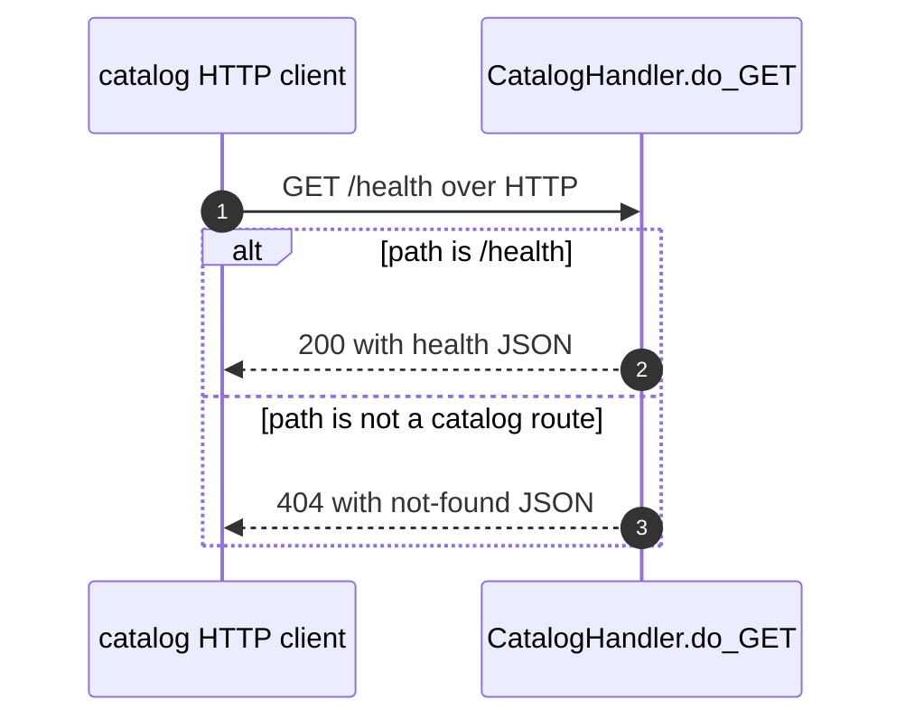
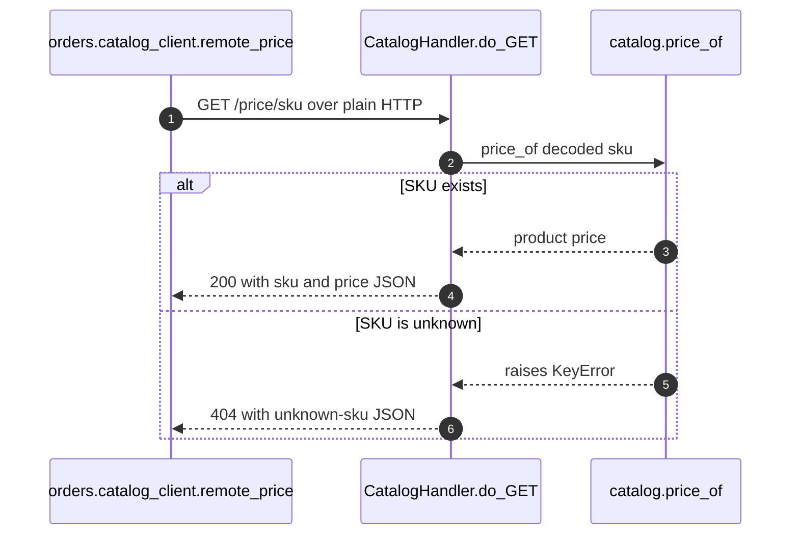

# Endpoints: catalog

| Method | Path | Handler | Auth | Card |
| --- | --- | --- | --- | --- |
| GET | `/health` | `CatalogHandler.do_GET` (`components/catalog/service.py:24-27`) | None | [GET `/health`](#get-health) |
| GET | `/price/<sku>` | `CatalogHandler.do_GET` (`components/catalog/service.py:28-34`) | None | [GET `/price/<sku>`](#get-pricesku) |

## GET `/health`

Handler: [`CatalogHandler.do_GET`](../../catalog/service.md#cataloghandlerdo_get). Source: `components/catalog/service.py:24-27`.

| | |
| --- | --- |
| Who may call | No authentication or authorization check is performed (inferred: the handler directly matches the path and sends its response, `components/catalog/service.py:24-27`). |
| Called by | `test_catalog_client.test_query_string_ignored_by_server` (`components/orders/test_catalog_client.py:56-58`). |

**Request**

| Part | Name | Type | Required | Validation | Evidence |
| --- | --- | --- | --- | --- | --- |
| path | `/health` | URL path | yes | Must equal `/health`; query strings are excluded from matching | `components/catalog/service.py:25-27` |

**Processing**: see [`CatalogHandler.do_GET`](../../catalog/service.md#cataloghandlerdo_get), steps 1-2.

**Data**: no catalog data is read or written (`components/catalog/service.py:26-27`).

**Outbound**: none.

**Response**

| Status | When | Body | Evidence |
| --- | --- | --- | --- |
| 200 | Path equals `/health` | `{"status": "ok"}` | `components/catalog/service.py:26-27` |
| 404 | Path is neither `/health` nor a `/price/` path | `{"error": "not found"}` | `components/catalog/service.py:26-28`, `components/catalog/service.py:34` |

Every response carries `Content-Type: application/json` and a `Content-Length` header (`components/catalog/service.py:16-22`). The handler defines `do_GET` only, so a request with another method is answered by the library's default handler with status 501 (assumed: `BaseHTTPRequestHandler` behaviour for a method without a `do_` handler).

| Step | What happens | Evidence |
| --- | --- | --- |
| 1 | The client sends `GET /health`; the handler extracts the URL path, excluding its query string. | `components/catalog/service.py:25-26` |
| 2 | For `/health`, the handler sends status 200 with `{"status": "ok"}`. | `components/catalog/service.py:26-27` |
| 3 | For any other path that is not `/price/`, the handler sends status 404 with `{"error": "not found"}`. | `components/catalog/service.py:28`, `components/catalog/service.py:34` |

## GET `/price/<sku>`

Handler: [`CatalogHandler.do_GET`](../../catalog/service.md#cataloghandlerdo_get). Source: `components/catalog/service.py:24-34`.

| | |
| --- | --- |
| Who may call | No authentication or authorization check is performed (inferred: the handler routes by path and does not inspect identity or permissions, `components/catalog/service.py:24-34`). |
| Called by | `orders.catalog_client.remote_price` (`components/orders/catalog_client.py:19-23`); the in-repository client calls are exercised by `test_catalog_client.py` (`components/orders/test_catalog_client.py:37-54`). |

**Request**

| Part | Name | Type | Required | Validation | Evidence |
| --- | --- | --- | --- | --- | --- |
| path | `sku` | URL path segment | yes | The text after `/price/` is URL-decoded and looked up without other validation; an unknown or empty value returns 404 | `components/catalog/service.py:28-33` |
| query | ignored | URL query | no | `urlsplit(self.path).path` excludes the query from routing | `components/catalog/service.py:25-29` |

**Processing**: see [`CatalogHandler.do_GET`](../../catalog/service.md#cataloghandlerdo_get), steps 1-4.

**Data**: reads the product record and its `price` from `_PRODUCTS` through `catalog.price_of`; no data is written (`components/catalog/service.py:31-33`; `components/catalog/catalog.py:20-24`).

**Outbound**: none.

**Response**

| Status | When | Body | Evidence |
| --- | --- | --- | --- |
| 200 | SKU exists | `{"sku": "<decoded sku>", "price": <price>}` | `components/catalog/service.py:30-31` |
| 404 | SKU is unknown | `{"error": "unknown sku <sku>"}` | `components/catalog/service.py:32-33` |
| 404 | Path does not match `/health` or `/price/` | `{"error": "not found"}` | `components/catalog/service.py:26-28`, `components/catalog/service.py:34` |

Every response carries `Content-Type: application/json` and a `Content-Length` header (`components/catalog/service.py:16-22`). The handler defines `do_GET` only, so a request with another method is answered by the library's default handler with status 501 (assumed: `BaseHTTPRequestHandler` behaviour for a method without a `do_` handler).

| Step | What happens | Evidence |
| --- | --- | --- |
| 1 | `remote_price` builds the `/price/<sku>` URL and opens it over HTTP. | `components/orders/catalog_client.py:19-23` |
| 2 | The handler extracts and URL-decodes the SKU, then calls `catalog.price_of`. | `components/catalog/service.py:24-31` |
| 3 | For a known SKU, the handler sends status 200 with the decoded SKU and price. | `components/catalog/service.py:30-31` |
| 4 | For an unknown SKU, `price_of` raises `KeyError` and the handler sends status 404 with an error body. | `components/catalog/catalog.py:20-24`; `components/catalog/service.py:32-33` |

<!-- cites components/catalog/catalog.py@1e15fdaab1fa3c720d99a864abb4cac9c8259421 -->

<!-- cites components/catalog/service.py@64e5abbab5e101fac6e56c67450ac4c6346198f1 -->

<!-- cites components/orders/catalog_client.py@469f9d282aab983cdd85f364e46bcd02ef6d3635 -->

<!-- cites components/orders/test_catalog_client.py@1d32463e1cdc21bd3eee3bc1b6f31feb8ef40a2d -->
