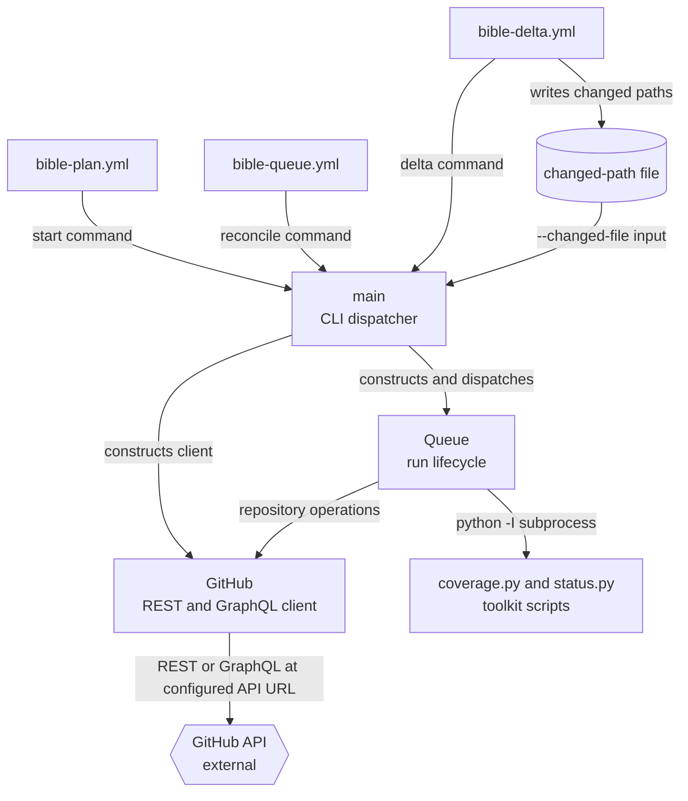
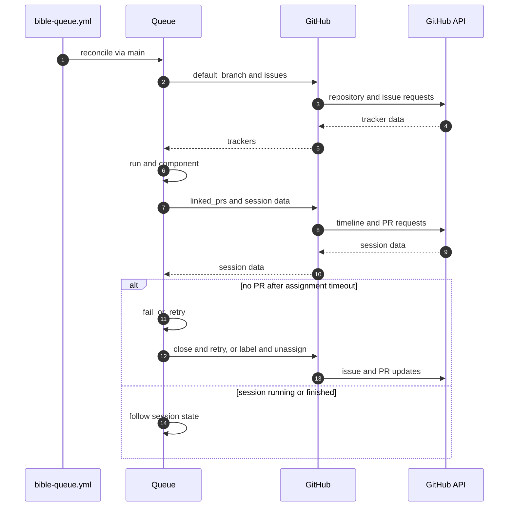
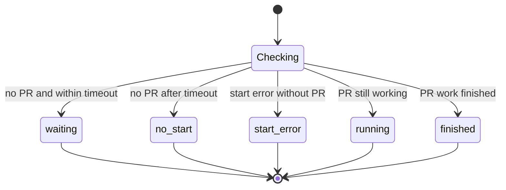
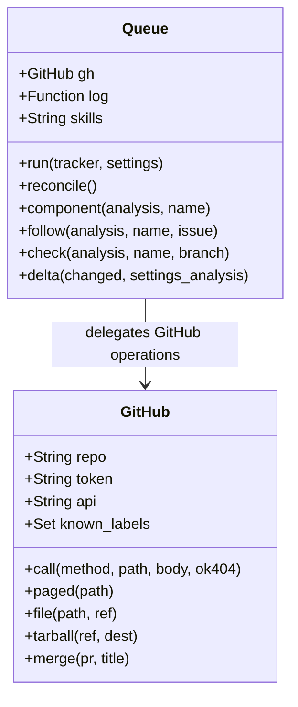

# bible-mode-b

| | |
| --- | --- |
| Kind | CLI and GitHub Actions workflow component |
| Folders and files | `.github/bible/bible_queue.py`; workflow adapters in `.github/workflows/bible-plan.yml`, `.github/workflows/bible-queue.yml`, and `.github/workflows/bible-delta.yml`; independent `.github/workflows/poc-assign-copilot.yml` |
| Technology | Python 3 standard library; GitHub Actions YAML |
| Starts by | Manual `bible-plan` workflow starts a run; `bible-queue` reconciles on a 15-minute schedule or manual dispatch; `bible-delta` handles default-branch pushes outside the ignored paths. (`.github/workflows/bible-plan.yml:7-8`, `.github/workflows/bible-queue.yml:7-10`, `.github/workflows/bible-delta.yml:6-10`) |
| Size | 1 Python source file, 867 lines, 66 functions/methods, 2 classes, 0 routes. (`.github/bible/bible_queue.py:1-867`) |
| Depth | Deep |

## Responsibility

This component coordinates the Mode B analysis workflow through a `start`, `reconcile`, or `delta` CLI command. `Queue` reads tracker and session state from GitHub, assigns work, handles retries and human holds, checks component completion, and opens review pull requests; `GitHub` wraps the REST and GraphQL operations. (`.github/bible/bible_queue.py:9-11`, `.github/bible/bible_queue.py:396-817`)

The `bible-plan.yml` workflow starts a run from a manual dispatch, `bible-queue.yml` invokes reconciliation on demand or every 15 minutes, and `bible-delta.yml` writes changed paths to a file and starts delta processing after a default-branch push. (`.github/workflows/bible-plan.yml:7-8`, `.github/workflows/bible-plan.yml:50-54`, `.github/workflows/bible-queue.yml:7-10`, `.github/workflows/bible-queue.yml:34-37`, `.github/workflows/bible-delta.yml:6-10`, `.github/workflows/bible-delta.yml:29-36`)

`poc-assign-copilot.yml` independently creates an issue and assigns Copilot through its inline `gh api` command; it does not invoke the queue or check out repository code. Its required `task` input defaults to an instruction to create `docs/poc-hello.md` with one line, and the input becomes the issue body passed to Copilot. (`.github/workflows/poc-assign-copilot.yml:18-21,31-37,55-69`)

No other analysis component calls into this component or is called by it (inferred: repository search for `bible_queue|\.github/bible/` in `*.py` and `*.yml` returned six references, all in this source file and its three workflow adapters). The queue's `delta` method does call the analysis toolkit's `components` helpers, which are outside the component catalog. (`.github/bible/bible_queue.py:798-802`)

## Structure

The diagram shows the three workflow entry paths and their shared queue/client path to GitHub; component internals and unrelated workflow jobs are omitted.

| Element | Evidence |
| --- | --- |
| `bible-plan.yml` -> `main` | `.github/workflows/bible-plan.yml:50-54` |
| `bible-queue.yml` -> `main` | `.github/workflows/bible-queue.yml:34-37` |
| `bible-delta.yml` -> `main` and changed-path file | `.github/workflows/bible-delta.yml:29-36` |
| `main` -> `Queue`, `GitHub` | `.github/bible/bible_queue.py:820-821` |
| `Queue` -> `GitHub` | `.github/bible/bible_queue.py:397-402` |
| `Queue.check` -> toolkit scripts | `.github/bible/bible_queue.py:723-732` |
| `GitHub` -> GitHub API | `.github/bible/bible_queue.py:91-103`, `.github/bible/bible_queue.py:286-289` |

## Reconcile sequence

This sequence shows a tracker reconciliation and a failed session; other component branches and gate details are omitted.

| Steps | Evidence |
| --- | --- |
| Workflow invokes reconcile | `.github/workflows/bible-queue.yml:34-37`, `.github/bible/bible_queue.py:820-821`, `.github/bible/bible_queue.py:837-838` |
| Trackers fetched and processed | `.github/bible/bible_queue.py:129-131`, `.github/bible/bible_queue.py:153-154`, `.github/bible/bible_queue.py:477-487`, `.github/bible/bible_queue.py:509-514` |
| Session and API data | `.github/bible/bible_queue.py:176-188`, `.github/bible/bible_queue.py:404-429`, `.github/bible/bible_queue.py:577-585`, `.github/bible/bible_queue.py:644-658` |
| Failure retry or hold | `.github/bible/bible_queue.py:455-474`, `.github/bible/bible_queue.py:653-655` |

## Session classification

Each invocation of `Queue.session` classifies the current observation independently; the diagram does not assert persistent transitions between returned states.

| Element | Evidence |
| --- | --- |
| No PR: `waiting`, `no-start`, `start-error` | `.github/bible/bible_queue.py:415-419` |
| PR exists: `running`, `finished` | `.github/bible/bible_queue.py:420-429` |

The state IDs `no_start` and `start_error` represent the returned strings `no-start` and `start-error`. The diagrams were checked by reading, not rendered.

## Modules

| Module page | Source file | Lines | Role | Main functions |
| --- | --- | --- | --- | --- |
| [bible_queue](bible_queue.md) | `.github/bible/bible_queue.py` | 1-848 | CLI entry point, queue coordinator, and GitHub API client | `main`, `Queue.reconcile`, `Queue.run`, `Queue.component`, `Queue.follow`, `Queue.check`, `Queue.delta`, `GitHub.call` |

The workflow files listed above are adapters that invoke the module, not additional Python source modules. (`.github/workflows/bible-plan.yml:50-54`, `.github/workflows/bible-queue.yml:34-37`, `.github/workflows/bible-delta.yml:29-36`)

## Main types

The class diagram focuses on each type's configuration/state and principal orchestration methods; incidental REST helpers are omitted.

| Element | Evidence |
| --- | --- |
| `GitHub` fields and methods | `.github/bible/bible_queue.py:89-103`, `.github/bible/bible_queue.py:133-138`, `.github/bible/bible_queue.py:166-170`, `.github/bible/bible_queue.py:234-259`, `.github/bible/bible_queue.py:293-296` |
| `Queue` fields and methods | `.github/bible/bible_queue.py:397-399`, `.github/bible/bible_queue.py:489-525`, `.github/bible/bible_queue.py:565-642`, `.github/bible/bible_queue.py:644-715`, `.github/bible/bible_queue.py:772-798` |
| `Queue` -> `GitHub` | `.github/bible/bible_queue.py:397-402`, `.github/bible/bible_queue.py:489-493` |

The field types shown in the diagram are inferred from constructor assignments and use; the source does not declare annotations. (`.github/bible/bible_queue.py:89-92`, `.github/bible/bible_queue.py:397-399`)

## Public interface

| Interface | Kind | Card or page | Evidence |
| --- | --- | --- | --- |
| `start --components ... --verify-model ... [--model ...] [--concurrency ...] [--analysis ...] [--depth ...]` | CLI command | [main](bible_queue.md#main) | `.github/bible/bible_queue.py:802-810`, `.github/bible/bible_queue.py:823-836` |
| `reconcile` | CLI command | [main](bible_queue.md#main) | `.github/bible/bible_queue.py:811`, `.github/bible/bible_queue.py:837-838` |
| `delta --changed-file FILE [--analysis ...]` | CLI command | [main](bible_queue.md#main) | `.github/bible/bible_queue.py:812-814`, `.github/bible/bible_queue.py:839-842` |
| Other analysis components | Cross-component call | None found | (inferred: repository search described under Responsibility) |

`start` requires a verification model different from the normal model and validates component names; it stops rather than opening a second run when a tracker is already open. (`.github/bible/bible_queue.py:824-831`)

## Business rules

| # | Rule, in plain words | Enforced in | Triggered by | Evidence |
| --- | --- | --- | --- | --- |
| R-01 | Verification must use a nonempty model different from the analysis model. | `main` | `start` command | `.github/bible/bible_queue.py:824-825` |
| R-02 | Component selection must be `all` or a comma-separated list of names matching `NAME`. | `main` | `start` command | `.github/bible/bible_queue.py:826-828` |
| R-03 | A second tracker cannot be opened while a tracker issue is already open. | `main` | `start` command | `.github/bible/bible_queue.py:830-831` |
| R-04 | A failed session is retried once; a second failure is labeled `bible-needs-human` and unassigned. | `Queue.fail_or_retry` | Failed agent session | `.github/bible/bible_queue.py:455-474` |
| R-05 | Chunk and verification sessions may write only their respective component paths; a disallowed file fails/retries the session. | `Queue.follow` | Agent PR file validation | `.github/bible/bible_queue.py:659-668` |
| R-06 | A component PR is created only for a PASS with no major corrections and a nonempty fingerprint matching the checked pages. | `Queue.component` | Successful component gate and verification | `.github/bible/bible_queue.py:608-612` |
| R-07 | After the maximum verification rounds without a clean matching PASS, a human hold is created. | `Queue.component` | Verification remains unsuccessful | `.github/bible/bible_queue.py:615-623` |

## Data

| Store or file | Reads | Writes | Data dictionary entry |
| --- | --- | --- | --- |
| GitHub issues and labels | Tracker settings, issue state, labels, assignments, comments, and timelines | Tracker, plan/chunk/verify/hold/delta issues, labels, comments, and assignment changes | Not applicable; GitHub-managed objects (`.github/bible/bible_queue.py:129-151`, `.github/bible/bible_queue.py:176-220`, `.github/bible/bible_queue.py:261-281`) |
| GitHub branches and pull requests | Branch refs, PR metadata/files, commit time, linked PRs | Component branch refs and PR lifecycle changes | Not applicable; GitHub-managed objects (`.github/bible/bible_queue.py:153-174`, `.github/bible/bible_queue.py:179-232`, `.github/bible/bible_queue.py:293-302`) |
| GitHub contents and archive | JSON/status/report files and branch tarball | Tarball extraction under the temporary gate directory | Not applicable (`.github/bible/bible_queue.py:166-170`, `.github/bible/bible_queue.py:234-259`, `.github/bible/bible_queue.py:702-709`) |
| `--changed-file` input | One changed path per line; blank lines are discarded | None | Input contract documented by the delta workflow (`.github/workflows/bible-delta.yml:35-36`, `.github/bible/bible_queue.py:839-841`) |

## Outbound calls

| Target | Purpose | Protocol and scheme | Address from | Timeout, retry, fallback | Evidence |
| --- | --- | --- | --- | --- | --- |
| GitHub API | Issues, labels, branches, contents, pull requests, timelines, commits, archives, and ready-for-review mutation | REST and GraphQL; configured API URL defaults to HTTPS | `GITHUB_API_URL`, default `https://api.github.com` | Request timeout defaults to 60 seconds; tarball request uses 300 seconds. HTTP and URL/timeout/OS errors become `RuntimeError`, except `ready` wraps only HTTP errors; API helper supports optional 404 fallback. | `.github/bible/bible_queue.py:91-103`, `.github/bible/bible_queue.py:105-117`, `.github/bible/bible_queue.py:237-243`, `.github/bible/bible_queue.py:283-291` |
| Analysis toolkit `components` helpers | Maps changed paths to component rows during delta processing | In-process Python import | `BIBLE_SKILLS` path, default `.github/skills` | No fallback is defined for import or helper errors in `Queue.delta`. | `.github/bible/bible_queue.py:397-399`, `.github/bible/bible_queue.py:775-781` |
| Analysis toolkit `coverage.py` and `status.py` | Check component coverage and obtain page fingerprint | Local subprocess, `python -I` | `BIBLE_SKILLS` path, default `.github/skills` | No timeout is passed to either subprocess. | `.github/bible/bible_queue.py:397-399`, `.github/bible/bible_queue.py:698-711` |

The API client does not log the token value; it adds a bearer authorization header only when a token is present. (`.github/bible/bible_queue.py:99-100`)

## Configuration read

| Key | Purpose | Default | Source | Evidence |
| --- | --- | --- | --- | --- |
| `GITHUB_REPOSITORY` | Repository owner/name for API calls | Required; none | Environment | `.github/bible/bible_queue.py:817-819` |
| `GH_TOKEN` | GitHub API bearer token | Required; none | Environment; workflow supplies `BIBLE_ASSIGN_TOKEN` | `.github/bible/bible_queue.py:817-819`, `.github/workflows/bible-plan.yml:44-49`, `.github/workflows/bible-queue.yml:31-36`, `.github/workflows/bible-delta.yml:24-31` |
| `GITHUB_API_URL` | GitHub API base | `https://api.github.com` | Environment | `.github/bible/bible_queue.py:91` |
| `BIBLE_AGENT_LOGINS` | Agent logins recognized as authors/commenters | `Copilot,copilot-swe-agent[bot],copilot-swe-agent` | Environment | `.github/bible/bible_queue.py:60` |
| `BIBLE_AGENT_APP` | GitHub app slug identifying agent work events | `copilot-swe-agent` | Environment | `.github/bible/bible_queue.py:61-64` |
| `BIBLE_NOW` | Test clock override | Current timezone-aware UTC time when unset | Environment | `.github/bible/bible_queue.py:307-309` |
| `BIBLE_SKILLS` | Analysis toolkit path | `.github/skills` | Environment | `.github/bible/bible_queue.py:397-399` |
| `--components` | Components for a new run | `all` | CLI/workflow input | `.github/bible/bible_queue.py:805`, `.github/workflows/bible-plan.yml:9-13` |
| `--model` | Analysis session model | Empty string | CLI/workflow input | `.github/bible/bible_queue.py:806`, `.github/workflows/bible-plan.yml:14-17` |
| `--verify-model` | Separate verification model | Required | CLI/workflow input | `.github/bible/bible_queue.py:807`, `.github/workflows/bible-plan.yml:18-20` |
| `--concurrency` | Maximum active components; zero means no cap | `0` | CLI/workflow input | `.github/bible/bible_queue.py:808`, `.github/workflows/bible-plan.yml:21-24`, `.github/bible/bible_queue.py:515-522` |
| `--analysis` | Analysis output folder | `codebase-analysis` | CLI input | `.github/bible/bible_queue.py:809`, `.github/bible/bible_queue.py:814` |
| `--depth` | Coverage depth | `deep` | CLI input | `.github/bible/bible_queue.py:810`, `.github/bible/bible_queue.py:707-708` |

## Errors and resilience

`GitHub.call` returns `None` for an allowed 404, turns other HTTP errors and URL/timeout/OS errors into `RuntimeError`, and decodes empty responses as `{}`. `main` converts `RuntimeError` to `SystemExit`; `Queue.reconcile` catches exceptions per tracker, while `Queue.run` catches component errors individually and continues other selected components. (`.github/bible/bible_queue.py:105-117`, `.github/bible/bible_queue.py:843-844`, `.github/bible/bible_queue.py:477-487`, `.github/bible/bible_queue.py:509-514`)

Session failures retry once and then create a human hold; successful sessions are gated by allowed-file paths and state/fingerprint checks before their PR is merged or exposed for review. (`.github/bible/bible_queue.py:455-474`, `.github/bible/bible_queue.py:659-696`, `.github/bible/bible_queue.py:608-627`)

## Logging and monitoring

The queue logs missing/invalid tracker settings, per-tracker exceptions, component gate output, tracker state rows, and delta issue creation or duplicate detection. (`.github/bible/bible_queue.py:481-487`, `.github/bible/bible_queue.py:698-709`, `.github/bible/bible_queue.py:768-769`, `.github/bible/bible_queue.py:772-798`)

## Tests

The repository search for `bible_queue` in test-named paths returned no matches.

## Surprises

- `Queue.session`'s docstring omits the `start-error` state that the method returns. (`.github/bible/bible_queue.py:413-418`)
- The module docstring lists two default `BIBLE_AGENT_LOGINS`, whereas the code includes a third, `copilot-swe-agent`. (`.github/bible/bible_queue.py:36`, `.github/bible/bible_queue.py:60`)
- `GitHub.prs` is unused (inferred: search for `.prs(` in `.github/bible/bible_queue.py` returned no matches); the method is defined at `.github/bible/bible_queue.py:172-174`.
- The queue workflow checks out the default branch's scripts and unpacks the component branch as input data before running the coverage check. (`.github/workflows/bible-queue.yml:26-30`, `.github/bible/bible_queue.py:700-705`)

## For the whole-system pages

### Risks and surprises

- The queue workflow deliberately checks out its scripts from the default branch, while downloading branch tarballs as data for coverage, so branch content is not the code that performs the gate. (`.github/workflows/bible-queue.yml:26-30`, `.github/bible/bible_queue.py:700-705`)
- The `Queue.session` docstring omits the returned `start-error` state. (`.github/bible/bible_queue.py:413-418`)

### Open questions

None found in this component.

### Glossary

| Term | Meaning | Evidence |
| --- | --- | --- |
| Tracker issue | Issue storing the settings and state for one analysis run. | `.github/bible/bible_queue.py:490-493`, `.github/bible/bible_queue.py:828-832` |
| Component branch | Branch named `bible/<component>` for component work. | `.github/bible/bible_queue.py:553-558` |
| Agent event | Timeline event whose GitHub app slug is `AGENT_APP` and event is start or finish. | `.github/bible/bible_queue.py:195-199` |
| Pages fingerprint | Status output used to require verification to match the checked component pages. | `.github/bible/bible_queue.py:609-614`, `.github/bible/bible_queue.py:707-709` |
