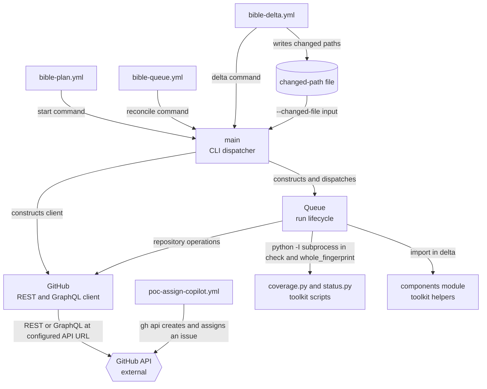
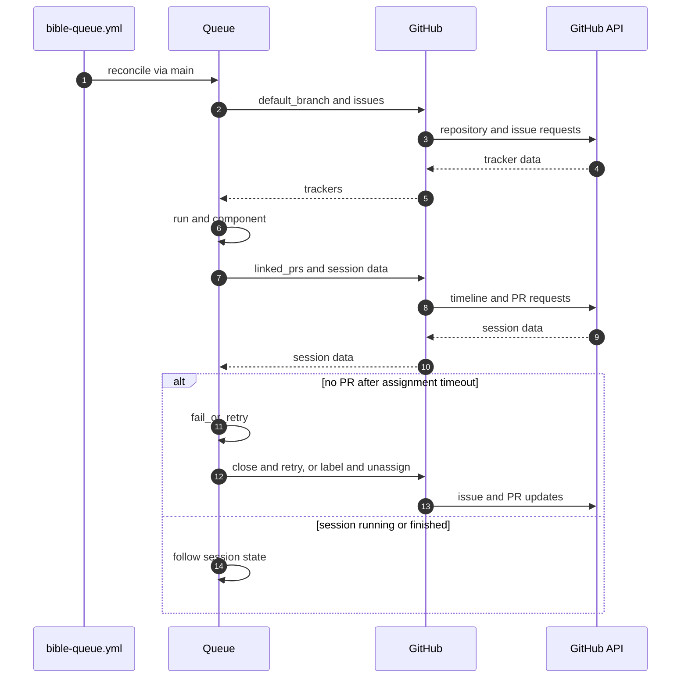
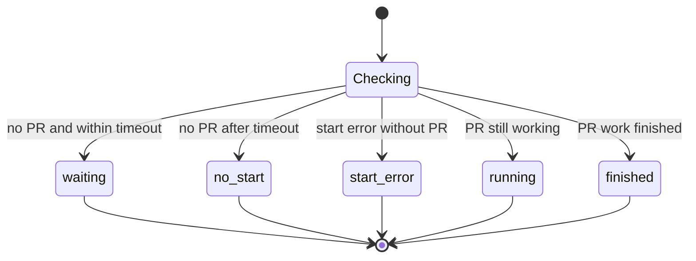
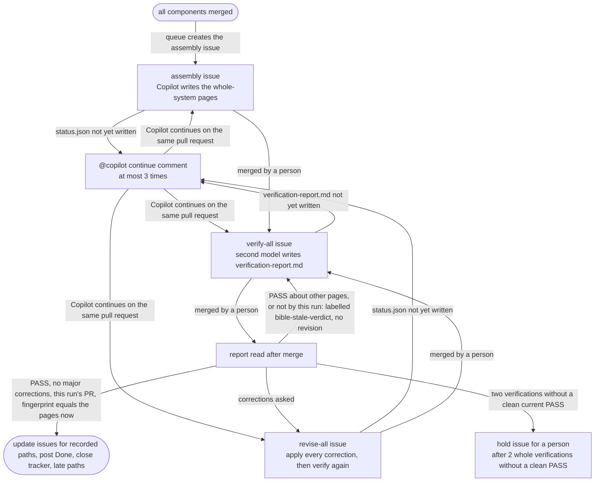
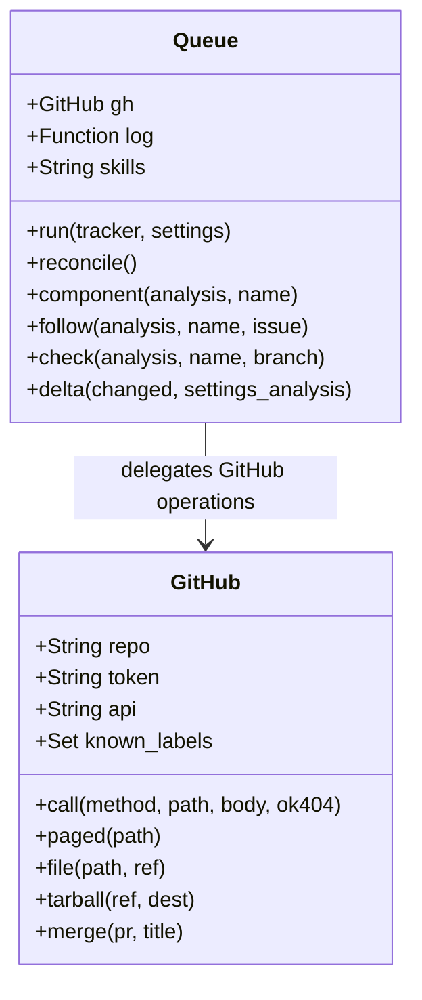

# bible-mode-b

| | |
| --- | --- |
| Kind | CLI and GitHub Actions workflow component |
| Folders and files | `.github/bible/bible_queue.py`; workflow adapters in `.github/workflows/bible-plan.yml`, `.github/workflows/bible-queue.yml`, and `.github/workflows/bible-delta.yml`; independent `.github/workflows/poc-assign-copilot.yml` |
| Technology | Python 3 standard library; GitHub Actions YAML |
| Starts by | Manual `bible-plan` workflow starts a run; `bible-queue` reconciles on a 15-minute schedule or manual dispatch; `bible-delta` handles default-branch pushes except those that change only `codebase-analysis/**` and `.github/skills/**`; code under `.github/workflows/` and `.github/bible/` is not ignored. (`.github/workflows/bible-plan.yml:7-8`, `.github/workflows/bible-queue.yml:7-10`, `.github/workflows/bible-delta.yml:6-12`, `.github/workflows/bible-delta.yml:19`) |
| Size | 1 Python source file, 1336 lines, 74 functions/methods (one more, `last_activity`, is nested in `Queue.delta`), 2 classes, 0 routes. (`.github/bible/bible_queue.py:1-1336`, `.github/bible/bible_queue.py:1226-1228`; component coverage: `ledger/components/bible-mode-b/coverage-report.md`) |
| Depth | Deep |

## Responsibility

This component coordinates the Mode B analysis workflow through a `start`, `reconcile`, or `delta` CLI command. `Queue` reads tracker and session state from GitHub, assigns work, handles retries and human holds, checks component completion, and opens review pull requests; `GitHub` wraps the REST and GraphQL operations. (`.github/bible/bible_queue.py:1288-1299`, `.github/bible/bible_queue.py:500-1283`, `.github/bible/bible_queue.py:110-374`)

The `bible-plan.yml` workflow starts a run from a manual dispatch, `bible-queue.yml` invokes reconciliation on demand or every 15 minutes, and `bible-delta.yml` writes changed paths to a file and starts delta processing after a default-branch push. (`.github/workflows/bible-plan.yml:7-8`, `.github/workflows/bible-plan.yml:50-54`, `.github/workflows/bible-queue.yml:7-10`, `.github/workflows/bible-queue.yml:34-37`, `.github/workflows/bible-delta.yml:6-10`, `.github/workflows/bible-delta.yml:31-38`)

`poc-assign-copilot.yml` independently creates an issue and assigns Copilot through its inline `gh api` command; it does not invoke the queue or check out repository code. Its required `task` input defaults to an instruction to create `docs/poc-hello.md` with one line, and the input becomes the issue body passed to Copilot. (`.github/workflows/poc-assign-copilot.yml:18-21`, `.github/workflows/poc-assign-copilot.yml:38-72`, `.github/workflows/poc-assign-copilot.yml:55-69`)

No other analysis component calls into this component or is called by it (inferred: repository search for `bible_queue|\.github/bible/` in `*.py` and `*.yml` returned seven references, including the toolkit's mirrored revision rule). The queue's `delta` method does call the analysis toolkit's `components` helpers, which are outside the component catalog. (`.github/bible/bible_queue.py:1247-1249`, `.github/bible/bible_queue.py:1252-1253`, `.github/bible/bible_queue.py:1267`)

## Structure

The diagram shows the three workflow entry paths and their shared queue/client path to GitHub, and the POC workflow's own `gh api` call; component internals are omitted.

| Element | Evidence |
| --- | --- |
| `bible-plan.yml` -> `main` | `.github/workflows/bible-plan.yml:50-54` |
| `bible-queue.yml` -> `main` | `.github/workflows/bible-queue.yml:34-37` |
| `bible-delta.yml` -> `main` and changed-path file | `.github/workflows/bible-delta.yml:31-38` |
| `main` -> `Queue`, `GitHub` | `.github/bible/bible_queue.py:1305-1306` |
| `Queue` -> `GitHub` | `.github/bible/bible_queue.py:501-503` |
| `Queue.check` -> toolkit scripts | `.github/bible/bible_queue.py:882-883`, `.github/bible/bible_queue.py:893-900` |
| `Queue.whole_fingerprint` -> `status.py --fingerprint` | `.github/bible/bible_queue.py:922-929` |
| `Queue.delta` -> toolkit `components` helpers | `.github/bible/bible_queue.py:1247-1248` |
| `GitHub` -> GitHub API | `.github/bible/bible_queue.py:113-125`, `.github/bible/bible_queue.py:357-360` |
| `poc-assign-copilot.yml` -> GitHub API (it starts no queue code) | `.github/workflows/poc-assign-copilot.yml:66-69` |

## Reconcile sequence

This sequence shows a tracker reconciliation and a failed session; other component branches and gate details are omitted.

| Steps | Evidence |
| --- | --- |
| Workflow invokes reconcile | `.github/workflows/bible-queue.yml:34-37`, `.github/bible/bible_queue.py:1296`, `.github/bible/bible_queue.py:1325-1326` |
| Trackers fetched and processed | `.github/bible/bible_queue.py:151-153`, `.github/bible/bible_queue.py:181-182`, `.github/bible/bible_queue.py:604-615`, `.github/bible/bible_queue.py:617-627` |
| Session and API data | `.github/bible/bible_queue.py:204-216`, `.github/bible/bible_queue.py:505-533`, `.github/bible/bible_queue.py:711-719`, `.github/bible/bible_queue.py:824-834` |
| Failure retry or hold | `.github/bible/bible_queue.py:582-601`, `.github/bible/bible_queue.py:830-832` |

## Session classification

Each invocation of `Queue.session` classifies the current observation independently; the diagram does not assert persistent transitions between returned states.

| Element | Evidence |
| --- | --- |
| No PR: `waiting`, `no-start`, `start-error` | `.github/bible/bible_queue.py:519-523` |
| PR exists: `running`, `finished` (any work event of Copilot's app decides: only `copilot_work_started` as the newest gives `running`, so `copilot_work_finished_failure` gives `finished`; without work events, the head commit age and the PR's review state decide; for a chunk session, a `status.json` at the PR head whose state is in `FINAL_STATES` with review asked or the head idle for `IDLE_AFTER` gives `finished`, as does a head idle for three times `IDLE_AFTER`, and anything else gives `running`) | `.github/bible/bible_queue.py:524-533`, `.github/bible/bible_queue.py:73`, `.github/bible/bible_queue.py:75` |

The state IDs `no_start` and `start_error` represent the returned strings `no-start` and `start-error`. The diagrams were checked by reading, not rendered.

## Whole-analysis phase and deferred updates

When every wanted component's row is `merged`, `Queue.run` hands over to `Queue.assemble_phase` (`.github/bible/bible_queue.py:666-667`). It works through two issue kinds in order, the assembly (`bible-assemble`) and the whole verification (`bible-verify-all`), and the run ends only when both are done.

| Step | What happens | Evidence |
| --- | --- | --- |
| Assembly session | The assembly issue is created from `ledger/issues/assemble.md`. When its session has finished but the pull request does not contain `status.json`, `continue_if_unfinished` comments `@copilot continue ...` (marked with `CONTINUE_MARK`), at most 3 times since a person last released the issue; a session that failed before starting any work is held for a person at once. The same continuation applies to the verify-all session (end marker `verification-report.md`) and to the revise-all session (end marker `status.json`). | `.github/bible/bible_queue.py:1027-1035`, `.github/bible/bible_queue.py:1022-1026`, `.github/bible/bible_queue.py:1154-1207`, `.github/bible/bible_queue.py:1117-1120`, `.github/bible/bible_queue.py:1162-1164` |
| Whole verification | The verify-all issue is created on `verify_model`. A person merges the pull request; the queue then reads `verification-report.md` on the default branch. | `.github/bible/bible_queue.py:939-941`, `.github/bible/bible_queue.py:1033-1034`, `.github/bible/bible_queue.py:995-1011` |
| Corrections asked | A missing, unreadable, not-`PASS` or major-corrections report labels the issue `bible-needs-revision`; an issue the queue sees still open is also closed as not planned, while one GitHub already closed as completed is only labelled and commented. At the next check `revise_all_step` creates a `bible-revise-all` issue (apply every correction without editing the report, finish with `status.py --write`). Its pull request may change only files under the analysis folder and never `verification-*` files. After a person merges it the next whole verification is created. | `.github/bible/bible_queue.py:999-1007`, `.github/bible/bible_queue.py:981-985`, `.github/bible/bible_queue.py:1074-1152`, `.github/bible/bible_queue.py:1121-1126` |
| Stale or foreign `PASS` | A clean `PASS` whose fingerprint does not equal the pages now, or whose report was not written by this run's own merged pull request, is labelled `bible-stale-verdict` and verified again. If too little of the run's time is left the check just waits for the next run; if the fingerprint cannot be computed (no `status.py`, a failed or oversized download, a timeout or no output) it is counted, and after 3 such checks in a row a person is asked. | `.github/bible/bible_queue.py:947-980`, `.github/bible/bible_queue.py:964-971`, `.github/bible/bible_queue.py:920-933`, `.github/bible/bible_queue.py:907-918` |
| Round limit | `rounds` counts the whole verifications that asked for corrections or were stale since a person last released the run; at 2 the queue creates the hold issue of the whole analysis. Removing `bible-needs-human` from it starts new rounds. | `.github/bible/bible_queue.py:1089-1097`, `.github/bible/bible_queue.py:1136-1142`, `.github/bible/bible_queue.py:1066-1072`, `.github/bible/bible_queue.py:76` |
| End of the run | Only at this Done step does the queue read the paths recorded while the run was open and create their update issues; then it comments that every component, the assembly and the whole verification are merged, closes the tracker, and reads the recorded paths once more for any that arrived after the first read. If a person closes the tracker, or the run never reaches Done, the recorded paths are never replayed (inferred: `deferred_updates` is called only at lines 1038 and 1043, and `reconcile` lists open trackers only). Those paths get no update issue of their own; a later update issue for the same component asks its session for every change since the analysis's baseline, not only that push's files. The replay goes through `delta`: with no `components.json` or no `ledger/baseline.json` on the default branch the recorded paths are dropped with only a log line, more than 10 touched components give one hold issue, and a component that already has an open `bible-delta` issue is skipped. | `.github/bible/bible_queue.py:607`, `.github/bible/bible_queue.py:1036-1042`, `.github/bible/bible_queue.py:1043-1050`, `.github/bible/bible_queue.py:1273-1277`, `.github/bible/bible_queue.py:1243-1246`, `.github/bible/bible_queue.py:1255-1264`, `.github/bible/bible_queue.py:1270-1272` |

`Queue.delta` (the `delta` command after a push to the default branch) behaves differently while a run is open: it records the changed plain paths in comments of at most 200 paths on the first tracker whose own `Updated` line (its creation time when it has none) is no older than 14 days, each with a hidden `bible-deferred-update` marker, and creates no issue. `Queue.deferred_updates` reads those comments (only the queue's own, only plain paths), and it is called only at lines 1038 and 1043, in `assemble_phase` at the Done step (inferred: a search of the file for `deferred_updates`); `reconcile` visits open trackers only, so paths recorded on a tracker that a person closes, or on a run that never finishes, are never read. A later update issue for the same component asks its session for every change since the analysis's baseline, not only that push's files (`.github/bible/bible_queue.py:1273-1277`). With no open run, `delta` maps the changed paths (not the analysis folder, not the skills folder) to components; more than 10 components give one hold issue. (`.github/bible/bible_queue.py:1226-1264`, `.github/bible/bible_queue.py:1052-1064`)

## Modules

| Module page | Source file | Lines | Role | Main functions |
| --- | --- | --- | --- | --- |
| [bible_queue](bible_queue.md) | `.github/bible/bible_queue.py` | 1-1336 | CLI entry point, queue coordinator, and GitHub API client | `main`, `Queue.reconcile`, `Queue.run`, `Queue.component`, `Queue.follow`, `Queue.check`, `Queue.delta`, `GitHub.call` |

The workflow files listed above are adapters that invoke the module, not additional Python source modules. (`.github/workflows/bible-plan.yml:50-54`, `.github/workflows/bible-queue.yml:34-37`, `.github/workflows/bible-delta.yml:31-38`)

## Main types

The class diagram focuses on each type's configuration/state and principal orchestration methods; incidental REST helpers are omitted.

| Element | Evidence |
| --- | --- |
| `GitHub` fields and methods | `.github/bible/bible_queue.py:111-125`, `.github/bible/bible_queue.py:127-139`, `.github/bible/bible_queue.py:141-149`, `.github/bible/bible_queue.py:155-160`, `.github/bible/bible_queue.py:194-198`, `.github/bible/bible_queue.py:291-330`, `.github/bible/bible_queue.py:364-368` |
| `Queue` fields and methods | `.github/bible/bible_queue.py:501-503`, `.github/bible/bible_queue.py:604-615`, `.github/bible/bible_queue.py:617-668`, `.github/bible/bible_queue.py:708-819`, `.github/bible/bible_queue.py:821-878`, `.github/bible/bible_queue.py:880-905`, `.github/bible/bible_queue.py:1223-1283` |
| `Queue` -> `GitHub` | `.github/bible/bible_queue.py:501-503`, `.github/bible/bible_queue.py:606-607` |

The field types shown in the diagram are inferred from constructor assignments and use; the source does not declare annotations. (`.github/bible/bible_queue.py:111-114`, `.github/bible/bible_queue.py:501-503`)

## Public interface

| Interface | Kind | Card or page | Evidence |
| --- | --- | --- | --- |
| `start [--components ...] --verify-model ... [--model ...] [--concurrency ...] [--analysis ...] [--depth ...]` | CLI command | [main](bible_queue.md#main) | `.github/bible/bible_queue.py:1317-1322`, `.github/bible/bible_queue.py:1289-1302` |
| `reconcile` | CLI command | [main](bible_queue.md#main) | `.github/bible/bible_queue.py:1296`, `.github/bible/bible_queue.py:1325-1326` |
| `delta --changed-file FILE [--analysis ...]` | CLI command | [main](bible_queue.md#main) | `.github/bible/bible_queue.py:1297-1299`, `.github/bible/bible_queue.py:1327-1330` |
| Other analysis components | Cross-component call | None found | (inferred: repository search described under Responsibility) |

`start` requires a verification model different from the normal model and validates component names; it stops rather than opening a second run when a tracker is already open. (`.github/bible/bible_queue.py:1309-1316`)

## Business rules

| # | Rule, in plain words | Enforced in | Triggered by | Evidence |
| --- | --- | --- | --- | --- |
| R-01 | Verification must use a nonempty model different from the analysis model. | `main` | `start` command | `.github/bible/bible_queue.py:1309-1310` |
| R-02 | `start` checks each comma-separated entry of the component selection on its own: it must be `all` or match `NAME`. A list with an unknown name, or `all` mixed with names, passes `start` and is stopped later by `reconcile`, which renders "stopped: unknown component(s) ...". | `main`, `Queue.run` | `start` command, then the next reconcile | `.github/bible/bible_queue.py:1311-1313`, `.github/bible/bible_queue.py:640-647` |
| R-03 | A second tracker cannot be opened while a tracker issue is already open. | `main` | `start` command | `.github/bible/bible_queue.py:1315-1316` |
| R-04 | A failed session is retried once; a second failure is labeled `bible-needs-human` and unassigned. A session whose start Copilot refused (`start-error`) is held at once, with no retry. | `Queue.fail_or_retry`, `Queue.hold_start_error` | Failed agent session, or a refused start | `.github/bible/bible_queue.py:582-601`, `.github/bible/bible_queue.py:574-581`, `.github/bible/bible_queue.py:827-829` |
| R-05 | Chunk and verification sessions may write only their respective component paths; a disallowed file fails/retries the session. | `Queue.follow` | Agent PR file validation | `.github/bible/bible_queue.py:841-850` |
| R-06 | A component PR is created only for a PASS with no major corrections and a nonempty fingerprint matching the checked pages. | `Queue.component` | Successful component gate and verification | `.github/bible/bible_queue.py:778-782` |
| R-07 | After the maximum verification rounds without a clean matching PASS, a human hold is created. | `Queue.component` | Verification remains unsuccessful | `.github/bible/bible_queue.py:797-805` |
| R-08 | An assembly or whole-analysis session that ended before its end marker (`status.json`, or `verification-report.md` for the whole verification) is continued on the same pull request at most `MAX_CONTINUE` (3) times since a person last released it, then held for a person; a session whose Copilot work ended in `copilot_work_finished_failure` without any `copilot_work_started` after the queue's last request (or, before any request, after the time a person last released the hold) is held for a person at once. | `Queue.continue_if_unfinished` | Finished session whose pull request lacks the end marker | `.github/bible/bible_queue.py:1162-1164`, `.github/bible/bible_queue.py:1179-1188`, `.github/bible/bible_queue.py:1191-1197` |
| R-09 | A whole verification that is missing, unreadable, not `PASS` or has major corrections does not end the run and does not wait for a person: the issue gets `bible-needs-revision`, and a revision of the whole analysis (`bible-revise-all` issue, on the analysis model) is assigned, then verified again. | `Queue.assemble_phase`, `Queue.revise_all_step` | Merged whole-verification pull request with such a report | `.github/bible/bible_queue.py:999-1007`, `.github/bible/bible_queue.py:981-985`, `.github/bible/bible_queue.py:1074-1152` |
| R-10 | After `MAX_VERIFY_ROUNDS` (2) whole verifications without a clean, current `PASS` since a person last released the run, the queue creates a hold issue (`bible-hold`, `bible-whole`, `bible-needs-human`) for a person. | `Queue.revise_all_step`, `Queue.whole_hold` | Second whole verification that is not a clean current `PASS` | `.github/bible/bible_queue.py:1089-1097`, `.github/bible/bible_queue.py:1136-1142`, `.github/bible/bible_queue.py:1066-1072` |
| R-11 | The run ends only on a clean `PASS` whose printed fingerprint equals the whole analysis's fingerprint on the default branch now and whose report was written by a merged pull request of this run's own verification issue; any other `PASS` is labelled `bible-stale-verdict` and verified again. | `Queue.assemble_phase` | Closed whole-verification issue | `.github/bible/bible_queue.py:947-980` |
| R-12 | While a tracker is open (its own `Updated` line, or its creation time when it has none, no older than 14 days), a push to the default branch creates no update issue: the changed paths that match `SAFE_FILE` (other names are counted in the comment, not recorded) are recorded in `bible-deferred-update` comments on the tracker. They are turned into update issues only when the run ends through its Done step, before the tracker is closed and once more for paths recorded after the first read; if a person closes the tracker, or the run never finishes, they get no update issue of their own (inferred: `deferred_updates` is called only at lines 1038 and 1043, and `reconcile` lists open trackers only), and a later update issue for the same component asks its session for every change since the analysis's baseline. | `Queue.delta`, `Queue.deferred_updates`, `Queue.assemble_phase` | Default-branch push while a run is open | `.github/bible/bible_queue.py:389`, `.github/bible/bible_queue.py:1226-1228`, `.github/bible/bible_queue.py:1229-1242`, `.github/bible/bible_queue.py:1052-1064`, `.github/bible/bible_queue.py:1038-1050`, `.github/bible/bible_queue.py:607`, `.github/bible/bible_queue.py:1273-1277` |
| R-13 | A push that touches more than `MAX_DELTA_ISSUES` (10) components starts no update session; one hold issue is opened for a person instead. | `Queue.delta` | Default-branch push with no open run | `.github/bible/bible_queue.py:1255-1264` |
| R-14 | The file list a session pull request is checked on is never read as complete unless it is: for an open pull request whose base branch moved, the queue lists the comparison with the base branch's tip and refuses a missing list or one of `COMPARE_MAX` (300) files or more; otherwise the list must match the pull request's own `changed_files` count when that count is nonzero (a pull request that reports none, or a value that is not a number, is not count-checked). | `GitHub.pr_files` | Every file-scope check of a pull request | `.github/bible/bible_queue.py:252-286` |
| R-15 | A component with no passing check yet (its `status.json` state is not `COMPONENT_DONE`, or its check fails) gets chunk sessions until the closed chunk issues of this run that were created at or after the later of the last hold release and the latest merge of the component branch into the default branch reach a cap: the estimate (`est_sessions` from `components.json`, 2 when missing or zero, clamped to 1-10) gives a cap of 2 x estimate + 2, at least 4 (`MIN_SESSION_CAP`) and at most 22 (`MAX_SESSION_CAP`). At the cap the queue creates a hold issue (`bible-hold`, `bible-needs-human`) for a person instead of another chunk. | `Queue.component` | A component without a passing check, at each reconcile | `.github/bible/bible_queue.py:82-83`, `.github/bible/bible_queue.py:754-770` |
| R-16 | A check that could not run is counted, not failed: for a component's check a branch tarball whose download fails or that is over the size limits, or a timeout; for the fingerprint of the whole analysis the same, and also a missing `status.py` or no output. After `MAX_NOCHECK` (3) in a row the queue creates a hold issue for a person; a check that runs resets the count. When too little of the run's time is left the check just waits for the next run and is not counted. | `Queue.could_not_check` | Check of a component, or fingerprint of the whole analysis, that cannot run | `.github/bible/bible_queue.py:89`, `.github/bible/bible_queue.py:745-752`, `.github/bible/bible_queue.py:890-892`, `.github/bible/bible_queue.py:901-903`, `.github/bible/bible_queue.py:907-918`, `.github/bible/bible_queue.py:923-933`, `.github/bible/bible_queue.py:964-972` |
| R-17 | A chunk session's pull request is merged only if it made progress: its `status.json` must show more `packets_done` than the component branch has, or `COMPONENT_DONE`, and must not be `STOP`; a revision chunk must also change a page of the component and end at `COMPONENT_DONE`. Otherwise the session fails and is retried or held. | `Queue.follow` | Finished chunk session | `.github/bible/bible_queue.py:858-871` |
| R-18 | A session pull request is merged by a squash merge that names the head commit that was checked, and the comment says GitHub then refuses the merge if anything was pushed since. | `GitHub.merge` | Accepted session pull request | `.github/bible/bible_queue.py:364-368` |

## Data

| Store or file | Reads | Writes | Data dictionary entry |
| --- | --- | --- | --- |
| GitHub issues and labels | Tracker settings, issue state, labels, assignments, comments, and timelines | Tracker, plan/chunk/verify/assemble/verify-all/revise-all/hold/delta issues, issue body rewrites and closes, labels, comments, and assignment changes | Not applicable; GitHub-managed objects (`.github/bible/bible_queue.py:342-346`, `.github/bible/bible_queue.py:1033`, `.github/bible/bible_queue.py:1150`, `.github/bible/bible_queue.py:151-173`, `.github/bible/bible_queue.py:204-205`, `.github/bible/bible_queue.py:223-227`, `.github/bible/bible_queue.py:236-250`, `.github/bible/bible_queue.py:332-352`) |
| GitHub branches and pull requests | Branch refs, PR metadata/files, commit time, linked PRs | Component branch refs and PR lifecycle changes | Not applicable; GitHub-managed objects (`.github/bible/bible_queue.py:181-202`, `.github/bible/bible_queue.py:207-221`, `.github/bible/bible_queue.py:252-289`, `.github/bible/bible_queue.py:354-374`) |
| GitHub contents and archive | JSON/status/report files and branch tarball | Tarball extraction under the temporary gate directory | Not applicable (`.github/bible/bible_queue.py:194-198`, `.github/bible/bible_queue.py:291-330`, `.github/bible/bible_queue.py:886-896`) |
| `--changed-file` input | One changed path per line; blank lines are discarded | None | Input contract documented by the delta workflow (`.github/workflows/bible-delta.yml:37-38`, `.github/bible/bible_queue.py:1328-1330`) |

## Outbound calls

| Target | Purpose | Protocol and scheme | Address from | Timeout, retry, fallback | Evidence |
| --- | --- | --- | --- | --- | --- |
| GitHub API | Issues, labels, branches, contents, pull requests, timelines, commits, archives, and ready-for-review mutation | REST and GraphQL; configured API URL defaults to HTTPS | `GITHUB_API_URL`, default `https://api.github.com` | Request timeout defaults to 60 seconds; tarball request uses 300 seconds. HTTP and URL/timeout/OS errors become `RuntimeError`, except `ready` wraps only HTTP errors; API helper supports optional 404 fallback. | `.github/bible/bible_queue.py:113-125`, `.github/bible/bible_queue.py:127-139`, `.github/bible/bible_queue.py:297`, `.github/bible/bible_queue.py:354-362` |
| GitHub Issues API, from the POC workflow | Creates an issue and assigns Copilot | REST through `gh api`; the scheme and port are `gh`'s own (assumed: library behaviour) | `REPO` and `gh`'s API base | The job is limited to 5 minutes; no retry (inferred: a search of the workflow for `retry` finds nothing); no timeout option on the `gh api` call (inferred: lines 66-69 pass none) | `.github/workflows/poc-assign-copilot.yml:37`, `.github/workflows/poc-assign-copilot.yml:66-69` |
| Analysis toolkit `components` helpers | Maps changed paths to component rows during delta processing | In-process Python import | `BIBLE_SKILLS` path, default `.github/skills` | No fallback is defined for import or helper errors in `Queue.delta`. | `.github/bible/bible_queue.py:501-503`, `.github/bible/bible_queue.py:1247-1249` |
| Analysis toolkit `coverage.py` and `status.py` | Check component coverage and obtain page fingerprint | Local subprocess, `python -I` | `BIBLE_SKILLS` path, default `.github/skills` | Each subprocess is run with a 300-second timeout (`GATE_TIMEOUT`, `.github/bible/bible_queue.py:78`); `subprocess.TimeoutExpired` is logged and the check counts as could not run (`.github/bible/bible_queue.py:901-903`). | `.github/bible/bible_queue.py:501-503`, `.github/bible/bible_queue.py:882-900` |

The API client adds a bearer authorization header only when a token is present (`.github/bible/bible_queue.py:121-122`). It does not log the token value (inferred: a search of `bible_queue.py` for `token` finds it only in the constructor, the header, the `GH_TOKEN` check in `main` and comments, `.github/bible/bible_queue.py:111-112`, `.github/bible/bible_queue.py:121-122`, `.github/bible/bible_queue.py:1302-1305`, and no `print` or `self.log` call is given it).

## Configuration read

| Key | Purpose | Default | Source | Evidence |
| --- | --- | --- | --- | --- |
| `GITHUB_REPOSITORY` | Repository owner/name for API calls | Required; none | Environment | `.github/bible/bible_queue.py:1302-1304` |
| `GH_TOKEN` | GitHub API bearer token | Required; none | Environment; workflow supplies `BIBLE_ASSIGN_TOKEN` | `.github/bible/bible_queue.py:1302-1304`, `.github/workflows/bible-plan.yml:44-49`, `.github/workflows/bible-queue.yml:31-36`, `.github/workflows/bible-delta.yml:26-33` |
| `GITHUB_API_URL` | GitHub API base | `https://api.github.com` | Environment | `.github/bible/bible_queue.py:113` |
| `BIBLE_AGENT_LOGINS` | Agent logins recognized as authors/commenters | `Copilot,copilot-swe-agent[bot],copilot-swe-agent` | Environment | `.github/bible/bible_queue.py:61` |
| `BIBLE_AGENT_APP` | GitHub app slug identifying agent work events | `copilot-swe-agent` | Environment | `.github/bible/bible_queue.py:66` |
| `BIBLE_NOW` | Test clock override | Current timezone-aware UTC time when unset | Environment | `.github/bible/bible_queue.py:379-381` |
| `BIBLE_SKILLS` | Analysis toolkit path | `.github/skills` | Environment | `.github/bible/bible_queue.py:501-503` |
| `--components` | Components for a new run | `all` | CLI/workflow input | `.github/bible/bible_queue.py:1290`, `.github/workflows/bible-plan.yml:9-13` |
| `--model` | Analysis session model | Empty string | CLI/workflow input | `.github/bible/bible_queue.py:1291`, `.github/workflows/bible-plan.yml:14-17` |
| `--verify-model` | Separate verification model | Required | CLI/workflow input | `.github/bible/bible_queue.py:1292`, `.github/workflows/bible-plan.yml:18-20` |
| `--concurrency` | Maximum active components; zero means no cap | `0` | CLI/workflow input | `.github/bible/bible_queue.py:1293`, `.github/workflows/bible-plan.yml:21-24`, `.github/bible/bible_queue.py:658-660` |
| `--analysis` | Analysis output folder | `codebase-analysis` | CLI input | `.github/bible/bible_queue.py:1294`, `.github/bible/bible_queue.py:1299` |
| `--depth` | Coverage depth | `deep` | CLI input | `.github/bible/bible_queue.py:1295`, `.github/bible/bible_queue.py:419-420` |

## Errors and resilience

`GitHub.call` returns `None` for an allowed 404, turns other HTTP errors and URL/timeout/OS errors into `RuntimeError`, and decodes empty responses as `{}`. `main` converts `RuntimeError` to `SystemExit`; `Queue.reconcile` catches exceptions per tracker, while `Queue.run` catches component errors individually and continues other selected components. (`.github/bible/bible_queue.py:127-139`, `.github/bible/bible_queue.py:1331-1332`, `.github/bible/bible_queue.py:612-615`, `.github/bible/bible_queue.py:652-657`)

Session failures retry once and then create a human hold (a start Copilot refused is held at once, with no retry); successful sessions are gated by allowed-file paths and state/fingerprint checks before their PR is merged or exposed for review. (`.github/bible/bible_queue.py:574-581`, `.github/bible/bible_queue.py:582-601`, `.github/bible/bible_queue.py:841-874`, `.github/bible/bible_queue.py:742-747`, `.github/bible/bible_queue.py:778-782`) A whole-analysis session (assembly, whole revision, whole verification) that ended before writing its end marker is not retried but continued, at most `MAX_CONTINUE` (3) times; when GitHub recorded `copilot_work_finished_failure` with no `copilot_work_started` after the queue's request, the queue holds the issue for a person at once instead of spending the remaining continuations. (`.github/bible/bible_queue.py:1162-1164`, `.github/bible/bible_queue.py:1179-1188`, `.github/bible/bible_queue.py:1191-1197`)

## Logging and monitoring

The queue logs missing/invalid tracker settings, per-tracker exceptions, component gate output, tracker state rows, the deferral of a push while a run is open, a push that finds no assembled analysis (no `components.json` or baseline) so that nothing is updated, a whole-analysis fingerprint that could not be computed, delta issue creation or duplicate detection, and the decision that more than 10 changed components need a person. (`.github/bible/bible_queue.py:610`, `.github/bible/bible_queue.py:615`, `.github/bible/bible_queue.py:884`, `.github/bible/bible_queue.py:891`, `.github/bible/bible_queue.py:896`, `.github/bible/bible_queue.py:902`, `.github/bible/bible_queue.py:1219-1220`, `.github/bible/bible_queue.py:1240-1241`, `.github/bible/bible_queue.py:932`, `.github/bible/bible_queue.py:1245`, `.github/bible/bible_queue.py:1263`, `.github/bible/bible_queue.py:1271`, `.github/bible/bible_queue.py:1283`)

## Tests

The repository search for `bible_queue` in test-named paths returned no matches.

## Surprises

- `Queue.session`'s docstring omits the `start-error` state that the method returns. (`.github/bible/bible_queue.py:518`, `.github/bible/bible_queue.py:521-522`)
- `GitHub.prs` is unused (inferred: search for `.prs(` in `.github/bible/bible_queue.py` returned no matches); the method is defined at `.github/bible/bible_queue.py:200-202`.
- The queue workflow checks out the default branch's scripts and unpacks the component branch as input data before running the coverage check. (`.github/workflows/bible-queue.yml:26-30`, `.github/bible/bible_queue.py:886-900`)

## For the whole-system pages

### Risks and surprises

- The queue workflow deliberately checks out its scripts from the default branch, while downloading branch tarballs as data for coverage, so branch content is not the code that performs the gate. (`.github/workflows/bible-queue.yml:26-30`, `.github/bible/bible_queue.py:886-900`)
- The `Queue.session` docstring omits the returned `start-error` state. (`.github/bible/bible_queue.py:518`, `.github/bible/bible_queue.py:521-522`)

### Open questions

None found in this component.

### Glossary

| Term | Meaning | Evidence |
| --- | --- | --- |
| Tracker issue | Issue storing the settings and state for one analysis run. | `.github/bible/bible_queue.py:621-627`, `.github/bible/bible_queue.py:1317-1322` |
| Component branch | Branch named `bible/<component>` for component work. | `.github/bible/bible_queue.py:696-701` |
| Agent event | Timeline event whose GitHub app slug is `AGENT_APP` and whose name is in `WORK_EVENTS`: work started, work finished, or work finished with failure. | `.github/bible/bible_queue.py:70`, `.github/bible/bible_queue.py:223-227` |
| Pages fingerprint | Status output used to require verification to match the checked component pages. | `.github/bible/bible_queue.py:777-778`, `.github/bible/bible_queue.py:897-900` |

<!-- cites .github/bible/bible_queue.py@5886e8a4b1928e02dee435ffad7e6f9a1e5ec075 -->

<!-- cites .github/workflows/bible-delta.yml@5317a1ada61df3db98cc21d8db6d1415fe732c58 -->

<!-- cites .github/workflows/bible-plan.yml@65016c0e6616ef12f74a26e6d6a4a5f566b584c1 -->

<!-- cites .github/workflows/bible-queue.yml@d54080b12d039672f31f0d0924cc380ded069010 -->

<!-- cites .github/workflows/poc-assign-copilot.yml@dab60e0d846bfee50726dce662df48fc186ca3d3 -->
