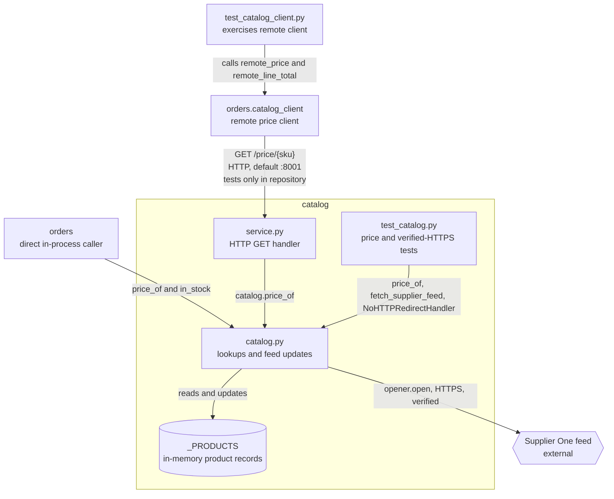
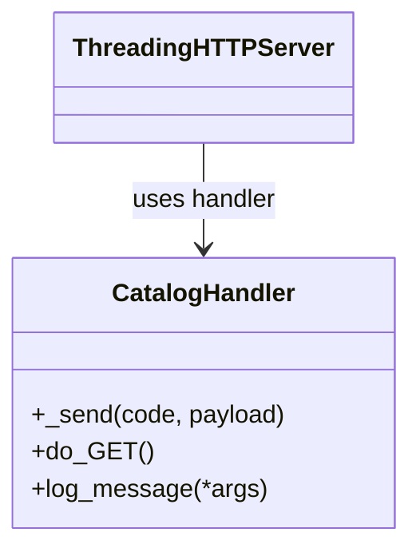

# catalog

| | |
| --- | --- |
| Kind | service and Python library |
| Folders and files | `components/catalog/` |
| Technology | Python 3, standard-library `http.server`, `urllib.request`, `urllib.error`, `urllib.parse`, `ssl`, `json`, and `unittest` (`components/catalog/service.py:7-12`, `components/catalog/catalog.py:2-6`, `components/catalog/test_catalog.py:1-5`) |
| Starts by | `python3 -m components.catalog.service` (inferred: per the module docstring, `components/catalog/service.py:1-5`); the main guard starts the server (`components/catalog/service.py:46-49`). |
| Size | 3 source files, 160 lines, 11 runtime functions and methods (6 functions and 1 redirect-handler method in `catalog.py`, 4 in `service.py`), 2 GET path matches (`components/catalog/catalog.py:18-63`, `components/catalog/service.py:15-43`) |
| Depth | deep |

## Responsibility

The component stores three product records in the module-level `_PRODUCTS` dictionary and provides price and stock lookups (`components/catalog/catalog.py:11-15`, `components/catalog/catalog.py:27-41`). `orders` imports this module and calls `price_of` and `in_stock` directly (`components/orders/orders.py:5`, `components/orders/orders.py:19-20`, `components/orders/orders.py:35-42`). The HTTP server also offers GET handling for health and price paths, with `price_of` supplying the price response (`components/catalog/service.py:24-34`). Catalog code includes functions to fetch and apply supplier data; the fetch uses HTTPS with a certificate-verifying context and refuses a redirect to `http://` (`components/catalog/catalog.py:8`, `components/catalog/catalog.py:18-24`, `components/catalog/catalog.py:48-55`). No feed scheduling or orchestration is defined in this component (inferred: a search of the repository outside the analysis folder and the skills for `fetch_supplier_feed` and `apply_feed` finds 3 hits, the two definitions and one test call of the fetch at `components/catalog/test_catalog.py:19`, and a search for `cron` and `schedul` finds 3 hits, the docstring and the queue's own schedule at `.github/workflows/bible-queue.yml:8-9`).

## Structure

The modules and their direct data and call paths are shown below; the HTTP client is exercised by the orders tests.

| Element | Evidence |
| --- | --- |
| `orders` -> `catalogmod` | `components/orders/orders.py:5`, `components/orders/orders.py:19-20`, `components/orders/orders.py:35-42` |
| `ordershttptests` -> `ordershttp` | `components/orders/test_catalog_client.py:37-54` |
| `ordershttp` -> `service` | `components/orders/catalog_client.py:1-4`, `components/orders/catalog_client.py:11`, `components/orders/catalog_client.py:16`, `components/orders/catalog_client.py:19-23`; search `remote_price\|remote_line_total` in `*.py`: 10 hits in 2 files, calls occur in `test_catalog_client.py` and the client's internal call at `components/orders/catalog_client.py:29` |
| `service` -> `catalogmod` | `components/catalog/service.py:12`, `components/catalog/service.py:24-34` |
| `catalogmod` -> `_PRODUCTS` | `components/catalog/catalog.py:11-15`, `components/catalog/catalog.py:27-29`, `components/catalog/catalog.py:58-63` |
| `testmod` -> `catalogmod` | `components/catalog/test_catalog.py:7`, `components/catalog/test_catalog.py:11-12`, `components/catalog/test_catalog.py:19`, `components/catalog/test_catalog.py:33` |
| `catalogmod` -> supplier feed | `components/catalog/catalog.py:8`, `components/catalog/catalog.py:48-55` |

## Modules

| Module page | Source file | Lines | Role | Main functions |
| --- | --- | ---: | --- | --- |
| [catalog](catalog.md) | `components/catalog/catalog.py` | 63 | Stores products and provides price, stock, image, and feed functions; refuses a feed redirect to `http://`. | `NoHTTPRedirectHandler.redirect_request`, `get_product`, `price_of`, `in_stock`, `image_url`, `fetch_supplier_feed`, `apply_feed` (`components/catalog/catalog.py:18-63`) |
| [service](service.md) | `components/catalog/service.py` | 49 | Implements JSON GET responses and constructs the threaded server. | `CatalogHandler.do_GET`, `make_server` (`components/catalog/service.py:24-43`) |
| [test_catalog](test_catalog.md) | `components/catalog/test_catalog.py` | 48 | Checks a known-SKU price lookup, the verified-HTTPS supplier fetch, and the refusal of a redirect to `http://`. | `CatalogTest.test_price_of_known_sku`, `CatalogTest.test_supplier_feed_uses_verified_https`, `CatalogTest.test_supplier_feed_rejects_redirect_to_http` (`components/catalog/test_catalog.py:10-44`) |

## Main types

`CatalogHandler` is the component's request-handler class; it has no declared data attributes and defines the three methods shown. `make_server` passes it to `ThreadingHTTPServer` (`components/catalog/service.py:15-22`, `components/catalog/service.py:24-37`, `components/catalog/service.py:40-43`).

| Element | Evidence |
| --- | --- |
| `CatalogHandler` methods | `components/catalog/service.py:15-37` |
| `ThreadingHTTPServer` uses `CatalogHandler` | `components/catalog/service.py:10`, `components/catalog/service.py:40-43` |

## Public interface

| Interface | Kind | Card or page | Evidence |
| --- | --- | --- | --- |
| `catalog.price_of(sku)` | function | [catalog module](catalog.md#price_ofsku) | `orders` calls it for each line total (`components/orders/orders.py:19-20`). |
| `catalog.in_stock(sku, qty)` | function | [catalog module](catalog.md#in_stocksku-qty1) | `orders.validate` calls it for positive-quantity lines (`components/orders/orders.py:35-42`). |
| `GET /health` | route | [endpoint card](../api/catalog/catalog.md#get-health) | The handler matches `/health` and returns status 200 (`components/catalog/service.py:26-27`). |
| `GET /price/<sku>` | route | [endpoint card](../api/catalog/catalog.md#get-pricesku) | The handler matches the `/price/` prefix, looks up the remaining decoded path, and responds (`components/catalog/service.py:28-34`). |
| `python3 -m components.catalog.service` | command | [service module](service.md#module-level-code) | The documented invocation and main guard (`components/catalog/service.py:1-5`, `components/catalog/service.py:46-49`). |

`orders.catalog_client.remote_price` constructs `GET /price/<sku>` using `CATALOG_URL` (default `http://127.0.0.1:8001`) and plain HTTP. A search for `remote_price|remote_line_total` in Python files found 10 hits in 2 files: the test call sites and `remote_line_total`'s internal call to `remote_price`; no other in-repository caller was found (inferred: that search) (`components/orders/catalog_client.py:1-4`, `components/orders/catalog_client.py:11`, `components/orders/catalog_client.py:16`, `components/orders/catalog_client.py:19-23`, `components/orders/catalog_client.py:26-29`; `components/orders/test_catalog_client.py:37-54`; search `remote_price|remote_line_total` in `*.py`).

The GET routes do not check authentication or authorization, and the server is created with `ThreadingHTTPServer` without TLS configuration (inferred: `CatalogHandler.do_GET` has no identity or permission checks and `make_server` constructs the server that the module identifies as HTTP; `components/catalog/service.py:24-34`, `components/catalog/service.py:40-43`, `components/catalog/service.py:48`). By default the server listens on the loopback address only: it binds the `host` argument of `make_server`, else `CATALOG_HOST`, else `127.0.0.1`, so another machine can reach it only when a host is set explicitly (assumed: a loopback bind accepts local connections only) (`components/catalog/service.py:40-43`).

## Business rules

| # | Rule, in plain words | Enforced in | Triggered by | Evidence |
| --- | --- | --- | --- | --- |
| C-01 | A missing SKU has no price and causes `price_of` to raise `KeyError` with the SKU in its message. | `price_of` | Price lookup | `components/catalog/catalog.py:32-36` |
| C-02 | Stock is sufficient only when a product exists and its stock is at least the requested quantity. | `in_stock` | Stock lookup | `components/catalog/catalog.py:39-41` |
| C-03 | Supplier-feed entries update only SKUs already present in `_PRODUCTS`; absent product lists produce no updates. | `apply_feed` | Feed application | `components/catalog/catalog.py:60-63` |
| C-04 | `GET /health` returns the health response with status 200. | `CatalogHandler.do_GET` | `/health` path | `components/catalog/service.py:24-27` |
| C-05 | An unrecognized catalog GET path returns status 404. | `CatalogHandler.do_GET` | Any unmatched path | `components/catalog/service.py:33-34` |
| C-06 | A redirect of the supplier-feed request to an `http://` target is refused: it raises `HTTPError` instead of being followed. | `NoHTTPRedirectHandler.redirect_request` | A redirect response to the feed request | `components/catalog/catalog.py:19-24` |

## Data

| Store or file | Reads | Writes | Data dictionary entry |
| --- | --- | --- | --- |
| `_PRODUCTS` (in-memory dictionary) | `get_product`, `price_of`, `in_stock`, and `apply_feed` read existing products (`components/catalog/catalog.py:11-15`, `components/catalog/catalog.py:27-41`, `components/catalog/catalog.py:60-61`). | `apply_feed` changes `price` and `stock` for matching products (`components/catalog/catalog.py:60-63`). | [Data dictionary: `_PRODUCTS`](../data-dictionary.md#_products-the-catalog-products) |
| Supplier JSON response | `fetch_supplier_feed` reads and JSON-decodes the response body (`components/catalog/catalog.py:54-55`). | Not written by this component (inferred: a search of `components/catalog` for `write` finds 1 hit, `self.wfile.write(body)` at `components/catalog/service.py:22`, which sends a response body, not the supplier JSON). | [Data dictionary: external JSON payloads](../data-dictionary.md#external-json-payloads) |

## Outbound calls

| Target | Purpose | Protocol and scheme | Address from | Timeout, retry, fallback | Evidence |
| --- | --- | --- | --- | --- | --- |
| Supplier One feed (`feeds.supplier-one.example.com`) | Fetch product JSON | HTTPS (`https://` URL; `ssl.create_default_context()`; a redirect to `http://` raises `HTTPError`) | Hard-coded `SUPPLIER_FEED_URL` | `timeout=10` by default; no retry or fallback in the function | `components/catalog/catalog.py:8`, `components/catalog/catalog.py:18-24`, `components/catalog/catalog.py:48-55` |

## Configuration read

| Key | Purpose | Default | Source | Evidence |
| --- | --- | --- | --- | --- |
| `CATALOG_HOST` | HTTP server bind host | `127.0.0.1` when the `host` argument is falsey and the variable is unset; a variable set to an empty string is used as it is and binds all interfaces (assumed: library behaviour of an empty host string in a socket address) | Environment, unless a truthy function argument is provided | `components/catalog/service.py:40-43` |
| `CATALOG_PORT` | HTTP server bind port | `8001` when `port` is `None` and the variable is unset | Environment, unless `port` is not `None` | `components/catalog/service.py:40`, `components/catalog/service.py:42` |

## Errors and resilience

`price_of` raises `KeyError` for a missing SKU; the `/price/` handler catches `KeyError` from its success response expression and returns 404 (`components/catalog/catalog.py:32-36`, `components/catalog/service.py:30-33`). The supplier fetch has a timeout argument but does not catch errors or retry; a redirect to `http://` surfaces as an uncaught `HTTPError` (`components/catalog/catalog.py:18-24`, `components/catalog/catalog.py:48-55`). `apply_feed` directly indexes item fields and converts price and stock, so missing fields or invalid conversions can raise (assumed: Python builtin behaviour of key lookup, `float` and `int`) (`components/catalog/catalog.py:60-63`).

## Logging and monitoring

`CatalogHandler.log_message` discards the handler's log message by doing nothing (`components/catalog/service.py:36-37`). The three catalog source files define no metrics or tracing calls (inferred: a search of the three files for `metric`, `trace`, `opentelemetry`, `statsd` and `logging` found 0 hits; `components/catalog/catalog.py:1-63`, `components/catalog/service.py:1-49`, `components/catalog/test_catalog.py:1-48`).

## Tests

`CatalogTest.test_price_of_known_sku` asserts that `SKU-1` has price `24.0` (`components/catalog/test_catalog.py:11-12`). `test_supplier_feed_uses_verified_https` replaces `build_opener` with a mock and asserts the returned feed, the handler types, `check_hostname`, `CERT_REQUIRED`, the `https://` URL and `timeout=10` (`components/catalog/test_catalog.py:14-30`); `test_supplier_feed_rejects_redirect_to_http` asserts that `redirect_request` raises `HTTPError` for an `http://` target (`components/catalog/test_catalog.py:32-44`). Direct execution invokes `unittest.main()` (`components/catalog/test_catalog.py:47-48`). The test file contains no checks for missing SKUs, stock, images, `apply_feed`, or the HTTP server, and no test contacts the supplier (inferred: the whole file, `components/catalog/test_catalog.py:1-48`, holds three test methods that call only `price_of`, `fetch_supplier_feed` and `NoHTTPRedirectHandler`, the second with `build_opener` mocked).

## Surprises

`orders` uses direct Python calls to `price_of` and `in_stock`; it also has an HTTP client for the price route, which is exercised by the orders tests (`components/orders/orders.py:5`, `components/orders/orders.py:19-20`, `components/orders/orders.py:35-42`; `components/orders/catalog_client.py:19-23`; `components/orders/test_catalog_client.py:37-54`). The supplier URL now uses HTTPS (`components/catalog/catalog.py:8`). The fetch function's docstring says it runs nightly from cron (`components/catalog/catalog.py:49`), but this component does not show the claimed schedule (inferred: a search for `fetch_supplier_feed` in the repository outside the analysis folder and the skills finds 2 hits, its definition and the test call, and a search for `cron` and `schedul` finds 3 hits, the docstring and the queue's own schedule).

The component and class diagrams were checked by reading their syntax; no Mermaid renderer was available.

## For the whole-system pages

- **Risk:** The catalog GET routes have no authentication or authorization checks and use plain HTTP without TLS (inferred: as under Security, `do_GET` has no identity or permission checks and `make_server` builds a plain `ThreadingHTTPServer`); the known orders HTTP client also uses plain HTTP by default (`DEFAULT_CATALOG_URL`, `components/orders/catalog_client.py:11`); the server listens on loopback unless a host is set (`components/catalog/service.py:24-34`, `components/catalog/service.py:40-43`, `components/catalog/service.py:48`; `components/orders/catalog_client.py:1-4`, `components/orders/catalog_client.py:11`, `components/orders/catalog_client.py:19-23`).
- **Risk:** The supplier-feed URL is hard-coded (`components/catalog/catalog.py:8`). It is HTTPS with a verifying context, but the live endpoint's certificate was not checked when the URL was switched (inferred: per `https-migration/https-migration-summary.md:29`); the switch rests on the supplier's confirmation of HTTPS on the same host and path (inferred: per `https-migration/https-inventory.md:13`).
- **Surprise:** The supplier-fetch docstring claims a nightly cron run, but no invocation is shown (inferred: a search for `fetch_supplier_feed` outside the analysis folder and the skills finds 2 hits, its definition at `components/catalog/catalog.py:48` and the test call at `components/catalog/test_catalog.py:19`) or by the function body (`components/catalog/catalog.py:48-55`).
- **Open questions:** No question requiring a person to answer was identified from the catalog component files.
- **Glossary:** `SKU` is the key used to identify each product in `_PRODUCTS` (`components/catalog/catalog.py:11-15`); the supplier feed's `products` collection contains the entries consumed by `apply_feed` (`components/catalog/catalog.py:58-63`).

<!-- cites .github/workflows/bible-queue.yml@d54080b12d039672f31f0d0924cc380ded069010 -->

<!-- cites components/catalog/catalog.py@75bb1dc767dc16cad9a5ed5555a7293bc004275b -->

<!-- cites components/catalog/service.py@64e5abbab5e101fac6e56c67450ac4c6346198f1 -->

<!-- cites components/catalog/test_catalog.py@29eeea56df47ceb3c96481a327851eee696ec67d -->

<!-- cites components/orders/catalog_client.py@469f9d282aab983cdd85f364e46bcd02ef6d3635 -->

<!-- cites components/orders/orders.py@33203a1b4d48a6d335cf411f56a54a7035a66ae0 -->

<!-- cites components/orders/test_catalog_client.py@1d32463e1cdc21bd3eee3bc1b6f31feb8ef40a2d -->

<!-- cites https-migration/https-inventory.md@67f184b87fafa019446005a50dc9d98b96256544 -->

<!-- cites https-migration/https-migration-summary.md@8af6a247647debc371a600624b95b7c94326da9c -->
