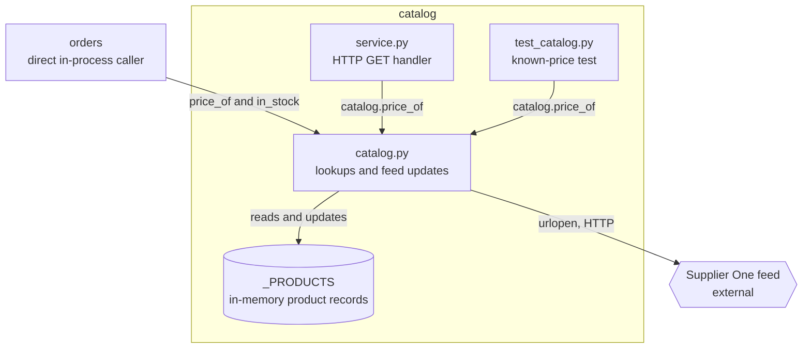
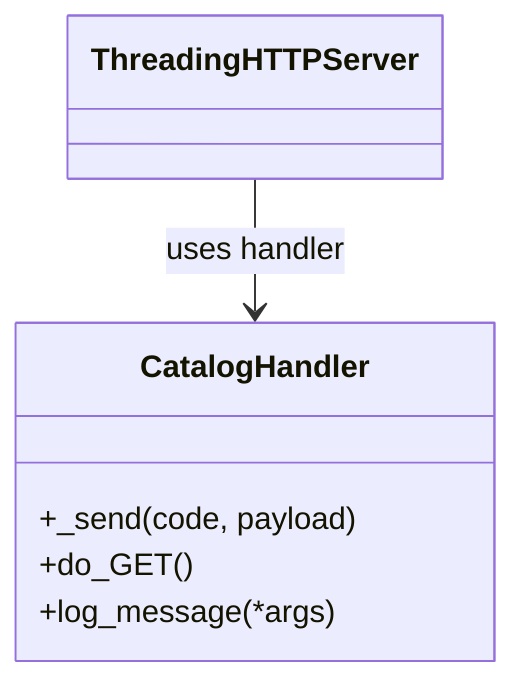

# catalog

| | |
| --- | --- |
| Kind | service and Python library |
| Folders and files | `components/catalog/` |
| Technology | Python 3, standard-library `http.server`, `urllib.request`, `json`, and `unittest` (`components/catalog/service.py:7-12`, `components/catalog/catalog.py:2-3`, `components/catalog/test_catalog.py:1-3`) |
| Starts by | `python3 -m components.catalog.service` (per the module docstring, `components/catalog/service.py:1-5`); the main guard starts the server (`components/catalog/service.py:46-49`). |
| Size | 3 source files, 108 lines, 10 runtime functions, 2 GET path matches (`components/catalog/catalog.py:15-47`, `components/catalog/service.py:15-43`) |
| Depth | deep |

## Responsibility

The component stores three product records in the module-level `_PRODUCTS` dictionary and provides price and stock lookups (`components/catalog/catalog.py:8-12,15-29`). `orders` imports this module and calls `price_of` and `in_stock` directly (`components/orders/orders.py:5,19-20,35-42`). The HTTP server also offers GET handling for health and price paths, with `price_of` supplying the price response (`components/catalog/service.py:24-34`). Catalog code includes functions to fetch and apply supplier data, but no feed scheduling or orchestration is defined in this component (`components/catalog/catalog.py:36-47`).

## Structure

The modules and their direct data and call paths are shown below; HTTP clients not identified in the repository are not shown.

| Element | Evidence |
| --- | --- |
| `orders` -> `catalogmod` | `components/orders/orders.py:5,19-20,35-42` |
| `service` -> `catalogmod` | `components/catalog/service.py:12,24-34` |
| `catalogmod` -> `_PRODUCTS` | `components/catalog/catalog.py:8-12,15-17,42-47` |
| `testmod` -> `catalogmod` | `components/catalog/test_catalog.py:3,7-8` |
| `catalogmod` -> supplier feed | `components/catalog/catalog.py:5,36-39` |

## Modules

| Module page | Source file | Lines | Role | Main functions |
| --- | --- | ---: | --- | --- |
| [catalog](catalog.md) | `components/catalog/catalog.py` | 47 | Stores products and provides price, stock, image, and feed functions. | `get_product`, `price_of`, `in_stock`, `image_url`, `fetch_supplier_feed`, `apply_feed` (`components/catalog/catalog.py:15-47`) |
| [service](service.md) | `components/catalog/service.py` | 49 | Implements JSON GET responses and constructs the threaded server. | `CatalogHandler.do_GET`, `make_server` (`components/catalog/service.py:24-43`) |
| [test_catalog](test_catalog.md) | `components/catalog/test_catalog.py` | 12 | Checks a known-SKU price lookup. | `CatalogTest.test_price_of_known_sku` (`components/catalog/test_catalog.py:6-8`) |

## Main types

`CatalogHandler` is the component's request-handler class; it has no declared data attributes and defines the three methods shown. `make_server` passes it to `ThreadingHTTPServer` (`components/catalog/service.py:15-22,24-37,40-43`).

| Element | Evidence |
| --- | --- |
| `CatalogHandler` methods | `components/catalog/service.py:15-37` |
| `ThreadingHTTPServer` uses `CatalogHandler` | `components/catalog/service.py:10,40-43` |

## Public interface

| Interface | Kind | Card or page | Evidence |
| --- | --- | --- | --- |
| `catalog.price_of(sku)` | function | [catalog module](catalog.md#price_ofsku) | `orders` calls it for each line total (`components/orders/orders.py:19-20`). |
| `catalog.in_stock(sku, qty)` | function | [catalog module](catalog.md#in_stocksku-qty1) | `orders.validate` calls it for positive-quantity lines (`components/orders/orders.py:35-42`). |
| `GET /health` | route | [service module](service.md#cataloghandlerdo_get) | The handler matches `/health` and returns status 200 (`components/catalog/service.py:26-27`). |
| `GET /price/<sku>` | route | [service module](service.md#cataloghandlerdo_get) | The handler matches the `/price/` prefix, looks up the remaining decoded path, and responds (`components/catalog/service.py:28-34`). |
| `python3 -m components.catalog.service` | command | [service module](service.md#module-level-code) | The documented invocation and main guard (`components/catalog/service.py:1-5,46-49`). |

The repository shows `orders` as a caller of the two Python functions; no caller of the HTTP routes is identified here (`components/orders/orders.py:5,19-20,35-42`; the API's documented purpose is in `components/catalog/service.py:1-5`).

## Business rules

| # | Rule, in plain words | Enforced in | Triggered by | Evidence |
| --- | --- | --- | --- | --- |
| C-01 | A missing SKU has no price and causes `price_of` to raise `KeyError` with the SKU in its message. | `price_of` | Price lookup | `components/catalog/catalog.py:20-24` |
| C-02 | Stock is sufficient only when a product exists and its stock is at least the requested quantity. | `in_stock` | Stock lookup | `components/catalog/catalog.py:27-29` |
| C-03 | Supplier-feed entries update only SKUs already present in `_PRODUCTS`; absent product lists produce no updates. | `apply_feed` | Feed application | `components/catalog/catalog.py:44-47` |

## Data

| Store or file | Reads | Writes | Data dictionary entry |
| --- | --- | --- | --- |
| `_PRODUCTS` (in-memory dictionary) | `get_product`, `price_of`, `in_stock`, and `apply_feed` read existing products (`components/catalog/catalog.py:8-12,15-29,44-45`). | `apply_feed` changes `price` and `stock` for matching products (`components/catalog/catalog.py:44-47`). | [Catalog module](catalog.md#module-level-code) |
| Supplier JSON response | `fetch_supplier_feed` reads and JSON-decodes the response body (`components/catalog/catalog.py:36-39`). | Not written by this component. | [Catalog module](catalog.md#fetch_supplier_feedtimeout10) |

## Outbound calls

| Target | Purpose | Protocol and scheme | Address from | Timeout, retry, fallback | Evidence |
| --- | --- | --- | --- | --- | --- |
| Supplier One feed (`feeds.supplier-one.example.com`) | Fetch product JSON | HTTP | Hard-coded `SUPPLIER_FEED_URL` | `timeout=10` by default; no retry or fallback in the function | `components/catalog/catalog.py:5,36-39` |

## Configuration read

| Key | Purpose | Default | Source | Evidence |
| --- | --- | --- | --- | --- |
| `CATALOG_HOST` | HTTP server bind host | `127.0.0.1` when the `host` argument is falsey | Environment, unless a truthy function argument is provided | `components/catalog/service.py:40-41` |
| `CATALOG_PORT` | HTTP server bind port | `8001` when `port` is `None` and the variable is unset | Environment, unless `port` is not `None` | `components/catalog/service.py:40,42` |

## Errors and resilience

`price_of` raises `KeyError` for a missing SKU; the `/price/` handler catches `KeyError` from its success response expression and returns 404 (`components/catalog/catalog.py:20-24`, `components/catalog/service.py:30-33`). The supplier fetch has a timeout argument but does not catch errors or retry (`components/catalog/catalog.py:36-39`). `apply_feed` directly indexes item fields and converts price and stock, so missing fields or invalid conversions can raise (`components/catalog/catalog.py:44-47`).

## Logging and monitoring

`CatalogHandler.log_message` discards the handler's log message by doing nothing (`components/catalog/service.py:36-37`). The three catalog source files define no metrics or tracing calls (`components/catalog/catalog.py:1-47`, `components/catalog/service.py:1-49`, `components/catalog/test_catalog.py:1-12`).

## Tests

`CatalogTest.test_price_of_known_sku` asserts that `SKU-1` has price `24.0`; direct execution invokes `unittest.main()` (`components/catalog/test_catalog.py:6-12`). The test file contains no checks for missing SKUs, stock, images, feed processing, or HTTP behavior (`components/catalog/test_catalog.py:6-8`).

## Surprises

`orders` uses direct Python calls to `price_of` and `in_stock`; the HTTP API is another interface, and no HTTP caller is identified in the repository (`components/orders/orders.py:5,19-20,35-42`; `components/catalog/service.py:24-34`). The supplier URL uses plain HTTP, and the fetch function's docstring says it runs nightly from cron, but a repository search for `fetch_supplier_feed` found four hits, with the only source-code hit being its definition (`components/catalog/catalog.py:36-39`; search: `fetch_supplier_feed` in the repository, 4 hits). This component does not show the claimed schedule.

The component and class diagrams were checked by reading their syntax; no Mermaid renderer was available.

## For the whole-system pages

- **Risk:** Supplier-feed transport uses plain HTTP, and the URL is hard-coded (`components/catalog/catalog.py:5,36-39`).
- **Surprise:** The supplier-fetch docstring claims a nightly cron run, but no invocation is shown by the repository search for `fetch_supplier_feed` (4 hits, with the only source-code hit at `components/catalog/catalog.py:36`) or by the function body (`components/catalog/catalog.py:36-39`).
- **Open questions:** No question requiring a person to answer was identified from the catalog component files.
- **Glossary:** `SKU` is the key used to identify each product in `_PRODUCTS` (`components/catalog/catalog.py:8-12`); the supplier feed's `products` collection contains the entries consumed by `apply_feed` (`components/catalog/catalog.py:42-47`).
