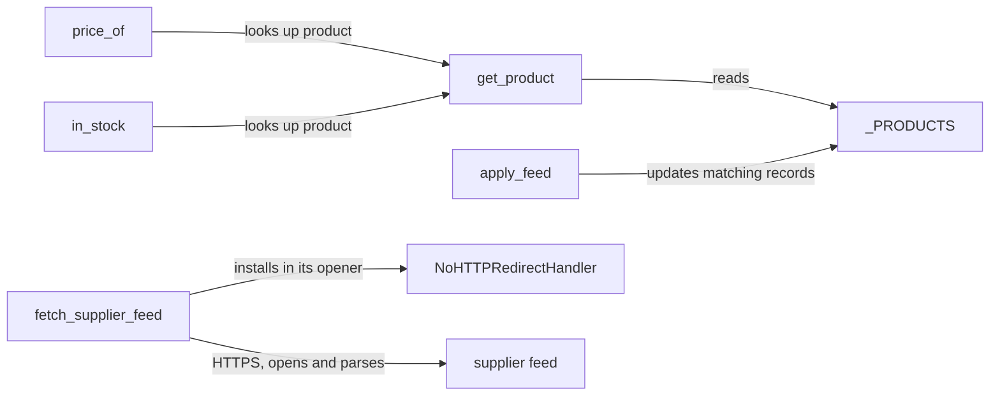

# catalog

Source file: `components/catalog/catalog.py`

| | |
| --- | --- |
| Component | `catalog` (its design page is `README.md` in this folder) |
| Lines | 63 |
| Role | Stores product records and provides functions to look up and update them. |
| Imports that matter | `json` parses the supplier response; `ssl` builds the certificate-verifying context; `urllib.request` opens the feed URL; `urllib.parse` and `urllib.error` serve the redirect handler (`components/catalog/catalog.py:2-6`). |
| Module-level state | `SUPPLIER_FEED_URL` (an `https://` URL), `IMAGE_CDN`, and mutable `_PRODUCTS` are assigned at import time (`components/catalog/catalog.py:8-15`). |

## Summary

The module initializes three product records, defines a redirect handler that refuses a redirect to `http://`, then defines lookup, price, stock, and image helpers followed by the supplier-feed fetch, which uses that handler, and the update function (`components/catalog/catalog.py:8-63`).

## Index

| Symbol | Kind | Lines | Card |
| --- | --- | --- | --- |
| `NoHTTPRedirectHandler` | class | 18-24 | [class](#nohttpredirecthandler) |
| `NoHTTPRedirectHandler.redirect_request` | method | 19-24 | [card](#nohttpredirecthandlerredirect_requestreq-fp-code-msg-headers-newurl) |
| `get_product` | function | 27-29 | [card](#get_productsku) |
| `price_of` | function | 32-36 | [card](#price_ofsku) |
| `in_stock` | function | 39-41 | [card](#in_stocksku-qty1) |
| `image_url` | function | 44-45 | [card](#image_urlsku) |
| `fetch_supplier_feed` | function | 48-55 | [card](#fetch_supplier_feedtimeout10) |
| `apply_feed` | function | 58-63 | [card](#apply_feedfeed) |

## Call graph



## Classes

### `NoHTTPRedirectHandler`

Source: `components/catalog/catalog.py:18-24` <!-- code: 0c3e5197b403 -->

`NoHTTPRedirectHandler` subclasses `urllib.request.HTTPRedirectHandler` and overrides one method, `redirect_request`. It declares no fields. `fetch_supplier_feed` creates one instance per call and passes it to `build_opener` (`components/catalog/catalog.py:18-24`, `components/catalog/catalog.py:51-53`).

#### `NoHTTPRedirectHandler.redirect_request(req, fp, code, msg, headers, newurl)`

Source: `components/catalog/catalog.py:19-24` <!-- code: fc549dd35745 -->

| | |
| --- | --- |
| Kind | instance method, overrides `urllib.request.HTTPRedirectHandler.redirect_request` |
| Called by | the opener built in `fetch_supplier_feed`, when the server answers with a redirect (assumed: `urllib.request` calls `redirect_request` of the installed redirect handler); `CatalogTest.test_supplier_feed_rejects_redirect_to_http` calls it directly (`components/catalog/test_catalog.py:37-44`). |
| Calls | `urllib.parse.urlsplit`, `.scheme.lower`, `urllib.error.HTTPError`, `super().redirect_request` |
| Purpose | Refuses a redirect whose target uses the `http` scheme; every other redirect is handled by the parent class. |

**Inputs**

| Name | Type | Meaning | Checked how |
| --- | --- | --- | --- |
| `req`, `fp`, `code`, `msg`, `headers` | urllib redirect arguments | The original request, the response body, status code, reason and headers of the redirect response | Passed through to the parent method or to the `HTTPError` (`components/catalog/catalog.py:21-24`). |
| `newurl` | string | The redirect target | Its scheme is lowercased and compared with `"http"` (`components/catalog/catalog.py:20`). |

**Steps**

1. Splits `newurl` with `urllib.parse.urlsplit` and lowercases its scheme (`components/catalog/catalog.py:20`).
2. When that scheme equals `http`, raises `urllib.error.HTTPError(newurl, code, "Refusing redirect from HTTPS to HTTP", headers, fp)` (`components/catalog/catalog.py:21-23`).
3. For any other scheme, returns `super().redirect_request(req, fp, code, msg, headers, newurl)` (`components/catalog/catalog.py:24`).

**Pseudo-code**

```text
if scheme(newurl).lower() == "http":
    raise HTTPError(newurl, code, "Refusing redirect from HTTPS to HTTP", headers, fp)
return parent.redirect_request(req, fp, code, msg, headers, newurl)
```

**Branches and errors**

| Line | Branch | When | What happens |
| --- | --- | --- | --- |
| `components/catalog/catalog.py:20` | if | the lowercased scheme of `newurl` equals `http` | Enters the refusal path (`components/catalog/catalog.py:20-23`). |
| `components/catalog/catalog.py:21` | raise | the redirect target is `http` | Raises `urllib.error.HTTPError` with message `Refusing redirect from HTTPS to HTTP`, so the fetch fails instead of following the downgrade (`components/catalog/catalog.py:21-23`). |

**Output and side effects**: returns whatever the parent method returns for a non-`http` target, or raises; it changes no state (`components/catalog/catalog.py:19-24`). The check compares only the scheme text: a target with a scheme other than `http` (for example `https`) is not refused here (`components/catalog/catalog.py:20-24`).

## Functions and methods

### `get_product(sku)`

Source: `components/catalog/catalog.py:27-29` <!-- code: 9e5f194ac459 -->

| | |
| --- | --- |
| Kind | function |
| Called by | `price_of` (`components/catalog/catalog.py:33`) and `in_stock` (`components/catalog/catalog.py:40`). |
| Calls | `_PRODUCTS.get` |
| Purpose | Looks up a product record by SKU. |

**Inputs**

| Name | Type | Meaning | Checked how |
| --- | --- | --- | --- |
| `sku` | dictionary key | SKU to find in `_PRODUCTS` | No normalization or validation is applied (`components/catalog/catalog.py:27-29`). |

**Steps**

1. Returns `_PRODUCTS.get(sku)`, which is the product dictionary for a present key or `None` for a missing key (`components/catalog/catalog.py:29`).

**Pseudo-code**

```text
return _PRODUCTS.get(sku)
```

**Output and side effects**: returns the stored product dictionary or `None`; it does not update the store (`components/catalog/catalog.py:27-29`).

### `price_of(sku)`

Source: `components/catalog/catalog.py:32-36` <!-- code: 9339c8a1a6d3 -->

| | |
| --- | --- |
| Kind | function |
| Called by | `orders.line_total` (`components/orders/orders.py:20`); the HTTP handler calls `catalog.price_of` (`components/catalog/service.py:31`); `CatalogTest.test_price_of_known_sku` (`components/catalog/test_catalog.py:12`). |
| Calls | `get_product`, `KeyError` |
| Purpose | Returns a product's price or raises `KeyError` for a missing SKU. |

**Inputs**

| Name | Type | Meaning | Checked how |
| --- | --- | --- | --- |
| `sku` | dictionary key | SKU whose price is requested | Resolved through `get_product` (`components/catalog/catalog.py:33`). |

**Steps**

1. Gets the record with `get_product(sku)` (`components/catalog/catalog.py:33`).
2. Raises `KeyError` with `unknown sku <sku>` if the result is `None` (`components/catalog/catalog.py:34-35`).
3. Otherwise returns its `price` value (`components/catalog/catalog.py:36`).

**Pseudo-code**

```text
product = get_product(sku)
if product is None: raise KeyError("unknown sku " + sku)
return product["price"]
```

**Branches and errors**

| Line | Branch | When | What happens |
| --- | --- | --- | --- |
| `catalog.py:34` | if | `product is None` | Enters the missing-product path (`components/catalog/catalog.py:34-35`). |
| `catalog.py:35` | raise | Product lookup returned `None` | Raises `KeyError` with the SKU in its message (`components/catalog/catalog.py:35`). |

**Output and side effects**: returns `product["price"]`; missing SKUs raise `KeyError`; the store is not modified (`components/catalog/catalog.py:32-36`).

### `in_stock(sku, qty=1)`

Source: `components/catalog/catalog.py:39-41` <!-- code: 9dfed2fca633 -->

| | |
| --- | --- |
| Kind | function |
| Called by | `orders.validate` (`components/orders/orders.py:40`). |
| Calls | `get_product` |
| Purpose | Checks that the SKU exists and its stock is at least the requested quantity. |

**Inputs**

| Name | Type | Meaning | Checked how |
| --- | --- | --- | --- |
| `sku` | dictionary key | Product to check | Looked up with `get_product` (`components/catalog/catalog.py:40`). |
| `qty` | number, default `1` | Minimum stock required | Compared directly with the stored `stock` (`components/catalog/catalog.py:41`). |

**Steps**

1. Gets the product record with `get_product(sku)` (`components/catalog/catalog.py:40`).
2. Returns `True` only if a product exists and its `stock` is greater than or equal to `qty`; the `and` short-circuits for a missing product (`components/catalog/catalog.py:41`).

**Pseudo-code**

```text
product = get_product(sku)
return product exists and product["stock"] >= qty
```

**Output and side effects**: returns the result of the existence and stock comparison; does not mutate the record (`components/catalog/catalog.py:39-41`).

### `image_url(sku)`

Source: `components/catalog/catalog.py:44-45` <!-- code: ba322139b301 -->

| | |
| --- | --- |
| Kind | function |
| Called by | Not established by this module (inferred: a search of the repository outside the analysis folder and the skills for `image_url` finds 1 hit, its definition). |
| Calls | `sku.lower` |
| Purpose | Builds a product image URL from the configured CDN prefix and SKU. |

**Inputs**

| Name | Type | Meaning | Checked how |
| --- | --- | --- | --- |
| `sku` | string | SKU used in the image filename | Lowercased; no other validation is shown (`components/catalog/catalog.py:44-45`). |

**Steps**

1. Returns `IMAGE_CDN + sku.lower() + ".jpg"` (`components/catalog/catalog.py:45`).

**Pseudo-code**

```text
return IMAGE_CDN + lowercase(sku) + ".jpg"
```

**Output and side effects**: returns the constructed URL string; does not perform a request (`components/catalog/catalog.py:44-45`).

### `fetch_supplier_feed(timeout=10)`

Source: `components/catalog/catalog.py:48-55` <!-- code: ec0db1f55db3 -->

| | |
| --- | --- |
| Kind | function |
| Called by | `CatalogTest.test_supplier_feed_uses_verified_https` (`components/catalog/test_catalog.py:19`); no other caller (inferred: a search of the repository outside the analysis folder and the skills for `fetch_supplier_feed` finds 2 hits, its definition and that test call). |
| Calls | `ssl.create_default_context`, `urllib.request.build_opener`, `NoHTTPRedirectHandler`, `urllib.request.HTTPSHandler`, `opener.open`, `resp.read`, `json.loads` |
| Purpose | Opens the configured HTTPS supplier-feed URL with a certificate-verifying context and a redirect handler that refuses `http://`, and parses the response as JSON. |

**Inputs**

| Name | Type | Meaning | Checked how |
| --- | --- | --- | --- |
| `timeout` | number, default `10` | Timeout passed to `opener.open` | Passed through without local validation (`components/catalog/catalog.py:48`, `components/catalog/catalog.py:54`). |

**Steps**

1. Creates `ssl.create_default_context()` (`components/catalog/catalog.py:50`). The unit test asserts that the context it receives has `check_hostname` true and `verify_mode` `ssl.CERT_REQUIRED` (`components/catalog/test_catalog.py:25-27`).
2. Builds an opener from `NoHTTPRedirectHandler()` and `urllib.request.HTTPSHandler(context=context)` (`components/catalog/catalog.py:51-53`).
3. Opens `SUPPLIER_FEED_URL` with the supplied timeout as a context manager (`components/catalog/catalog.py:54`); the constant is `https://feeds.supplier-one.example.com/v2/products.json` (`components/catalog/catalog.py:8`).
4. Reads the response body and returns `json.loads(resp.read())` (`components/catalog/catalog.py:55`).

**Pseudo-code**

```text
context = default SSL context (certificate and hostname verified)
opener = build_opener(NoHTTPRedirectHandler(), HTTPSHandler(context))
with opener.open(SUPPLIER_FEED_URL, timeout) as response:
    return JSON(response.read())
```

**Output and side effects**: returns the parsed JSON value; opening, reading, or parsing errors are not caught in this function, and neither is the `HTTPError` that `NoHTTPRedirectHandler` raises for a redirect to `http://` (`components/catalog/catalog.py:48-55`).

**Notes**: There is no retry or fallback to plain HTTP in the function (`components/catalog/catalog.py:48-55`). The supplier's live certificate and hostname were not checked against the real endpoint when the URL was switched (inferred: per `https-migration/https-migration-summary.md:29`).

### `apply_feed(feed)`

Source: `components/catalog/catalog.py:58-63` <!-- code: 8a9129d98a7c -->

| | |
| --- | --- |
| Kind | function |
| Called by | Not established by this module (inferred: a search of the repository outside the analysis folder and the skills for `apply_feed` finds 1 hit, its definition). |
| Calls | `feed.get`, `float`, `int` |
| Purpose | Applies price and stock values from feed entries for SKUs already in `_PRODUCTS`. |

**Inputs**

| Name | Type | Meaning | Checked how |
| --- | --- | --- | --- |
| `feed` | mapping-like value | Feed object whose `products` value contains entries | Reads `feed.get("products", [])`; directly indexes each item's `sku`, `price`, and `stock` (`components/catalog/catalog.py:60-63`). |

**Steps**

1. Iterates over `feed.get("products", [])`; a missing `products` key produces no iterations (`components/catalog/catalog.py:60`).
2. For each item whose `sku` is already in `_PRODUCTS`, converts and writes its `price` as `float` and its `stock` as `int` (`components/catalog/catalog.py:61-63`).
3. Ignores items whose SKU is not in `_PRODUCTS` (`components/catalog/catalog.py:61`).

**Pseudo-code**

```text
for item in feed.get("products", []):
    if item["sku"] is in _PRODUCTS:
        update matching price as float and stock as int
```

**Branches and errors**

| Line | Branch | When | What happens |
| --- | --- | --- | --- |
| `catalog.py:60` | for | For each entry in `feed.get("products", [])` | Processes entries one by one; an empty or missing list has no iterations (`components/catalog/catalog.py:60`). |
| `catalog.py:61` | if | `item["sku"]` is a key in `_PRODUCTS` | Updates that product; otherwise makes no update for the item (`components/catalog/catalog.py:61-63`). |

**Output and side effects**: mutates matching records in `_PRODUCTS`; no explicit value is returned (`components/catalog/catalog.py:58-63`). Missing fields or invalid numeric values can raise during direct indexing or conversion (assumed: Python builtin behaviour of key lookup, `float` and `int`) (`components/catalog/catalog.py:61-63`).

## Module-level code

The module defines the supplier feed URL, image CDN prefix, and three initial product dictionaries (`components/catalog/catalog.py:8-15`). The redirect handler class and the function definitions follow and do not fetch or update the feed merely by being imported (`components/catalog/catalog.py:18-63`).

## Surprises

`fetch_supplier_feed` reads from the hard-coded HTTPS URL (`components/catalog/catalog.py:8`), while `apply_feed` only updates SKUs already present in `_PRODUCTS` (`components/catalog/catalog.py:58-63`). The source docstring says the fetch runs nightly from cron (`components/catalog/catalog.py:49`), but this file defines no schedule (inferred: a search of the repository outside the analysis folder and the skills for `cron` and `schedul` finds 3 hits, the docstring and the queue workflow's own schedule at `.github/workflows/bible-queue.yml:8-9`). The HTTPS migration records are in `https-migration/`; they describe the supplier change as not proven against the live endpoint (inferred: per `https-migration/https-migration-summary.md:3-5`).

<!-- cites .github/workflows/bible-queue.yml@d54080b12d039672f31f0d0924cc380ded069010 -->

<!-- cites components/catalog/catalog.py@75bb1dc767dc16cad9a5ed5555a7293bc004275b -->

<!-- cites components/catalog/service.py@64e5abbab5e101fac6e56c67450ac4c6346198f1 -->

<!-- cites components/catalog/test_catalog.py@29eeea56df47ceb3c96481a327851eee696ec67d -->

<!-- cites components/orders/orders.py@33203a1b4d48a6d335cf411f56a54a7035a66ae0 -->

<!-- cites https-migration/https-migration-summary.md@8af6a247647debc371a600624b95b7c94326da9c -->
