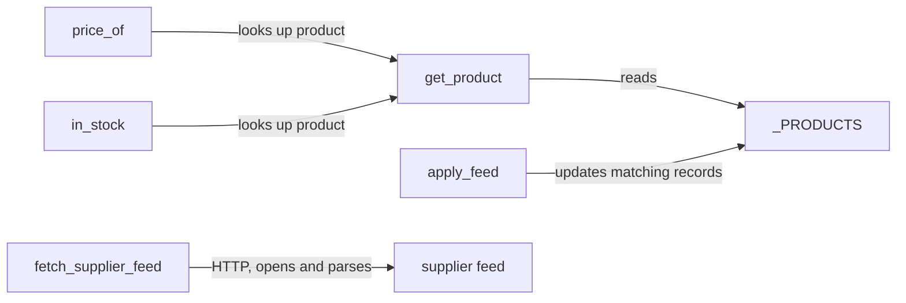

# catalog

Source file: `components/catalog/catalog.py`

| | |
| --- | --- |
| Component | `catalog` (its design page is `README.md` in this folder) |
| Lines | 47 |
| Role | Stores product records and provides functions to look up and update them. |
| Imports that matter | `json` parses the supplier response; `urllib.request` opens the feed URL. |
| Module-level state | `SUPPLIER_FEED_URL`, `IMAGE_CDN`, and mutable `_PRODUCTS` are assigned at import time (`components/catalog/catalog.py:5-12`). |

## Summary

The module initializes three product records, then defines lookup, price, stock, and image helpers followed by supplier-feed fetch and update functions (`components/catalog/catalog.py:5-47`).

## Index

| Symbol | Kind | Lines | Card |
| --- | --- | --- | --- |
| `get_product` | function | 15-17 | [card](#get_productsku) |
| `price_of` | function | 20-24 | [card](#price_ofsku) |
| `in_stock` | function | 27-29 | [card](#in_stocksku-qty1) |
| `image_url` | function | 32-33 | [card](#image_urlsku) |
| `fetch_supplier_feed` | function | 36-39 | [card](#fetch_supplier_feedtimeout10) |
| `apply_feed` | function | 42-47 | [card](#apply_feedfeed) |

## Call graph



## Functions and methods

### `get_product(sku)`

Source: `components/catalog/catalog.py:15-17` <!-- code: 9e5f194ac459 -->

| | |
| --- | --- |
| Kind | function |
| Called by | `price_of` (`components/catalog/catalog.py:21`) and `in_stock` (`components/catalog/catalog.py:28`). |
| Calls | `_PRODUCTS.get` |
| Purpose | Looks up a product record by SKU. |

**Inputs**

| Name | Type | Meaning | Checked how |
| --- | --- | --- | --- |
| `sku` | dictionary key | SKU to find in `_PRODUCTS` | No normalization or validation is applied (`components/catalog/catalog.py:15-17`). |

**Steps**

1. Returns `_PRODUCTS.get(sku)`, which is the product dictionary for a present key or `None` for a missing key (`components/catalog/catalog.py:17`).

**Pseudo-code**

```text
return _PRODUCTS.get(sku)
```

**Output and side effects**: returns the stored product dictionary or `None`; it does not update the store (`components/catalog/catalog.py:15-17`).

### `price_of(sku)`

Source: `components/catalog/catalog.py:20-24` <!-- code: 9339c8a1a6d3 -->

| | |
| --- | --- |
| Kind | function |
| Called by | `orders.line_total` (`components/orders/orders.py:20`); the HTTP handler calls `catalog.price_of` (`components/catalog/service.py:31`); `CatalogTest.test_price_of_known_sku` (`components/catalog/test_catalog.py:8`). |
| Calls | `get_product`, `KeyError` |
| Purpose | Returns a product's price or raises `KeyError` for a missing SKU. |

**Inputs**

| Name | Type | Meaning | Checked how |
| --- | --- | --- | --- |
| `sku` | dictionary key | SKU whose price is requested | Resolved through `get_product` (`components/catalog/catalog.py:21`). |

**Steps**

1. Gets the record with `get_product(sku)` (`components/catalog/catalog.py:21`).
2. Raises `KeyError` with `unknown sku <sku>` if the result is `None` (`components/catalog/catalog.py:22-23`).
3. Otherwise returns its `price` value (`components/catalog/catalog.py:24`).

**Pseudo-code**

```text
product = get_product(sku)
if product is None: raise KeyError("unknown sku " + sku)
return product["price"]
```

**Branches and errors**

| Line | Branch | When | What happens |
| --- | --- | --- | --- |
| `catalog.py:22` | if | `product is None` | Enters the missing-product path (`components/catalog/catalog.py:22-23`). |
| `catalog.py:23` | raise | Product lookup returned `None` | Raises `KeyError` with the SKU in its message (`components/catalog/catalog.py:23`). |

**Output and side effects**: returns `product["price"]`; missing SKUs raise `KeyError`; the store is not modified (`components/catalog/catalog.py:20-24`).

### `in_stock(sku, qty=1)`

Source: `components/catalog/catalog.py:27-29` <!-- code: 9dfed2fca633 -->

| | |
| --- | --- |
| Kind | function |
| Called by | `orders.validate` (`components/orders/orders.py:40`). |
| Calls | `get_product` |
| Purpose | Checks that the SKU exists and its stock is at least the requested quantity. |

**Inputs**

| Name | Type | Meaning | Checked how |
| --- | --- | --- | --- |
| `sku` | dictionary key | Product to check | Looked up with `get_product` (`components/catalog/catalog.py:28`). |
| `qty` | number, default `1` | Minimum stock required | Compared directly with the stored `stock` (`components/catalog/catalog.py:29`). |

**Steps**

1. Gets the product record with `get_product(sku)` (`components/catalog/catalog.py:28`).
2. Returns `True` only if a product exists and its `stock` is greater than or equal to `qty`; the `and` short-circuits for a missing product (`components/catalog/catalog.py:29`).

**Pseudo-code**

```text
product = get_product(sku)
return product exists and product["stock"] >= qty
```

**Output and side effects**: returns the result of the existence and stock comparison; does not mutate the record (`components/catalog/catalog.py:27-29`).

### `image_url(sku)`

Source: `components/catalog/catalog.py:32-33` <!-- code: ba322139b301 -->

| | |
| --- | --- |
| Kind | function |
| Called by | Not established by this module (inferred: a search of the repository outside the analysis folder and the skills for `image_url` finds 1 hit, its definition). |
| Calls | `sku.lower` |
| Purpose | Builds a product image URL from the configured CDN prefix and SKU. |

**Inputs**

| Name | Type | Meaning | Checked how |
| --- | --- | --- | --- |
| `sku` | string | SKU used in the image filename | Lowercased; no other validation is shown (`components/catalog/catalog.py:32-33`). |

**Steps**

1. Returns `IMAGE_CDN + sku.lower() + ".jpg"` (`components/catalog/catalog.py:33`).

**Pseudo-code**

```text
return IMAGE_CDN + lowercase(sku) + ".jpg"
```

**Output and side effects**: returns the constructed URL string; does not perform a request (`components/catalog/catalog.py:32-33`).

### `fetch_supplier_feed(timeout=10)`

Source: `components/catalog/catalog.py:36-39` <!-- code: d1d97f4f1787 -->

| | |
| --- | --- |
| Kind | function |
| Called by | Not established by this module (inferred: a search of the repository outside the analysis folder and the skills for `fetch_supplier_feed` finds 1 hit, its definition). |
| Calls | `urllib.request.urlopen`, `resp.read`, `json.loads` |
| Purpose | Opens the configured supplier-feed URL and parses its response as JSON. |

**Inputs**

| Name | Type | Meaning | Checked how |
| --- | --- | --- | --- |
| `timeout` | number, default `10` | Timeout passed to `urlopen` | Passed through without local validation (`components/catalog/catalog.py:36-38`). |

**Steps**

1. Opens `SUPPLIER_FEED_URL` with the supplied timeout as a context manager (`components/catalog/catalog.py:38`).
2. Reads the response body and returns `json.loads(resp.read())` (`components/catalog/catalog.py:39`).

**Pseudo-code**

```text
with urlopen(SUPPLIER_FEED_URL, timeout) as response:
    return JSON(response.read())
```

**Output and side effects**: returns the parsed JSON value; opening, reading, or parsing errors are not caught in this function (`components/catalog/catalog.py:36-39`).

### `apply_feed(feed)`

Source: `components/catalog/catalog.py:42-47` <!-- code: 8a9129d98a7c -->

| | |
| --- | --- |
| Kind | function |
| Called by | Not established by this module (inferred: a search of the repository outside the analysis folder and the skills for `apply_feed` finds 1 hit, its definition). |
| Calls | `feed.get`, `float`, `int` |
| Purpose | Applies price and stock values from feed entries for SKUs already in `_PRODUCTS`. |

**Inputs**

| Name | Type | Meaning | Checked how |
| --- | --- | --- | --- |
| `feed` | mapping-like value | Feed object whose `products` value contains entries | Reads `feed.get("products", [])`; directly indexes each item's `sku`, `price`, and `stock` (`components/catalog/catalog.py:44-47`). |

**Steps**

1. Iterates over `feed.get("products", [])`; a missing `products` key produces no iterations (`components/catalog/catalog.py:44`).
2. For each item whose `sku` is already in `_PRODUCTS`, converts and writes its `price` as `float` and its `stock` as `int` (`components/catalog/catalog.py:45-47`).
3. Ignores items whose SKU is not in `_PRODUCTS` (`components/catalog/catalog.py:45`).

**Pseudo-code**

```text
for item in feed.get("products", []):
    if item["sku"] is in _PRODUCTS:
        update matching price as float and stock as int
```

**Branches and errors**

| Line | Branch | When | What happens |
| --- | --- | --- | --- |
| `catalog.py:44` | for | For each entry in `feed.get("products", [])` | Processes entries one by one; an empty or missing list has no iterations (`components/catalog/catalog.py:44`). |
| `catalog.py:45` | if | `item["sku"]` is a key in `_PRODUCTS` | Updates that product; otherwise makes no update for the item (`components/catalog/catalog.py:45-47`). |

**Output and side effects**: mutates matching records in `_PRODUCTS`; no explicit value is returned (`components/catalog/catalog.py:42-47`). Missing fields or invalid numeric values can raise during direct indexing or conversion (assumed: Python builtin behaviour of key lookup, `float` and `int`) (`components/catalog/catalog.py:45-47`).

## Module-level code

The module defines the supplier feed URL, image CDN prefix, and three initial product dictionaries (`components/catalog/catalog.py:5-12`). Function definitions follow and do not fetch or update the feed merely by being imported (`components/catalog/catalog.py:15-47`).

## Surprises

`fetch_supplier_feed` reads from the hard-coded URL, while `apply_feed` only updates SKUs already present in `_PRODUCTS` (`components/catalog/catalog.py:5`, `components/catalog/catalog.py:42-47`). The source docstring says the fetch runs nightly from cron, but this file defines no schedule (inferred: the function only opens and parses the feed at `components/catalog/catalog.py:36-39`).

<!-- cites components/catalog/catalog.py@1e15fdaab1fa3c720d99a864abb4cac9c8259421 -->

<!-- cites components/catalog/service.py@64e5abbab5e101fac6e56c67450ac4c6346198f1 -->

<!-- cites components/catalog/test_catalog.py@9be40d147e425d178067c8b34f19b28b9b374d1f -->

<!-- cites components/orders/orders.py@33203a1b4d48a6d335cf411f56a54a7035a66ae0 -->
