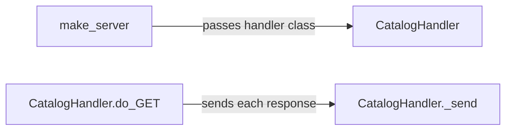

# service

Source file: `components/catalog/service.py`

| | |
| --- | --- |
| Component | `catalog` (its design page is `README.md` in this folder) |
| Lines | 49 |
| Role | Provides the catalog's HTTP GET endpoints and constructs their threaded server. |
| Imports that matter | `BaseHTTPRequestHandler` and `ThreadingHTTPServer` from `http.server`; the sibling `catalog` module. |
| Module-level state | No runtime state is assigned; imports and definitions are at lines 7-43. |

## Summary

`CatalogHandler` parses GET paths, returns the health response or a catalog price, and sends JSON through `_send`. `make_server` configures and constructs the HTTP server. When run as a module, the file creates the server and serves forever (`components/catalog/service.py:15-49`).

## Index

| Symbol | Kind | Lines | Card |
| --- | --- | --- | --- |
| `CatalogHandler` | class | 15-37 | [class](#cataloghandler) |
| `CatalogHandler._send` | method | 16-22 | [card](#cataloghandler_sendcode-payload) |
| `CatalogHandler.do_GET` | method | 24-34 | [card](#cataloghandlerdo_get) |
| `CatalogHandler.log_message` | method | 36-37 | [card](#cataloghandlerlog_messageargs) |
| `make_server` | function | 40-43 | [card](#make_serverhostnone-portnone) |

## Call graph



## Classes

### `CatalogHandler`

Source: `components/catalog/service.py:15-37` <!-- code: f7c8d0d6009d -->

`CatalogHandler` subclasses `BaseHTTPRequestHandler`. It defines `_send`, `do_GET`, and `log_message`; the class body declares no additional data attributes (`components/catalog/service.py:15-37`). `make_server` passes the class to `ThreadingHTTPServer` as its request handler (`components/catalog/service.py:40-43`).

#### `CatalogHandler._send(code, payload)`

Source: `components/catalog/service.py:16-22` <!-- code: e4ce28347ba9 -->

| | |
| --- | --- |
| Kind | instance method |
| Called by | `CatalogHandler.do_GET` (`components/catalog/service.py:27-34`) |
| Calls | `json.dumps`, `encode`, `self.send_response`, `self.send_header`, `str`, `len`, `self.end_headers`, `self.wfile.write` |
| Purpose | Serializes a payload as JSON and writes an HTTP response. |

**Inputs**

| Name | Type | Meaning | Checked how |
| --- | --- | --- | --- |
| `code` | integer-like | HTTP response status passed to `send_response` | Not validated in this method (`components/catalog/service.py:16-22`). |
| `payload` | JSON-serializable value | Response body to encode | Passed to `json.dumps` (`components/catalog/service.py:17`). |

**Steps**

1. Serializes `payload` with `json.dumps` and encodes the resulting string (`components/catalog/service.py:17`).
2. Sends `code`, declares `Content-Type: application/json` and the encoded body's length, ends headers, then writes the body (`components/catalog/service.py:18-22`).

**Pseudo-code**

```text
body = JSON(payload).encode()
send response code and JSON content headers
write body
```

**Output and side effects**: writes the status, headers, and body to the request handler's response stream; no value is returned explicitly (`components/catalog/service.py:18-22`).

#### `CatalogHandler.do_GET()`

Source: `components/catalog/service.py:24-34` <!-- code: 36b27ea8c095 -->

| | |
| --- | --- |
| Kind | instance method |
| Called by | `BaseHTTPRequestHandler` dispatches GET requests (assumed: Python standard library handler behavior). |
| Calls | `urllib.parse.urlsplit`, `self._send`, `path.startswith`, `urllib.parse.unquote`, `len`, `catalog.price_of` |
| Purpose | Routes GET requests to health, price, or not-found JSON responses. |

**Inputs**

| Name | Type | Meaning | Checked how |
| --- | --- | --- | --- |
| `self.path` | request target string | Requested URL path and optional query | `urlsplit(...).path` is used for routing (`components/catalog/service.py:25`). |

**Steps**

1. Extracts only the parsed path from `self.path` (`components/catalog/service.py:25`).
2. For `/health`, sends status 200 with `{"status": "ok"}` (`components/catalog/service.py:26-27`).
3. For paths starting with `/price/`, removes that prefix, URL-decodes the remaining text as `sku`, and looks up its price (`components/catalog/service.py:28-31`).
4. If the success response expression raises `KeyError`, sends status 404 with `{"error": "unknown sku <sku>"}`; any other `KeyError` raised within the `try` is also caught (`components/catalog/service.py:30-33`).
5. For all other paths, sends status 404 with `{"error": "not found"}` (`components/catalog/service.py:34`).

**Pseudo-code**

```text
path = parsed request path
if path is /health: send 200 health JSON
if path starts /price/: decode sku; send 200 sku and looked-up price
on KeyError in the success response: send 404 unknown-sku JSON
otherwise: send 404 not-found JSON
```

**Branches and errors**

| Line | Branch | When | What happens |
| --- | --- | --- | --- |
| `service.py:26` | if | `path == "/health"` | Sends status 200 and health JSON (`components/catalog/service.py:26-27`). |
| `service.py:28` | if | `path.startswith("/price/")` | Extracts and decodes `sku`, then attempts a price response (`components/catalog/service.py:28-31`). |
| `service.py:32` | except | A `KeyError` occurs while evaluating the success response | Sends status 404 with the unknown-SKU error (`components/catalog/service.py:30-33`). |

**Output and side effects**: writes one JSON response through `_send`; response status and payload depend on the path and price lookup (`components/catalog/service.py:26-34`).

#### `CatalogHandler.log_message(*args)`

Source: `components/catalog/service.py:36-37` <!-- code: 98f39d7eebc6 -->

| | |
| --- | --- |
| Kind | instance method |
| Called by | Not established by this module. |
| Calls | None |
| Purpose | Suppresses the standard handler's request-log message by doing nothing. |

**Steps**

1. Accepts positional arguments and executes `pass`; it has no explicit return (`components/catalog/service.py:36-37`).

**Pseudo-code**

```text
do nothing
```

**Output and side effects**: no action and no explicit return (`components/catalog/service.py:36-37`).

## Functions and methods

### `make_server(host=None, port=None)`

Source: `components/catalog/service.py:40-43` <!-- code: a060da66ba9d -->

| | |
| --- | --- |
| Kind | function |
| Called by | The module entry point when executed directly (`components/catalog/service.py:46-47`). |
| Calls | `os.environ.get`, `int`, `ThreadingHTTPServer` |
| Purpose | Builds the threaded HTTP server using explicit arguments or environment defaults. |

**Inputs**

| Name | Type | Meaning | Checked how |
| --- | --- | --- | --- |
| `host` | string or `None` | Bind address | A falsey value falls back to `CATALOG_HOST`, then `"127.0.0.1"` (`components/catalog/service.py:41`). |
| `port` | integer-like or `None` | Bind port | If not `None`, converted with `int`; otherwise reads `CATALOG_PORT`, defaulting to `"8001"`, then converts (`components/catalog/service.py:42`). |

**Steps**

1. Selects `host` from the argument or `CATALOG_HOST`, defaulting to `127.0.0.1` (`components/catalog/service.py:41`).
2. Selects the explicit non-`None` port or `CATALOG_PORT` (default `"8001"`) and converts it to an integer (`components/catalog/service.py:42`).
3. Returns `ThreadingHTTPServer((host, port), CatalogHandler)` (`components/catalog/service.py:43`).

**Pseudo-code**

```text
host = argument or CATALOG_HOST or 127.0.0.1
port = int(argument if not None else CATALOG_PORT or 8001)
return ThreadingHTTPServer((host, port), CatalogHandler)
```

**Branches and errors**

| Line | Branch | When | What happens |
| --- | --- | --- | --- |
| `service.py:42` | conditional expression | `port is not None` | Uses the explicit port; otherwise reads `CATALOG_PORT` with default `"8001"` (`components/catalog/service.py:42`). |

**Output and side effects**: returns a `ThreadingHTTPServer` bound to `(host, port)` with `CatalogHandler` as its request handler (`components/catalog/service.py:40-43`).

## Module-level code

The file imports `json`, `os`, `urllib.parse`, HTTP server classes, and the sibling catalog module, then defines the handler and server factory (`components/catalog/service.py:7-43`). Only when run as `__main__`, it creates the server, prints its address, and calls `serve_forever()` (`components/catalog/service.py:46-49`).

## Surprises

The path for routing comes from `urlsplit(self.path).path`, so the query portion does not participate in the route match (`components/catalog/service.py:25-28`).
