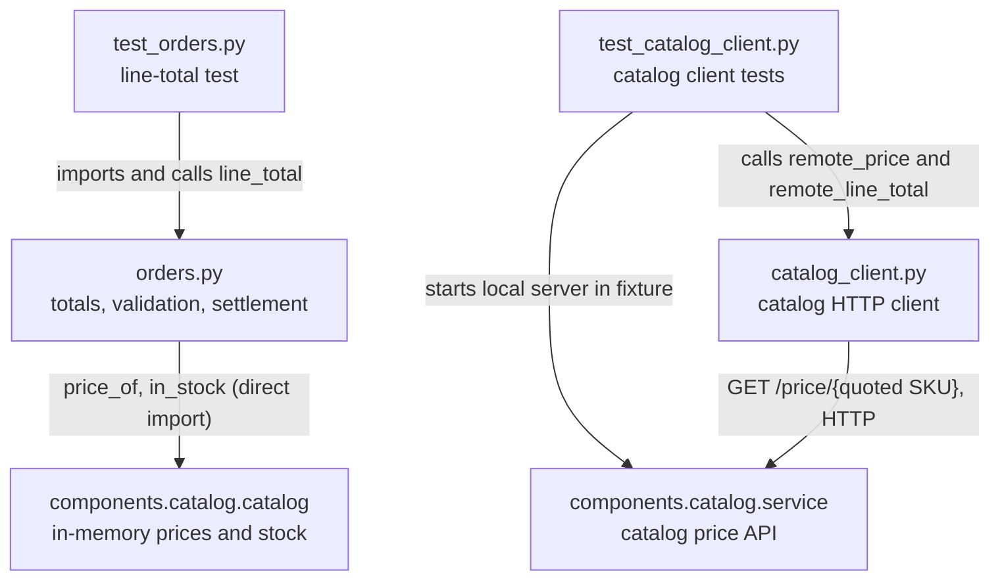

# orders

| | |
| --- | --- |
| Kind | library with unit and HTTP-client tests |
| Folders and files | `components/orders/` (`components/orders/orders.py:1-51`, `components/orders/catalog_client.py:1-29`, `components/orders/test_orders.py:1-12`, `components/orders/test_catalog_client.py:1-66`) |
| Technology | Python modules using the standard library and local catalog modules (`components/orders/orders.py:1-5`, `components/orders/catalog_client.py:6-9`) |
| Starts by | Order helpers are imported by Python callers; the test modules call `unittest.main()` when run as scripts (`components/orders/test_orders.py:3`, `components/orders/test_orders.py:11-12`, `components/orders/test_catalog_client.py:9`, `components/orders/test_catalog_client.py:65-66`) |
| Size | 4 files, 158 lines, 18 functions/methods, 0 routes (`components/orders/orders.py:1-51`, `components/orders/catalog_client.py:1-29`, `components/orders/test_orders.py:1-12`, `components/orders/test_catalog_client.py:1-66`) |
| Depth | deep |

## Responsibility

The component provides order line and discounted-total calculations, validates requested quantities against catalog stock, and submits order settlements (`components/orders/orders.py:19-51`). Its `catalog_client` module also resolves a catalog service URL and requests prices over HTTP (`components/orders/catalog_client.py:14-29`). Both catalog access paths are intentional: `orders.py` imports `components.catalog.catalog` directly when catalog and orders run in one process (today's deployment), while `catalog_client.py` is the path for orders running as its own service and reading prices from the catalog HTTP API (answer to Q1; code paths at `components/orders/orders.py:5`, `components/orders/orders.py:19-20`, `components/orders/orders.py:35-41` and `components/orders/catalog_client.py:1-4`, `components/orders/catalog_client.py:14-23`). The HTTP path's only callers found are its tests, and it uses plain HTTP to `CATALOG_URL`, defaulting to `http://127.0.0.1:8001` (answer to Q1; `components/orders/catalog_client.py:11`, `components/orders/catalog_client.py:14-23`, `components/orders/test_catalog_client.py:37-62`). The component does not declare routes or a service entry point in these modules; the test files run through `unittest` (`components/orders/test_orders.py:1-12`, `components/orders/test_catalog_client.py:1-66`).

## Structure

The diagram shows the two catalog access paths and the two test modules; it leaves out the settlement partner because it is an outbound call rather than an orders module.

| Element | Evidence |
| --- | --- |
| `test_orders.py` -> `orders.py` | `components/orders/test_orders.py:3`, `components/orders/test_orders.py:6-8` |
| `orders.py` -> `components.catalog.catalog` | `components/orders/orders.py:5`, `components/orders/orders.py:19-20`, `components/orders/orders.py:35-41`; `components/catalog/catalog.py:20-29` |
| `test_catalog_client.py` -> `catalog_client.py` | `components/orders/test_catalog_client.py:9`, `components/orders/test_catalog_client.py:37-62` |
| `test_catalog_client.py` -> `components.catalog.service` | `components/orders/test_catalog_client.py:8`, `components/orders/test_catalog_client.py:13-19` |
| `catalog_client.py` -> `components.catalog.service` | `components/orders/catalog_client.py:11`, `components/orders/catalog_client.py:19-23`; `components/catalog/service.py:24-34` |

## Modules

| Module page | Source file | Lines | Role | Main functions |
| --- | --- | --- | --- | --- |
| [orders](orders.md) | `components/orders/orders.py` | 1-51 | Totals, stock validation, settlement request | `line_total`, `order_total`, `validate`, `settle` |
| [catalog client](catalog_client.md) | `components/orders/catalog_client.py` | 1-29 | Resolves catalog URL and requests prices over HTTP | `catalog_url`, `remote_price`, `remote_line_total` |
| [catalog client tests](test_catalog_client.md) | `components/orders/test_catalog_client.py` | 1-66 | Starts local catalog server and checks HTTP client behavior | `CatalogClientTest` |
| [orders tests](test_orders.md) | `components/orders/test_orders.py` | 1-12 | Checks `line_total` | `OrdersTest` |

## Main types

No application classes are defined; `CatalogClientTest` and `OrdersTest` are unittest fixtures (`components/orders/test_catalog_client.py:12-62`, `components/orders/test_orders.py:6-8`).

## Public interface

| Interface | Kind (route, function, event, job, command) | Card or page | Components that call it |
| --- | --- | --- | --- |
| `line_total(sku, qty)` | function | [orders card](orders.md#line_totalsku-qty) | No external component caller found; `OrdersTest.test_line_total` calls it (`components/orders/test_orders.py:6-8`). |
| `order_total(lines, loyal=False)` | function | [orders card](orders.md#order_totallines-loyalfalse) | No external component caller found (search for `order_total` in `*.py`: definition only). |
| `validate(lines)` | function | [orders card](orders.md#validatelines) | No external component caller found (search for `validate` call sites in `components/**/*.py`: none in the orders component). |
| `settle(order_id, amount, dev=False, timeout=15)` | function | [orders card](orders.md#settleorder_id-amount-devfalse-timeout15) | No external component caller found (search for `settle` in `*.py`: definition only). |
| `catalog_url()`, `remote_price(sku, timeout=5)`, `remote_line_total(sku, qty)` | functions | [catalog client cards](catalog_client.md#functions-and-methods) | No external component caller found; `test_catalog_client.py` calls the client functions (`components/orders/test_catalog_client.py:37-62`; search for `remote_price` and `remote_line_total` in `components/**/*.py`). |

## Business rules

| # | Rule, in plain words | Enforced in | Triggered by | Evidence |
| --- | --- | --- | --- | --- |
| R-01 | A line quantity must be positive; `validate` records an error for zero or negative quantities. | `validate` | Each line passed to validation | `components/orders/orders.py:37-42` |
| R-02 | A positive quantity must be available in catalog stock; otherwise `validate` records a stock error. | `validate`, `catalog.in_stock` | Each positive-quantity line | `components/orders/orders.py:38-41`; `components/catalog/catalog.py:27-29` |
| R-03 | A loyal order receives a 5% discount; a total quantity of at least 10 receives a 10% discount, and only the larger discount is used. | `order_total` | `loyal` truthy or summed quantity at least 10 | `components/orders/orders.py:14-16`, `components/orders/orders.py:23-32` |
| R-04 | The HTTP catalog client's line-total helper rejects zero or negative quantities. | `remote_line_total` | `qty <= 0` | `components/orders/catalog_client.py:26-29` |
| R-05 | A settlement is reported as successful only when the response status equals 200. | `settle` | Settlement response received | `components/orders/orders.py:45-51` |

## Data

| Store or file | Reads | Writes | Data dictionary entry |
| --- | --- | --- | --- |
| Catalog product data, owned by `catalog` | `price_of(sku)` for line totals and `in_stock(sku, qty)` for validation (`components/orders/orders.py:19-20`, `components/orders/orders.py:35-41`; `components/catalog/catalog.py:20-29`) | None by orders (`components/orders/orders.py:19-20`, `components/orders/orders.py:35-42`) | Not owned by orders; in-memory `_PRODUCTS` is defined by catalog (`components/catalog/catalog.py:8-12`). |
| Settlement request body | `order_id`, `amount` as values for JSON fields `order`, `amount` (`components/orders/orders.py:45-49`) | Sent to the selected URL; no local persistence shown (`components/orders/orders.py:47-51`) | No local store. |

## Outbound calls

| Target | Purpose | Protocol and scheme | Address from | Timeout, retry, fallback | Evidence |
| --- | --- | --- | --- | --- | --- |
| `catalog` Python module | Reads a SKU price and stock quantity in the main order helpers. | In-process Python calls | Imported as `components.catalog.catalog` | No network timeout or retry; no fallback shown. | `components/orders/orders.py:5`, `components/orders/orders.py:19-20`, `components/orders/orders.py:35-41`; `components/catalog/catalog.py:20-29` |
| `catalog` HTTP API | Reads a SKU price through the separate HTTP client. | HTTP | `CATALOG_URL`; default `http://127.0.0.1:8001` | `remote_price` default timeout is 5 seconds; no retry or fallback shown (inferred: none in `components/orders/catalog_client.py:19-23`). | `components/orders/catalog_client.py:11`, `components/orders/catalog_client.py:14-23`; `components/catalog/service.py:24-34`, `components/catalog/service.py:40-43` |
| Payment partner | Sends JSON settlement request. | HTTP | `http://partner-legacy.internal/settle`, unless `dev` selects `http://localhost:8099/settle` | `settle` default timeout is 15 seconds; no retry or fallback shown (inferred: none in `components/orders/orders.py:45-51`). | `components/orders/orders.py:7-12`, `components/orders/orders.py:45-51` |

## Configuration read

| Key | Purpose | Default | Source | Evidence |
| --- | --- | --- | --- | --- |
| `CATALOG_URL` | Base URL for the catalog HTTP client; read each time `catalog_url()` runs. | `http://127.0.0.1:8001` | `os.environ` | `components/orders/catalog_client.py:11`, `components/orders/catalog_client.py:14-16` |

## Errors and resilience

- `validate` accumulates quantity and insufficient-stock messages and returns them; it does not raise an error for those checks (`components/orders/orders.py:35-42`).
- `remote_line_total` raises `ValueError("quantity must be positive")` when the quantity is non-positive (`components/orders/catalog_client.py:26-29`).
- The catalog service returns 404 for an unknown SKU; `remote_price` does not catch request errors (inferred: no handler in `components/orders/catalog_client.py:19-23`; service behavior at `components/catalog/service.py:28-34`).
- `settle` returns a boolean for response status 200 versus another returned status; request exceptions are not caught (inferred: no handler in `components/orders/orders.py:45-51`).

## Logging and monitoring

No application logging or metrics calls are present in the four orders files (inferred: reviewed `components/orders/orders.py:1-51`, `components/orders/catalog_client.py:1-29`, `components/orders/test_orders.py:1-12`, and `components/orders/test_catalog_client.py:1-66`).

## Tests

| Test page | Coverage |
| --- | --- |
| [test_orders](test_orders.md#tests) | Checks `line_total("SKU-3", 2) == 12.0` (`components/orders/test_orders.py:6-8`). |
| [test_catalog_client](test_catalog_client.md#tests) | Checks HTTP price and line-total calls, zero quantity, unknown and unusual SKUs, query handling, and percent-encoded SKU decoding (`components/orders/test_catalog_client.py:37-62`). |

The listed tests do not exercise `order_total`, `validate`, or `settle` (inferred: the complete test method listings are `components/orders/test_orders.py:6-8` and `components/orders/test_catalog_client.py:37-62`).

## Surprises

- Settlement uses plain HTTP to the partner URL; the adjacent source comment says TLS support is “coming soon” but gives no date (inferred: per `components/orders/orders.py:7-9`).
- The direct catalog import and HTTP client are intentional for different deployment modes: in-process catalog access today and HTTP access when orders runs separately (answer to Q1; code paths at `components/orders/orders.py:5`, `components/orders/orders.py:19-20`, `components/orders/orders.py:35-41` and `components/orders/catalog_client.py:1-4`, `components/orders/catalog_client.py:19-23`). The HTTP path's only callers found are its tests, and its URL is plain HTTP to `CATALOG_URL` (default `http://127.0.0.1:8001`) (answer to Q1; `components/orders/catalog_client.py:11`, `components/orders/catalog_client.py:14-23`, `components/orders/test_catalog_client.py:37-62`).

## For the whole-system pages

- **Risk:** Settlement requests use plain HTTP to `partner-legacy.internal`; the comment says TLS is forthcoming but supplies no date (inferred: comment at `components/orders/orders.py:7-9`).
- **Deployment detail:** The direct-import path serves today's in-process deployment, and the HTTP client is intended for orders running separately (answer to Q1). Only tests call the HTTP path today, which uses plain HTTP to `CATALOG_URL` with default `http://127.0.0.1:8001` (`components/orders/catalog_client.py:11`, `components/orders/catalog_client.py:14-23`; `components/orders/test_catalog_client.py:37-62`).
- **Glossary:** `loyalty discount` is `LOYALTY_DISCOUNT` (`components/orders/orders.py:14`, `components/orders/orders.py:28-29`); `bulk discount` is `BULK_DISCOUNT` at `BULK_THRESHOLD` (`components/orders/orders.py:15-16`, `components/orders/orders.py:30-31`); `CATALOG_URL` selects the catalog HTTP API base URL (`components/orders/catalog_client.py:11`, `components/orders/catalog_client.py:14-16`).

<!-- cites components/catalog/catalog.py@1e15fdaab1fa3c720d99a864abb4cac9c8259421 -->

<!-- cites components/catalog/service.py@64e5abbab5e101fac6e56c67450ac4c6346198f1 -->

<!-- cites components/orders/catalog_client.py@469f9d282aab983cdd85f364e46bcd02ef6d3635 -->

<!-- cites components/orders/orders.py@33203a1b4d48a6d335cf411f56a54a7035a66ae0 -->

<!-- cites components/orders/test_catalog_client.py@1d32463e1cdc21bd3eee3bc1b6f31feb8ef40a2d -->

<!-- cites components/orders/test_orders.py@ca9144cf39abe39e988dc009863b036a7ee1a39f -->
