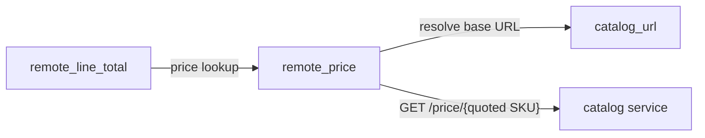

# catalog_client

Source file: `components/orders/catalog_client.py`

| | |
| --- | --- |
| Component | `orders` (its design page is `README.md` in this folder) |
| Lines | 29 |
| Role | Reads catalog prices through the catalog HTTP API and multiplies them by quantities. |
| Imports that matter | `json`, `os`, `urllib.parse`, `urllib.request` (`components/orders/catalog_client.py:6-9`) |
| Module-level state | `DEFAULT_CATALOG_URL = "http://127.0.0.1:8001"` (`components/orders/catalog_client.py:11`) |

## Summary

The module resolves `CATALOG_URL` at call time, requests `/price/<quoted SKU>` from that base URL, parses the returned JSON `price`, and optionally multiplies it by a quantity. Its module docstring describes it as orders' HTTP client for the catalog service (`components/orders/catalog_client.py:1-4,14-29`).

## Index

| Symbol | Kind | Lines | Card |
| --- | --- | --- | --- |
| `catalog_url()` | function | 14-16 | [card](#catalog_url) |
| `remote_price(sku, timeout=5)` | function | 19-23 | [card](#remote_pricesku-timeout5) |
| `remote_line_total(sku, qty)` | function | 26-29 | [card](#remote_line_totalsku-qty) |

## Call graph



## Functions and methods

### `catalog_url()`

Source: `components/orders/catalog_client.py:14-16` <!-- code: e72fa0984dfa -->

| | |
| --- | --- |
| Kind | function |
| Called by | `remote_price` (`components/orders/catalog_client.py:21`) |
| Calls | `os.environ.get`, `.rstrip` |
| Purpose | Reads the catalog service base URL from the environment, falling back to the module default. |

**Steps**

1. Reads `CATALOG_URL` from `os.environ`, using `DEFAULT_CATALOG_URL` when it is unset (`components/orders/catalog_client.py:16`).
2. Removes trailing `/` characters from the selected value and returns it (`components/orders/catalog_client.py:16`).

**Pseudo-code**

```text
return os.environ.get("CATALOG_URL", DEFAULT_CATALOG_URL).rstrip("/")
```

**Output and side effects**: Returns a string based on the environment value or `http://127.0.0.1:8001`; it does not cache the environment value (`components/orders/catalog_client.py:11,14-16`).

### `remote_price(sku, timeout=5)`

Source: `components/orders/catalog_client.py:19-23` <!-- code: 03c13d0b8444 -->

| | |
| --- | --- |
| Kind | function |
| Called by | `remote_line_total` (`components/orders/catalog_client.py:29`), `CatalogClientTest.test_remote_price` (`components/orders/test_catalog_client.py:37-38`), `CatalogClientTest.test_unknown_sku` (`components/orders/test_catalog_client.py:47-49`) |
| Calls | `catalog_url`, `urllib.parse.quote`, `urllib.request.urlopen`, `resp.read`, `json.loads`, `float` |
| Purpose | Requests a SKU price from the catalog service and returns it as a float. |

**Inputs**

| Name | Type | Meaning | Checked how |
| --- | --- | --- | --- |
| `sku` | not annotated | SKU path segment for the price request | Quoted with `safe=""` before insertion into the URL (`components/orders/catalog_client.py:21`). |
| `timeout` | not annotated, default `5` | Timeout passed to `urlopen` | Passed directly to `urlopen` (`components/orders/catalog_client.py:19,22`). |

**Steps**

1. Resolves the base URL with `catalog_url`, quotes `sku` with no characters marked safe, and appends `/price/<quoted SKU>` (`components/orders/catalog_client.py:21`).
2. Opens that URL with the supplied timeout, reads the response body, parses JSON, extracts `price`, converts it to `float`, and returns it (`components/orders/catalog_client.py:22-23`).

**Pseudo-code**

```text
url = catalog_url() + "/price/" + quote(sku, safe="")
with urlopen(url, timeout):
    return float(json.loads(response.read())["price"])
```

**Output and side effects**: Makes an HTTP request to the catalog service and returns the response's `price` as a float (`components/orders/catalog_client.py:21-23`). Request, JSON, or conversion errors are not caught here (inferred: no handler appears in `components/orders/catalog_client.py:19-23`).

### `remote_line_total(sku, qty)`

Source: `components/orders/catalog_client.py:26-29` <!-- code: 04e8013d891c -->

| | |
| --- | --- |
| Kind | function |
| Called by | `CatalogClientTest.test_remote_line_total` (`components/orders/test_catalog_client.py:40-41`), `CatalogClientTest.test_quantity_must_be_positive` (`components/orders/test_catalog_client.py:43-46`) |
| Calls | `ValueError`, `remote_price` |
| Purpose | Rejects non-positive quantities, then multiplies the remote price by the quantity. |

**Inputs**

| Name | Type | Meaning | Checked how |
| --- | --- | --- | --- |
| `sku` | not annotated | SKU whose price is requested | Passed to `remote_price` when quantity is positive (`components/orders/catalog_client.py:29`). |
| `qty` | not annotated | Multiplier for the remote price | Must be greater than zero (`components/orders/catalog_client.py:27-28`). |

**Steps**

1. If `qty <= 0`, raises `ValueError` with message `quantity must be positive` (`components/orders/catalog_client.py:27-28`).
2. Otherwise, requests the SKU price through `remote_price` and multiplies the result by `qty` (`components/orders/catalog_client.py:29`).

**Pseudo-code**

```text
if qty <= 0: raise ValueError("quantity must be positive")
return remote_price(sku) * qty
```

**Branches and errors**

| Line | Branch | When | What happens |
| --- | --- | --- | --- |
| `components/orders/catalog_client.py:27` | `if qty <= 0` | Quantity is zero or negative | Raises `ValueError` with `quantity must be positive` (`components/orders/catalog_client.py:27-28`). |
| `components/orders/catalog_client.py:28` | `raise` | The condition at line 27 is true | Exits by raising `ValueError`; the price lookup on line 29 is skipped (`components/orders/catalog_client.py:27-29`). |

**Output and side effects**: Returns remote price multiplied by quantity when `qty > 0`; otherwise raises `ValueError` (`components/orders/catalog_client.py:27-29`).

## Module-level code

The module imports JSON, environment, URL parsing, and URL request libraries and defines `DEFAULT_CATALOG_URL` as `http://127.0.0.1:8001` (`components/orders/catalog_client.py:6-11`). The default and module docstring specify plain HTTP (`components/orders/catalog_client.py:1-4,11`).

## Surprises

This module's docstring says orders running as its own service reads catalog prices over the network instead of importing the catalog, while `orders.py` imports `components.catalog.catalog` directly (`components/orders/catalog_client.py:3`, `components/orders/orders.py:5`). The Python call-site search finds the `catalog_client` price functions used in its tests and within this client, but not from `orders.py` (search for `remote_price` and `remote_line_total` in `components/**/*.py`).
