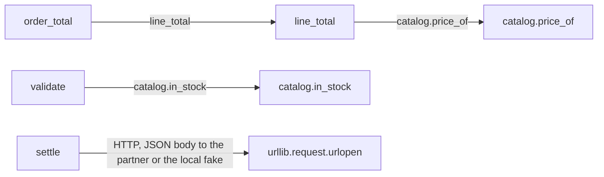

# orders

Source file: `components/orders/orders.py`

| | |
| --- | --- |
| Component | `orders` (its design page is `README.md` in this folder) |
| Lines | 51 |
| Role | Calculates line and order totals, validates stock quantities, and sends order settlements. |
| Imports that matter | `components.catalog.catalog` (`components/orders/orders.py:5`) |
| Module-level state | `PARTNER_SETTLE_URL`, `DEV_SETTLE_URL`, `LOYALTY_DISCOUNT`, `BULK_DISCOUNT`, and `BULK_THRESHOLD` (`components/orders/orders.py:9-16`) |

## Summary

The module defines settlement URLs and discount constants, then provides helpers in reading order: line pricing, discounted order totals, stock validation, and settlement submission. Catalog prices and stock are accessed through `catalog`; settlement is sent with `urllib.request` (`components/orders/orders.py:1-51`).

## Index

| Symbol | Kind | Lines | Card |
| --- | --- | --- | --- |
| `line_total(sku, qty)` | function | 19-20 | [card](#line_totalsku-qty) |
| `order_total(lines, loyal=False)` | function | 23-32 | [card](#order_totallines-loyalfalse) |
| `validate(lines)` | function | 35-42 | [card](#validatelines) |
| `settle(order_id, amount, dev=False, timeout=15)` | function | 45-51 | [card](#settleorder_id-amount-devfalse-timeout15) |

## Call graph



## Functions and methods

### `line_total(sku, qty)`

Source: `components/orders/orders.py:19-20` <!-- code: 878843ee3bcf -->

| | |
| --- | --- |
| Kind | function |
| Called by | `order_total` (`components/orders/orders.py:25`), `OrdersTest.test_line_total` (`components/orders/test_orders.py:7-8`) |
| Calls | `catalog.price_of` |
| Purpose | Multiplies the catalog price for a SKU by the requested quantity. |

**Inputs**

| Name | Type | Meaning | Checked how |
| --- | --- | --- | --- |
| `sku` | not annotated | SKU passed to `catalog.price_of` | Catalog lookup; unknown SKUs raise `KeyError` (`components/catalog/catalog.py:32-36`). |
| `qty` | not annotated | Multiplier for the catalog price | No validation in this function (`components/orders/orders.py:19-20`). |

**Steps**

1. Gets the SKU price from `catalog.price_of` and multiplies it by `qty` (`components/orders/orders.py:19-20`).

**Pseudo-code**

```text
return catalog.price_of(sku) * qty
```

**Output and side effects**: Returns the product of the catalog price and quantity; the catalog lookup may raise `KeyError` for an unknown SKU (`components/orders/orders.py:19-20`, `components/catalog/catalog.py:32-36`).

### `order_total(lines, loyal=False)`

Source: `components/orders/orders.py:23-32` <!-- code: d96746cc95d2 -->

| | |
| --- | --- |
| Kind | function |
| Called by | No other Python call site found (inferred: a search for `order_total` in `*.py` finds 1 hit, its definition). |
| Calls | `sum`, `line_total`, `max`, `round` |
| Purpose | Adds line totals and applies the larger of the loyalty or bulk discount. |

**Inputs**

| Name | Type | Meaning | Checked how |
| --- | --- | --- | --- |
| `lines` | list of `(sku, qty)` pairs (inferred: per the docstring at `components/orders/orders.py:24`) | Order lines used for the subtotal and item count | Unpacked while summing; no explicit validation (`components/orders/orders.py:24-26`). |
| `loyal` | boolean-like, default `False` (inferred: tested for truthiness) | Enables the loyalty discount | Truthy values select the 5% loyalty discount (`components/orders/orders.py:28-29`). |

**Steps**

1. Sums `line_total(sku, qty)` for every pair in `lines` to get `subtotal`, then sums each quantity to get `items` (`components/orders/orders.py:25-26`).
2. Starts with a `0.0` discount; when `loyal` is truthy, selects `LOYALTY_DISCOUNT` (`0.05`) (`components/orders/orders.py:14`, `components/orders/orders.py:27-29`).
3. When `items >= BULK_THRESHOLD` (`10`), selects the greater of the current discount and `BULK_DISCOUNT` (`0.10`), so the discounts do not stack (`components/orders/orders.py:15-16`, `components/orders/orders.py:30-31`).
4. Returns the subtotal multiplied by `1 - discount`, rounded to two decimal places (`components/orders/orders.py:32`).

**Pseudo-code**

```text
subtotal = sum(line_total(sku, qty) for each line)
items = sum(qty for each line)
discount = LOYALTY_DISCOUNT if loyal else 0
if items >= BULK_THRESHOLD: discount = max(discount, BULK_DISCOUNT)
return round(subtotal * (1 - discount), 2)
```

**Branches and errors**

| Line | Branch | When | What happens |
| --- | --- | --- | --- |
| `components/orders/orders.py:28` | `if loyal` | `loyal` is truthy | Sets the discount to `LOYALTY_DISCOUNT` (`components/orders/orders.py:28-29`). |
| `components/orders/orders.py:30` | `if items >= BULK_THRESHOLD` | Total quantity is at least 10 | Uses the greater of the current discount and `BULK_DISCOUNT` (`components/orders/orders.py:30-31`). |

**Output and side effects**: Returns the discounted subtotal rounded to two decimal places (`components/orders/orders.py:32`). A catalog lookup error from `line_total` propagates (`components/orders/orders.py:25`, `components/catalog/catalog.py:32-36`).

### `validate(lines)`

Source: `components/orders/orders.py:35-42` <!-- code: c72f2cd2ce78 -->

| | |
| --- | --- |
| Kind | function |
| Called by | No other Python call site found (inferred: a search for `validate` as a word in `*.py` finds 1 hit, its definition). |
| Calls | `errors.append`, `catalog.in_stock` |
| Purpose | Collects quantity and stock errors for each order line. |

**Inputs**

| Name | Type | Meaning | Checked how |
| --- | --- | --- | --- |
| `lines` | iterable of `(sku, qty)` pairs (inferred from unpacking in loop) | Lines to validate | Each quantity is checked before stock is queried (`components/orders/orders.py:37-40`). |

**Steps**

1. Creates an empty `errors` list and iterates through `(sku, qty)` pairs (`components/orders/orders.py:36-37`).
2. If `qty <= 0`, appends `"<sku>: quantity must be positive"`; the `elif` means this line is not also checked for stock (`components/orders/orders.py:38-40`).
3. Otherwise, if `catalog.in_stock(sku, qty)` is false, appends `"<sku>: not enough stock"` (`components/orders/orders.py:40-41`).
4. Returns the accumulated list, which is empty if no line met either error condition (`components/orders/orders.py:42`). `catalog.in_stock` returns false for an unknown SKU (`components/catalog/catalog.py:39-41`).

**Pseudo-code**

```text
errors = []
for sku, qty in lines:
    if qty <= 0: append quantity error
    elif not catalog.in_stock(sku, qty): append stock error
return errors
```

**Branches and errors**

| Line | Branch | When | What happens |
| --- | --- | --- | --- |
| `components/orders/orders.py:37` | `for` | For each `(sku, qty)` in `lines` | Checks each line in iteration order (`components/orders/orders.py:37-41`). |
| `components/orders/orders.py:38` | `if qty <= 0` | Quantity is zero or negative | Appends the positive-quantity error (`components/orders/orders.py:38-39`). |
| `components/orders/orders.py:40` | `elif not catalog.in_stock(sku, qty)` | Quantity is positive and catalog reports insufficient stock or unknown SKU | Appends the stock error (`components/orders/orders.py:40-41`, `components/catalog/catalog.py:39-41`). |

**Output and side effects**: Returns a list of error strings; it does not modify catalog stock (`components/orders/orders.py:36-42`).

### `settle(order_id, amount, dev=False, timeout=15)`

Source: `components/orders/orders.py:45-51` <!-- code: 32a9ae9ec0b6 -->

| | |
| --- | --- |
| Kind | function |
| Called by | No other Python call site found (inferred: a search for `settle` as a word in `*.py` finds 3 hits, the definition and the two URL strings `/settle` at `components/orders/orders.py:9` and `components/orders/orders.py:12`). |
| Calls | `json.dumps`, `.encode`, `urllib.request.Request`, `urllib.request.urlopen` |
| Purpose | Sends an order and amount as a JSON body to the selected settlement URL (the request sets no method in the code, `components/orders/orders.py:49`; assumed: library behaviour, `urllib` then sends a POST). |

**Inputs**

| Name | Type | Meaning | Checked how |
| --- | --- | --- | --- |
| `order_id` | not annotated | Value serialized as the `order` JSON field | No explicit validation (`components/orders/orders.py:45-49`). |
| `amount` | not annotated | Value serialized as the `amount` JSON field | No explicit validation (`components/orders/orders.py:45-49`). |
| `dev` | boolean-like, default `False` (inferred: used in a conditional expression) | Selects the development or partner URL | Truthy selects `DEV_SETTLE_URL`; otherwise selects `PARTNER_SETTLE_URL` (`components/orders/orders.py:47`). |
| `timeout` | not annotated, default `15` | Timeout passed to `urlopen` | Passed directly as the `timeout` argument (`components/orders/orders.py:45`, `components/orders/orders.py:50`). |

**Steps**

1. Chooses `DEV_SETTLE_URL` when `dev` is truthy, otherwise `PARTNER_SETTLE_URL` (`components/orders/orders.py:47`).
2. JSON-serializes `{"order": order_id, "amount": amount}` and encodes the resulting string (`components/orders/orders.py:48`).
3. Builds a `urllib.request.Request` with that body and the `Content-Type: application/json` header (`components/orders/orders.py:49`).
4. Opens the request with `timeout`; returns whether the response status equals `200` (`components/orders/orders.py:50-51`).

**Pseudo-code**

```text
url = DEV_SETTLE_URL if dev else PARTNER_SETTLE_URL
body = encode JSON {"order": order_id, "amount": amount}
request = Request(url, body, Content-Type: application/json)
with urlopen(request, timeout): return response.status == 200
```

**Branches and errors**

| Line | Branch | When | What happens |
| --- | --- | --- | --- |
| `components/orders/orders.py:47` | conditional expression | `dev` is truthy | Selects `DEV_SETTLE_URL`; otherwise selects `PARTNER_SETTLE_URL` (`components/orders/orders.py:47`). |

**Output and side effects**: Sends an HTTP request to the selected URL and returns `True` only when the response status is `200` (`components/orders/orders.py:47-51`). Exceptions from JSON serialization or `urlopen` are not caught in this function (inferred: no handler appears in `components/orders/orders.py:45-51`).

## Module-level code

The module imports `json`, `urllib.request`, and `catalog`; defines the partner settlement URL as `http://partner-legacy.internal/settle`, the development URL as `http://localhost:8099/settle`, and discounts of `0.05` and `0.10` with a bulk threshold of `10` (`components/orders/orders.py:1-16`). The source comments describe the development URL as a local fake and say the partner has no date for TLS support (inferred: per comments at `components/orders/orders.py:7-12`); the code currently selects the partner URL when `dev` is false (`components/orders/orders.py:47`).

## Surprises

The partner URL is plain HTTP (`components/orders/orders.py:9`). The adjacent comment says the partner's TLS support is “coming soon” but gives no date (inferred: per `components/orders/orders.py:7-8`).

<!-- cites components/catalog/catalog.py@75bb1dc767dc16cad9a5ed5555a7293bc004275b -->

<!-- cites components/orders/orders.py@33203a1b4d48a6d335cf411f56a54a7035a66ae0 -->

<!-- cites components/orders/test_orders.py@ca9144cf39abe39e988dc009863b036a7ee1a39f -->
