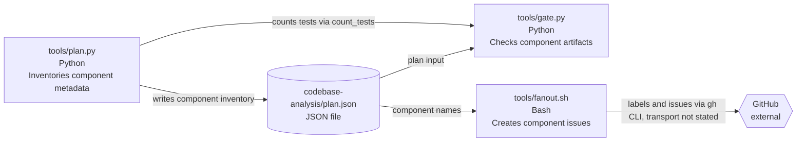

# tools

| | |
| --- | --- |
| Kind | tool |
| Folders and files | `tools/gate.py`, `tools/plan.py`, `tools/fanout.sh` |
| Technology | Python standard library and Bash; external `gh` command; versions are not stated in these files (inferred: a search of `tools/` for `version` finds 1 hit, the plan's own `"version": 1` at `tools/plan.py:47`, which is a schema version, not a tool version) (`tools/gate.py:13-18`, `tools/plan.py:8-15`, `tools/fanout.sh:1-6`) |
| Starts by | Invoking `python tools/plan.py` or `python tools/gate.py <component> [--pass N]` (`tools/plan.py:41-62`, `tools/gate.py:3-4`, `tools/gate.py:81-117`); issue fanout usage is `ENGINE=copilot\|claude tools/fanout.sh <owner/repo>` (`tools/fanout.sh:2-5`) |
| Size | 3 files, 210 source lines, 7 Python functions, 0 routes (`tools/gate.py:1-117`, `tools/plan.py:1-62`, `tools/fanout.sh:1-31`) |
| Depth | deep |

## Responsibility

The tools are command-line helpers for the component-analysis workflow: `plan.py` inventories component files and writes the JSON plan, `gate.py` validates a component’s artifacts and runs the test suite for pass 3, and `fanout.sh` creates component labels and issues through GitHub CLI (`tools/plan.py:21-58`, `tools/gate.py:42-78`, `tools/fanout.sh:9-30`). `plan.scan` uses `gate.count_tests` to record the test baseline (`tools/plan.py:15`, `tools/plan.py:36`). The modules expose command-line entry points; no HTTP routes are declared in these three files (inferred: a search of `tools/` for `do_GET`, `BaseHTTPRequestHandler`, `http.server`, `route` and `@app` finds 0 hits) (`tools/gate.py:81-117`, `tools/plan.py:41-62`, `tools/fanout.sh:1-31`).

## Structure

The diagram shows the tools’ file and command relationships; GitHub transport details and the internals of the `gh` command are not shown.

| Element | Evidence |
| --- | --- |
| `tools/plan.py` writes the JSON plan | `tools/plan.py:41-58` |
| `tools/plan.py` calls `gate.count_tests` | `tools/plan.py:15`, `tools/plan.py:36` |
| `tools/gate.py` reads the plan | `tools/gate.py:81-88` |
| `tools/fanout.sh` reads component names from the plan | `tools/fanout.sh:7-12` |
| `tools/fanout.sh` creates labels and issues through `gh` | `tools/fanout.sh:10-12`, `tools/fanout.sh:24-29` |

## Modules

| Module page | Source file | Lines | Role | Main functions |
| --- | --- | --- | --- | --- |
| [gate](gate.md) | `tools/gate.py` | 117 | Validates component inventory, risk decisions, and test artifacts; runs pass-3 unittest discovery | `fail`, `read`, `count_tests`, `check`, `main` (`tools/gate.py:23-113`) |
| [plan](plan.md) | `tools/plan.py` | 62 | Scans component Python files and writes `codebase-analysis/plan.json` | `scan`, `main` (`tools/plan.py:21-58`) |
| [fanout](fanout.md) | `tools/fanout.sh` | 31 | Creates labels and component-analysis issues using the selected engine | Script entry point; no functions (`tools/fanout.sh:1-31`) |

## Main types

Not applicable: the three files declare functions and a shell script, but no classes (inferred: a search of `tools/` for `class` at the start of a line finds 0 hits) (`tools/gate.py:23-117`, `tools/plan.py:21-62`, `tools/fanout.sh:1-31`).

## Public interface

| Interface | Kind (route, function, event, job, command) | Card or page | Evidence |
| --- | --- | --- | --- |
| `python tools/plan.py` | command | [plan module](plan.md) | `tools/plan.py:41-62` |
| `python tools/gate.py <component> [--pass N]` | command | [gate module](gate.md) | `tools/gate.py:3-4`, `tools/gate.py:81-117` |
| `ENGINE=copilot\|claude tools/fanout.sh <owner/repo>` | command | [fanout module](fanout.md) | `tools/fanout.sh:2-5` |
| `gate.count_tests(paths)` | internal function used by `plan.scan` | [gate module](gate.md#count_testspaths) | `tools/gate.py:33-39`, `tools/plan.py:15`, `tools/plan.py:36` |

## Business rules

| # | Rule, in plain words | Enforced in | Triggered by | Evidence |
| --- | --- | --- | --- | --- |
| R-01 | Pass 1 requires `inventory.md` and each planned function name to appear in it. | `check` | Pass 1 | `tools/gate.py:45-50` |
| R-02 | Pass 2 requires `risks.md` to list each planned HTTP site, avoid unresolved `ASK`, and classify each site as `CHANGE` or `KEEP`. | `check` | Pass 2 | `tools/gate.py:51-62` |
| R-03 | Pass 3 requires `tests-report.md`, more test functions than the baseline, and successful unittest discovery. | `check` | Pass 3 | `tools/gate.py:63-77` |

## Data

| Store or file | Reads | Writes | Data dictionary entry |
| --- | --- | --- | --- |
| `codebase-analysis/plan.json` | `gate.py` loads the JSON plan; `fanout.sh` reads its `components` keys (`tools/gate.py:86`, `tools/fanout.sh:9`) | `plan.py` writes version `1`, pass descriptions, and component inventories (`tools/plan.py:46-57`) | [Data dictionary: Component-analysis plan JSON](../data-dictionary.md#component-analysis-plan-json); fields are constructed at `tools/plan.py:46-54` |
| Component analysis artifacts | `gate.py` reads `status.json`, `inventory.md`, `risks.md`, and `tests-report.md` below its component output path (`tools/gate.py:46`, `tools/gate.py:52`, `tools/gate.py:64`, `tools/gate.py:89-96`) | Not written by these tools (inferred: a search of `tools/gate.py` and `tools/fanout.sh` for `write` and `open(` finds 1 hit, the read of `plan.json` at `tools/fanout.sh:9`, and `tools/plan.py` writes only `plan.json` at line 57) | [Data dictionary: Files read and written](../data-dictionary.md#files-read-and-written) |
| Component test sources | `plan.py` scans `components/<name>/*.py`; `gate.py` counts component `test_*.py` and runs repository unittest discovery (`tools/plan.py:21-36`, `tools/gate.py:66-75`) | Not written by these tools (inferred: the same search) | Not applicable |

## Outbound calls

| Target | Purpose | Protocol and scheme | Address from | Timeout, retry, fallback | Evidence |
| --- | --- | --- | --- | --- | --- |
| GitHub CLI (`gh`) targeting the supplied repository | Creates `agent:claude` and `component:<name>` labels and component issues | Invoked as a CLI; network protocol and scheme are not stated | Positional `repo` argument, passed with `-R` | No timeout, retry, or fallback is specified in this script (inferred: a search of `tools/fanout.sh` for `timeout`, `retry`, `trap` and `\|\|` finds 0 hits) | `tools/fanout.sh:7`, `tools/fanout.sh:10-12`, `tools/fanout.sh:24-29` |

## Configuration read

| Key | Purpose | Default | Source | Evidence |
| --- | --- | --- | --- | --- |
| `ENGINE` | Chooses Copilot or Claude issue assignment mode | `copilot` when unset or empty | Environment variable | `tools/fanout.sh:8`, `tools/fanout.sh:24-29` |
| `repo` | Selects the GitHub repository for labels and issues | None; supplied as `$1` | Positional argument | `tools/fanout.sh:7`, `tools/fanout.sh:10-12`, `tools/fanout.sh:25-29` |

## Errors and resilience

`gate.py` reports validation messages with `FAIL:` and returns status 1 when messages exist (`tools/gate.py:23-26`). In its CLI path it catches invalid JSON for `status.json`, rejects non-object status and malformed `open_questions`, and returns failures for missing passes or open questions (`tools/gate.py:94-108`). Pass 3 captures unittest output and appends the last 1,500 stderr characters when the subprocess returns nonzero (`tools/gate.py:73-77`). The shell script enables `-euo pipefail`; its unsupported-engine branch writes an error to stderr and exits 2 (`tools/fanout.sh:6`, `tools/fanout.sh:24-30`).

## Logging and monitoring

The gate prints a result line for each selected pass and failure lines for accumulated errors (`tools/gate.py:109-113`). The fanout script redirects the shared `agent:claude` label command's standard output to `/dev/null` (`tools/fanout.sh:10`). No metrics or tracing behavior is declared in these files (inferred: a search of the three files for `metric`, `trace`, `opentelemetry`, `statsd` and `logging` finds 0 hits; `tools/gate.py:13-117`, `tools/plan.py:8-62`, `tools/fanout.sh:1-31`).

## Tests

The test-related behavior documented here is the gate itself: it counts function definitions named with the `test_` prefix, compares the current component count with its baseline, and invokes unittest discovery with the repository root and `test_*.py` pattern (`tools/gate.py:33-39`, `tools/gate.py:66-75`). `plan.py` records the baseline by calling the same counter (`tools/plan.py:36-38`).

## Surprises

`fanout.sh` generates issue text pointing to `.github/skills/component-analysis/SKILL.md`, a stale reference from an earlier experiment; no external skill is intended (inferred: the recorded answer to Q1, a user decision, not a fact the code states; a listing of `.github/skills/` shows 7 folders, none named `component-analysis`). `fanout.sh` is described as written and is not changed (`tools/fanout.sh:13-15`; answer to Q1 in `ledger/components/tools/questions.md`).

## For the whole-system pages

- Risks and surprises: the fanout-generated issue contains a stale skill path; see `tools/fanout.sh:13-15` and the answer to Q1 in `ledger/components/tools/questions.md`.
- Open questions: none remain for this component.
- Glossary terms: component plan (`tools/plan.py:46-54`), component gate (`tools/gate.py:42-78`), and issue fanout (`tools/fanout.sh:9-30`).

<!-- cites tools/fanout.sh@9ad43aa70e042837954fea1faf483f6c08e07470 -->

<!-- cites tools/gate.py@65eb0af527e554cfb2dadb9d0c8cd1ee6e975c99 -->

<!-- cites tools/plan.py@e1dae33df7990fe69b145146d570403758d0635e -->
