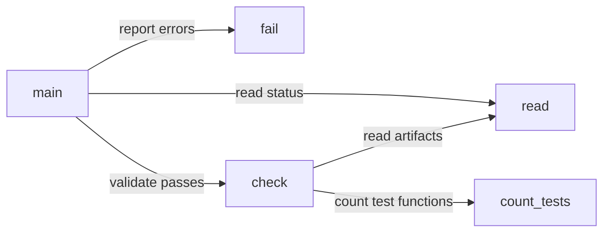

# gate

Source file: `tools/gate.py`

| | |
| --- | --- |
| Component | `tools` (its design page is `README.md` in this folder) |
| Lines | 117 |
| Role | Checks the selected component's analysis artifacts against its plan and, for pass 3, runs the test suite. |
| Imports that matter | Python `argparse`, `ast`, `json`, `pathlib`, `subprocess`, and `sys` modules (`tools/gate.py:13-18`) |
| Module-level state | `ROOT` is the parent of the `tools` directory (`tools/gate.py:20`). |

## Summary

`gate.py` is a command-line validator for one component. `main` loads the analysis plan and optional component status, then calls `check` for the requested pass or each recorded completed pass; `check` validates inventory, HTTP risk decisions, or tests, depending on the pass number. Errors are accumulated and reported through `fail` (`tools/gate.py:42-78`, `tools/gate.py:81-113`).

## Index

| Symbol | Kind | Lines | Card |
| --- | --- | --- | --- |
| `fail` | function | 23-26 | [card](#failmsgs) |
| `read` | function | 29-30 | [card](#readpath) |
| `count_tests` | function | 33-39 | [card](#count_testspaths) |
| `check` | function | 42-78 | [card](#checkcomponent-n-plan-out) |
| `main` | function | 81-113 | [card](#main) |

## Call graph



## Classes

None.

## Functions and methods

### `fail(msgs)`

Source: `tools/gate.py:23-26` <!-- code: de986c493730 -->

| | |
| --- | --- |
| Kind | function |
| Called by | `main` (`tools/gate.py:88`, `tools/gate.py:98`, `tools/gate.py:100`, `tools/gate.py:103`, `tools/gate.py:113`) |
| Calls | `print` |
| Purpose | Prints each error with the `FAIL:` prefix and returns an exit status reflecting whether any messages were supplied. |

**Inputs**

| Name | Type | Meaning | Checked how |
| --- | --- | --- | --- |
| `msgs` | iterable | Messages to report | Iterated once; truth-tested when choosing the return code (`tools/gate.py:24-26`) |

**Steps**

1. Prints each message as `FAIL: <message>` (`tools/gate.py:24-25`).
2. Returns `1` when `msgs` is truthy and `0` otherwise (`tools/gate.py:26`).

**Pseudo-code**

```text
for each message in msgs:
    print "FAIL:" and the message
return 1 if msgs is truthy, else 0
```

**Branches and errors**

| Line | Branch | When | What happens |
| --- | --- | --- | --- |
| `tools/gate.py:24` | `for` | For each item in `msgs` | Prints that message (`tools/gate.py:24-25`). |
| `tools/gate.py:26` | conditional expression | `msgs` is truthy | Returns `1`; otherwise returns `0` (`tools/gate.py:26`). |

**Output and side effects**: Prints one prefixed line per message and returns an integer status (`tools/gate.py:24-26`).

### `read(path)`

Source: `tools/gate.py:29-30` <!-- code: ed281972388d -->

| | |
| --- | --- |
| Kind | function |
| Called by | `check` (`tools/gate.py:46`, `tools/gate.py:52`, `tools/gate.py:64`), `main` (`tools/gate.py:94`) |
| Calls | `path.exists`, `path.read_text` |
| Purpose | Reads a path as text when it exists; otherwise signals absence with `None`. |

**Inputs**

| Name | Type | Meaning | Checked how |
| --- | --- | --- | --- |
| `path` | `pathlib.Path` | File to read | Checks `path.exists()` before reading (`tools/gate.py:30`) |

**Steps**

1. If `path.exists()` is true, returns `path.read_text()`; otherwise returns `None` (`tools/gate.py:30`).

**Pseudo-code**

```text
if path exists:
    return its text
return None
```

**Branches and errors**

| Line | Branch | When | What happens |
| --- | --- | --- | --- |
| `tools/gate.py:30` | conditional expression | `path.exists()` is true | Returns the text read from the path; otherwise returns `None` (`tools/gate.py:30`). |

**Output and side effects**: Returns the file text or `None`; filesystem read errors are not caught in this function (`tools/gate.py:30`).

### `count_tests(paths)`

Source: `tools/gate.py:33-39` <!-- code: 6d0b09eb9140 -->

| | |
| --- | --- |
| Kind | function |
| Called by | `check` (`tools/gate.py:69-70`), `scan` in `tools/plan.py` (`tools/plan.py:36`; imported at `tools/plan.py:15`) |
| Calls | `ast.walk`, `ast.parse`, `read_text`, `isinstance`, `node.name.startswith` |
| Purpose | Counts Python function definitions whose names start with `test_` across the supplied repository-relative paths. |

**Inputs**

| Name | Type | Meaning | Checked how |
| --- | --- | --- | --- |
| `paths` | iterable of paths | Python files to inspect, relative to `ROOT` | Each path is joined to `ROOT` and read; parsing errors are not caught (`tools/gate.py:35-37`) |

**Steps**

1. Initializes the count `n` to zero (`tools/gate.py:34`).
2. For each path, reads and parses its contents, then walks the resulting AST (`tools/gate.py:35-36`).
3. Increments `n` for each `ast.FunctionDef` whose name starts with `test_` (`tools/gate.py:37-38`).
4. Returns the accumulated count (`tools/gate.py:39`).

**Pseudo-code**

```text
n = 0
for each path:
    parse the file below ROOT
    for each AST node:
        if it is a function definition named with prefix "test_":
            n += 1
return n
```

**Branches and errors**

| Line | Branch | When | What happens |
| --- | --- | --- | --- |
| `tools/gate.py:35` | `for` | For each supplied path | Reads and parses that file (`tools/gate.py:35-36`). |
| `tools/gate.py:36` | `for` | For each node yielded by `ast.walk` | Evaluates whether the node is a qualifying function definition (`tools/gate.py:36-38`). |
| `tools/gate.py:37` | `if` | The node is an `ast.FunctionDef` and its name starts with `test_` | Increments `n`; otherwise leaves it unchanged (`tools/gate.py:37-38`). |

**Output and side effects**: Returns the number of matching function definitions; file-read and AST-parse errors propagate (`tools/gate.py:35-39`).

### `check(component, n, plan, out)`

Source: `tools/gate.py:42-78` <!-- code: 705feaea6761 -->

| | |
| --- | --- |
| Kind | function |
| Called by | `main` (`tools/gate.py:110`) |
| Calls | `read`, `sorted`, `count_tests`, `subprocess.run`, `errors.append`, `any`, `risks.splitlines`, `Path.glob`, `Path.relative_to`, `Path.as_posix` |
| Purpose | Returns validation errors for pass 1 inventory, pass 2 HTTP-site decisions, or pass 3 test artifacts and test execution. |

**Inputs**

| Name | Type | Meaning | Checked how |
| --- | --- | --- | --- |
| `component` | string | Component key in the plan | Used to select `plan["components"][component]` (`tools/gate.py:43`) |
| `n` | integer | Pass number to validate | Branches on 1, 2, and 3; other values return no errors (`tools/gate.py:45-78`) |
| `plan` | mapping | Parsed analysis plan | Reads component functions, HTTP sites, test count or test paths (`tools/gate.py:43`, `tools/gate.py:49-50`, `tools/gate.py:55-62`, `tools/gate.py:69`) |
| `out` | `pathlib.Path` | Component artifact directory | Reads inventory, risks, and tests-report files below it (`tools/gate.py:46`, `tools/gate.py:52`, `tools/gate.py:64`) |

**Steps**

1. Selects `plan["components"][component]` and initializes an empty `errors` list (`tools/gate.py:43-44`).
2. For pass 1, reads `inventory.md`; if absent, returns `["inventory.md missing"]`. Otherwise it adds an error for each planned function name not found in the text (`tools/gate.py:45-50`).
3. For pass 2, reads `risks.md`; if absent, returns `["risks.md missing"]`. For each planned HTTP site, it searches lines containing that site's `at` value, adds an error if no line is found, adds an unresolved-`ASK` error if any matching line says `ASK`, or adds a missing-decision error unless any matching line contains `CHANGE` or `KEEP` (`tools/gate.py:51-62`).
4. For pass 3, adds an error if `tests-report.md` is absent, collects sorted `components/<component>/test_*.py` paths relative to `ROOT`, and chooses the baseline from `test_count` or, for older plans without it, counts the `test_` functions (not the paths) in the files listed in `spec["tests"]` (`tools/gate.py:63-70`).
5. Adds an error when the current test-function count is not greater than the baseline (`tools/gate.py:70-72`).
6. Runs unittest discovery from `ROOT` with `-m unittest discover -s . -p test_*.py -t .`, which finds every `test_*.py` file under `ROOT`, not only the selected component's (assumed: library behaviour of `unittest discover` with `-s .` and `-p test_*.py`); if it fails, appends the last 1,500 characters of stderr to the error (`tools/gate.py:73-77`).
7. Returns the accumulated errors (`tools/gate.py:78`).

**Pseudo-code**

```text
spec = plan component entry
errors = []
if pass 1:
    require inventory.md
    report planned function names absent from inventory text
elif pass 2:
    require risks.md
    for each planned HTTP site:
        find lines containing its file:line
        report missing row, unresolved ASK, or missing CHANGE/KEEP decision
elif pass 3:
    require tests-report.md
    list and count component test functions
    compare count with the planned baseline (or count test functions in the planned test files)
    run unittest discovery over every test_*.py under ROOT (assumed: unittest behaviour)
    report failure with stderr tail when command fails
return errors
```

**Branches and errors**

| Line | Branch | When | What happens |
| --- | --- | --- | --- |
| `tools/gate.py:45` | `if` | `n == 1` | Reads and validates the inventory (`tools/gate.py:46-50`). |
| `tools/gate.py:47` | `if` | The inventory text is `None` | Returns the single error `inventory.md missing` (`tools/gate.py:47-48`). |
| `tools/gate.py:51` | `elif` | `n == 2` after the pass-1 condition is false | Reads and validates HTTP risk decisions (`tools/gate.py:52-62`). |
| `tools/gate.py:53` | `if` | The risks text is `None` | Returns the single error `risks.md missing` (`tools/gate.py:53-54`). |
| `tools/gate.py:55` | `for` | For each planned HTTP site | Checks its `at` value against the risk rows (`tools/gate.py:55-62`). |
| `tools/gate.py:57` | `if` | No risk row contains the site's `at` value | Appends a missing-site error (`tools/gate.py:56-58`). |
| `tools/gate.py:59` | `elif` | At least one matching row contains `ASK` | Appends an unresolved-`ASK` error (`tools/gate.py:59-60`). |
| `tools/gate.py:61` | `elif` | No matching row contains `CHANGE` or `KEEP` and no earlier condition matched | Appends a missing-decision error (`tools/gate.py:61-62`). |
| `tools/gate.py:63` | `elif` | `n == 3` after the first two conditions are false | Checks the report, test count, and test run (`tools/gate.py:64-77`). |
| `tools/gate.py:64` | `if` | `tests-report.md` is absent | Appends `tests-report.md missing` and continues (`tools/gate.py:64-65`). |
| `tools/gate.py:69` | conditional expression | `test_count` is present in `spec` | Uses that snapshot; otherwise counts the `test_` functions in the files of `spec["tests"]` (`tools/gate.py:69`, `tools/gate.py:33-39`). |
| `tools/gate.py:71` | `if` | `now <= before` | Appends an error that the component has no new test functions (`tools/gate.py:71-72`). |
| `tools/gate.py:76` | `if` | `subprocess.run` returns a nonzero code | Appends a test-failure error with the final 1,500 stderr characters (`tools/gate.py:76-77`). |

**Output and side effects**: Returns an error list; pass 3 launches unittest discovery as a subprocess with captured text output (`tools/gate.py:73-78`). A plan entry that lacks `functions` (pass 1), `http_sites` (pass 2) or, when it has no `test_count`, `tests` (pass 3) raises `KeyError` (assumed: Python builtin behaviour of a missing dictionary key), which `check` does not catch (`tools/gate.py:50`, `tools/gate.py:55`, `tools/gate.py:69`).

### `main()`

Source: `tools/gate.py:81-113` <!-- code: 4d59bf2d5380 -->

| | |
| --- | --- |
| Kind | function |
| Called by | Python module entry point (`tools/gate.py:116-117`) |
| Calls | `argparse.ArgumentParser`, `ap.add_argument`, `ap.parse_args`, `json.loads`, `Path.read_text`, `fail`, `read`, `status.get`, `isinstance`, `errors.append`, `check`, `print` |
| Purpose | Parses CLI arguments, loads the plan and pass status, validates requested passes, and returns a process status. |

**Inputs**

| Name | Type | Meaning | Checked how |
| --- | --- | --- | --- |
| CLI `component` | string | Component to validate | Checked against the plan's `components` mapping (`tools/gate.py:82-88`) |
| CLI `--pass` | integer, optional | One pass to validate | A truthy value selects a single pass; otherwise status determines passes (`tools/gate.py:84`, `tools/gate.py:91-103`) |

**Steps**

1. Builds an argument parser with positional `component` and optional integer `--pass` stored in `args.n`, then parses the command line (`tools/gate.py:82-85`).
2. Reads and JSON-decodes `codebase-analysis/plan.json`; errors from a missing file or invalid plan JSON are not caught here (`tools/gate.py:86`).
3. If the component is absent from `plan["components"]`, reports `unknown component <name>` through `fail` and returns its status; otherwise sets `out` to `codebase-analysis/components/<component>` and initializes `errors` (`tools/gate.py:87-90`).
4. If `args.n` is truthy, validates only that pass. Otherwise it reads `status.json`, uses an empty object if the file is absent, decodes JSON, rejects invalid JSON or a non-object, then reads `passes_done` (`tools/gate.py:91-101`).
5. If there are no passes, reports `status.json missing or no passes_done` and returns; only otherwise does it read `open_questions`: an invalid value adds an error and a positive count adds a blocked error (`tools/gate.py:101-108`).
6. For each selected pass, calls `check`, prints `<component> pass <n>: PASS` or `FAIL`, and appends the returned errors (`tools/gate.py:109-112`).
7. Calls `fail(errors)` and returns its result (`tools/gate.py:113`).

**Pseudo-code**

```text
parse component and optional --pass
load codebase-analysis/plan.json
if component is absent:
    report unknown component and return failure
if --pass is truthy:
    passes = [--pass]
else:
    load component status.json or default to {}
    reject invalid JSON or a non-object
    passes = passes_done
    if passes is empty: report and return failure
    record invalid or positive open_questions as errors
for each pass:
    check it and print PASS or FAIL
    append returned errors
return failure if errors exist, otherwise success
```

**Branches and errors**

| Line | Branch | When | What happens |
| --- | --- | --- | --- |
| `tools/gate.py:87` | `if` | The component is not a key in `plan["components"]` | Reports `unknown component <name>` and returns (`tools/gate.py:87-88`). |
| `tools/gate.py:91` | `if` | `args.n` is truthy | Selects only that pass; otherwise reads status (`tools/gate.py:91-103`). |
| `tools/gate.py:96` | conditional expression | `raw` status text is truthy | JSON-decodes the text; otherwise uses `{}` (`tools/gate.py:96`). |
| `tools/gate.py:97` | `except` | JSON decoding `raw` raises `json.JSONDecodeError` | Reports `status.json is not valid JSON: <error>` and returns (`tools/gate.py:97-98`). |
| `tools/gate.py:99` | `if` | The decoded status is not a dictionary | Reports `status.json must be a JSON object` and returns (`tools/gate.py:99-100`). |
| `tools/gate.py:102` | `if` | `passes_done` is empty or falsey | Reports `status.json missing or no passes_done` and returns (`tools/gate.py:101-103`). |
| `tools/gate.py:105` | `if` | `open_questions` is not a non-negative integer, is a boolean, or is negative | Appends an invalid-value error (`tools/gate.py:104-106`). |
| `tools/gate.py:107` | `elif` | `open_questions` is valid and greater than zero | Appends a blocked error naming the number of open questions (`tools/gate.py:107-108`). |
| `tools/gate.py:109` | `for` | For each selected pass | Calls `check`, prints that pass's result, and accumulates its errors (`tools/gate.py:109-112`). |
| `tools/gate.py:111` | conditional expression | The returned error list is empty | Prints `PASS`; otherwise prints `FAIL` (`tools/gate.py:110-111`). |

**Output and side effects**: Prints per-pass results and any final `FAIL:` messages; returns `0` for no errors or `1` when errors are reported (`tools/gate.py:109-113`). A truthy `passes_done` that is not iterable (for example an integer) makes the loop at line 109 raise `TypeError` (assumed: Python builtin behaviour of iterating a non-iterable) (`tools/gate.py:101`, `tools/gate.py:109`). The module invokes `main()` through `sys.exit` when run as a script (`tools/gate.py:116-117`).

## Module-level code

The module imports six standard-library modules, sets `ROOT` to the parent of the resolved `tools` directory, defines its functions, and calls `sys.exit(main())` only when `__name__ == "__main__"` (`tools/gate.py:13-20`, `tools/gate.py:116-117`).

## Surprises

None identified in this file.

<!-- cites tools/gate.py@65eb0af527e554cfb2dadb9d0c8cd1ee6e975c99 -->

<!-- cites tools/plan.py@e1dae33df7990fe69b145146d570403758d0635e -->
